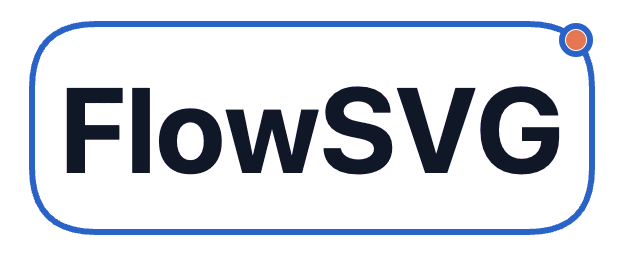

<p align="center">
  
</p>

<p align="center">Animated SVG diagrams for logic and architecture.</p>

<p align="center">English | <a href="README.zh-CN.md">简体中文</a></p>

<p align="center">
  <a href="#quick-start">Quick&nbsp;start</a> ·
  <a href="#integrations-and-api">API</a> ·
  <a href="apps/native-example/README.md">Examples</a>
</p>

Describe nodes, relationships, scenes, and beats in a serializable document, play them on the web, and export a static SVG at any point in time.

The TypeScript core runs without a DOM, network access, or browser clock. Native browser, Vue, React, and Web Component integrations share the same timeline and rendering results.

The Native showcase is prepared for GitHub Pages at `https://yokingma.github.io/FlowSVG/`. Initial publication is pending repository eligibility. See [Pages setup and deployment](docs/GITHUB-PAGES.md) for the workflow, local reproduction and verification.

For a complete example included in the npm package, see the [background task lifecycle](packages/flowsvg/README.md#typical-example-background-task-lifecycle), with an animated preview, diagram JSON and an offline-player command.

## Features

- Draw rectangles, rounded rectangles, ellipses, cylinders, and groups with straight, orthogonal, or curved edges. Curved and orthogonal inputs use separate same-side arrow tips. Orthogonal routes prefer bridges at the gap midpoint when arrow space permits and single outside channels for matching port sides. Separate ancestor frames add outside clearance; shared containers remain traversable. Orthogonal routes round bends by default and reserve straight approaches based on stroke width. SVG output, flow markers and hit testing share the rounded path geometry. Show forward or reverse dots and horizontal text capsules. A single transfer uses distance-based movement at a target 180 diagram units/second, with a 400 ms minimum, then holds for 500 ms; multiple transfers remain synchronized. Single-flow receivers fade their fill and stroke over 200 ms after arrival, within the 500 ms post-arrival interval. Automatic node and edge highlights then hold for 100 ms and fade out over 200 ms. Explicit highlights retain authored timing; reduced motion skips the fades.
- Compose titles, paragraphs, lists with rounded or pill tags and statuses, muted auxiliary text, and inline styled spans inside fixed-size rectangles, rounded rectangles, and cylinders, with controlled styles, safe-area clipping, and directional overflow warnings.
- Measure one or more explicit node-content versions at an authored width, then store a shared fixed height and inspect unresolved overflow diagnostics.
- Organize explanations into scenes, beats, and actions that change visibility, highlights, geometry, styles, and camera focus. Replace node content or switch text modes at beat starts.
- Play, pause, change speed, step through beats, switch scenes, and scrub the timeline. Enable the Loop control to repeat the whole timeline; loop mode defaults off. Styled scene/speed menus support keyboard selection; optional `flowsvg-compact` styling provides smaller controls.
- Hover a node's shape, label, or structured content to highlight its border by default; opt into background feedback with `hoverFill` / `hover-fill`.
- Seek to an exact time, inspect the frame, hit-test objects, and export the matching static SVG.
- Use thin neutral borders, gray edges and blue emphasis in light/dark themes, with keyboard controls, caption announcements and reduced motion.
- Report document errors with field paths and layout warnings for overflowing text.
- Generate standalone offline HTML and export GIFs in browsers or Node, with optional download controls, progress and cancellation.

Authors specify node positions and sizes. The project focuses on diagram presentation; drag-and-drop editing, automatic layout, and complex global routing are outside its current scope.

## Installation

Install from [npm](https://www.npmjs.com/package/flowsvg):

```sh
pnpm add flowsvg
```

The package includes ESM entries and TypeScript declarations. Core and native browser usage need no framework; see the [SDK guide](docs/SDK-GUIDE.md).

## Quick start

### 1. Define a diagram

Save this as `diagram.ts` for playback and export:

```ts
import type { DiagramDocument } from "flowsvg";

export const diagramDocument: DiagramDocument = {
  version: 1,
  title: "Request flow",
  viewport: { width: 640, height: 280 },
  nodes: [
    { id: "client", kind: "roundedRect", x: 40, y: 100, width: 140, height: 80, label: "Client" },
    { id: "service", kind: "rect", x: 420, y: 100, width: 160, height: 80, label: "Service", visible: false }
  ],
  edges: [{ id: "request", from: "client", to: "service", label: "HTTP", route: "straight" }],
  scenes: [{
    id: "request-flow",
    label: "Request reaches the service",
    beats: [
      { durationMs: 1000, transitionMs: 250, caption: "Show the service", actions: [{ type: "show", target: "service" }] },
      { durationMs: 1000, caption: "The service handles the request", actions: [{ type: "highlight", target: "service" }] }
    ]
  }]
};
```

### 2. Play in a browser

Add a container to your page:

```html
<div id="diagram" style="width: 100%; height: 360px;"></div>
```

Create the player in a client-side application module:

```ts
import { createPlayer } from "flowsvg/browser";
import "flowsvg/styles.css";
import { diagramDocument } from "./diagram.js";

const host = document.querySelector<HTMLElement>("#diagram");
if (!host) throw new Error("Diagram host is missing");

const player = createPlayer(host, diagramDocument);
player.play();
```

Built-in controls support pausing, speed changes, and seeking. Call `player.seek(1000)` to jump to a time in milliseconds, and `player.destroy()` on disposal. Plain HTML requires an import map or build tooling for package imports.

### 3. Export a static SVG

The core entry runs without a DOM:

```ts
import { createDiagram } from "flowsvg";
import { diagramDocument } from "./diagram.js";

const diagram = createDiagram(diagramDocument);
const svg = diagram.renderSvg(1000);
console.log(svg);
```

`svg` is a complete SVG string for saving or previewing. Reuse the compiled `diagram` for repeated evaluation or export.

Use the separate [`flowsvg/export` browser API](docs/SDK-GUIDE.md#browser-gif-export) to produce GIF bytes with captions, progress and cancellation. Its inline worker keeps encoding separate from playback. Range, speed, dimensions, captions, loop counts and motion are configurable; computable resource limits and every effective caption are checked before sampling. Enable built-in download controls with `gifExport: true` in native, React or Vue options, or `gif-export` on the Web Component. The controls show progress, cancel, completion and errors; GIF export is off by default.

## Offline HTML

Node 20+ tools generate a single HTML file with data, player and styles. The file opens through `file://` without a network connection. It starts paused with controls and captions, using the document theme or light when no theme is specified.

```js
import { renderHtml } from "flowsvg/node";
import { diagramDocument } from "./diagram.js";
import { writeFile } from "node:fs/promises";
await writeFile("diagram.html", await renderHtml(diagramDocument, { theme: "dark" }));
```

For the CLI, save the document as JSON and run the built tool from the repository root:

```bash
node packages/flowsvg/dist/node/cli.js diagram.json --output diagram.html --format html
```

Use `--theme light|dark`, `--autoplay`, `--no-controls`, `--gif-export` and `--overwrite` as needed. Existing output is preserved unless `--overwrite` is specified. HTML generation requires no Chromium. Core and browser entries retain Node 18+ support.

The build also produces `packages/flowsvg/dist/portable/` with a bundled player, CSS, version manifest and licenses. Copy the entire package `dist/` plus a `package.json` containing `{"type":"module"}` to distribute the Node HTML generator without source files or installed dependencies. Run `node dist/node/cli.js` in that directory. Keep all supplied licenses with the copy. The generator selects matching assets automatically. Enable `renderHtml(document, { gifExport: true })` or `--gif-export` to embed the GIF exporter and worker as well. GIF export is off by default; basic HTML excludes the encoder. Recipients can download GIFs with progress and cancellation in the offline browser; `controls: false` hides all controls.

## Node GIF export

Node 20+ `exportGif` from `flowsvg/node` runs the same browser exporter in an offline Chromium page. Prepare Chromium, system libraries and fonts explicitly before going offline. Neither installation nor export downloads a browser. Use `executablePath` for an installed browser, or pass a connected Playwright `browser`; caller-owned sessions remain open. Browser export options, progress, error codes and cancellation apply. See the [Node GIF API and setup](docs/SDK-GUIDE.md#node-gif-export-node-20).

```bash
node packages/flowsvg/dist/node/cli.js diagram.json --output diagram.gif --format gif --executable-path /path/to/chromium --fps 15 --loop-count 1
```

GIF options include time range, speed, dimensions, captions, loops, final hold and reduced motion. CLI SIGINT/SIGTERM cancellation exits nonzero. Both HTML and GIF use complete, atomic publication and preserve existing files unless `--overwrite` is set. Copied HTML tools need no installed dependencies; copied GIF tools need `playwright-core@1.58.2` beside the copied `dist/`.

## Integrations and API

The [SDK manual](docs/SDK-GUIDE.md) covers integrations, the document model, and public APIs. The npm package README keeps the main usage path concise.

| Goal | Documentation |
| --- | --- |
| Create documents, evaluate frames, or export SVG | [Quick start](docs/SDK-GUIDE.md#quick-start), [Core API](docs/SDK-GUIDE.md#core-api) |
| Measure node content at a fixed width | [Content measurement](docs/SDK-GUIDE.md#measure-content-before-creating-a-document) |
| Use a Vue component | [Vue integration](docs/SDK-GUIDE.md#vue-integration) |
| Use a React component | [React integration](docs/SDK-GUIDE.md#react-integration) |
| Integrate with a plain webpage or custom controls | [Native browser](docs/SDK-GUIDE.md#native-browser), [Player API](docs/SDK-GUIDE.md#player-api) |
| Use a custom element or load a document URL | [Web Component](docs/SDK-GUIDE.md#web-component) |
| Export GIF bytes or enable player downloads | [Browser GIF export](docs/SDK-GUIDE.md#browser-gif-export), [Built-in GIF downloads](docs/SDK-GUIDE.md#built-in-gif-downloads) |
| Generate offline HTML or export GIFs from Node | [Offline HTML](docs/SDK-GUIDE.md#offline-html-node-20), [Node GIF export](docs/SDK-GUIDE.md#node-gif-export-node-20) |
| Write scenes and actions | [Documents and timelines](docs/SDK-GUIDE.md#documents-and-timelines) |
| Handle events, errors, and themes | [Events](docs/SDK-GUIDE.md#events), [Themes and accessibility](docs/SDK-GUIDE.md#themes-and-accessibility), [Validation and errors](docs/SDK-GUIDE.md#validation-and-errors) |

## Requirements

| Use case | Requirements |
| --- | --- |
| Develop this repository | Node.js 22.12+ and pnpm 10.12.1 |
| Run the SDK core independently | Node.js 18+, or an environment supporting ES2022 ESM |
| Browser player | A modern browser supporting SVG, ES Modules, and `requestAnimationFrame` |
| Browser GIF export | Canvas 2D, image decoding, Blob workers and a content security policy that permits them |
| Node HTML generation / CLI | Node.js 20+; HTML generation needs no browser |
| Node GIF export | Node.js 20+, preinstalled Chromium, system libraries and fonts |
| Vue / React integration | Vue 3.5+ / React 18+; install only the framework you use |

The Vue/React examples use Vite 7, so repository development requires a newer Node.js version than the SDK core alone. The package provides ESM entries only.

## Development

Install dependencies and build the SDK from the repository root:

```sh
pnpm install --frozen-lockfile
pnpm build
```

Build all three independent static sites in order (SDK, shared author output, then native/React/Vue):

```sh
pnpm build:examples
SHOWCASE_SOURCE=dist/acceptance.js SHOWCASE_BASE=/showcase/ pnpm build:examples
```

The first command builds the formal catalog; the second explicitly selects acceptance input and a subpath. Serve each app's `dist/` separately at its configured base. See [showcase delivery and verification](docs/SHOWCASE-VERIFICATION.md) for resource boundaries and rebuild rules.

### Run the Vue example

```sh
pnpm --filter flowsvg-vue-example dev
```

Open the local URL printed in the terminal. For the React example, run:

```sh
pnpm --filter flowsvg-react-example dev
```

### Run the native browser example

```sh
pnpm --filter flowsvg-native-example dev
```

Open the address printed by Vite. Native, React and Vue consume the same private author catalog and session rules through their public SDK adapters. Their controls share rounded neutral styling, clear interaction states and a responsive playback toolbar. The formal catalog opens **请求与响应** (`request-response`): an order flow with uniform curved edges and default SDK styling. The second example, **RAG：从资料到答案** (`rag-workflow`), demonstrates fictional document ingestion, retrieval, optional reranking from five candidates to two chunks, and cited answer generation, using a compact three-row layout, rounded orthogonal routes and capsule tags. The third example, **FlowSVG：图解如何运行** (`project-architecture`), explains document evaluation, shared playback/adapters, optional export paths and the private showcase boundary. The fourth example, **vllm-metal：分层推理架构** (`vllm-metal-stack`), adapts the [upstream architecture figure](https://raw.githubusercontent.com/vllm-project/vllm-metal/main/docs/assets/architecture.svg) into a layered story with nested ownership panels and explicit hardware/configuration conditions. Visual controls preserve the operation-time frame and speed while pausing; example changes preserve visual preferences and reset time/rate. Loop mode defaults off and persists across in-page example, visual-setting and history changes. It is excluded from share URLs and diagram JSON. Each replacement cancels old GIF work. Every app’s `dev` / `build` prepares the shared author output first; `preview` serves its existing static output. Rebuild the SDK with `pnpm build` after SDK changes; restart development after author changes. See [native](apps/native-example/README.md), [React](apps/react-example/README.md), [Vue](apps/vue-example/README.md) and [shared authoring](packages/showcase/README.md) for isolated acceptance input and explicit deployment bases.

The additional stories are **后台任务生命周期** (`job-lifecycle`), **订单事件：从采集到指标** (`order-event-pipeline`), **Web 服务：双副本部署** (`web-service-deployment`), and **缓存未命中：查询与回填** (`cache-aside-sequence`). They demonstrate a single current task state, conserved event counts and amounts, nested deployment boundaries, and seven ordered message rows. Task event transitions use moving solid dots with `highlightParticipants: false`, so only the explicitly selected current state is highlighted. All eight use SDK default styling. The sequence story uses straight messages; RAG, project architecture, task states, order data flow and deployment use orthogonal routes with SDK-rounded bends; request-response and vllm-metal use curved edges. All data is self-contained teaching data. Catalog durations come from the compiled SDK schedule: each single-transfer beat lasts for its movement plus a 500 ms post-arrival interval, replacing the authored duration. Use separate no-flow beats for longer reading time.

Formal examples use compact node geometry. Task lifecycle, order data, deployment, RAG, project architecture and vllm-metal measure explicit content versions through the SDK before creating documents. RAG fits the current content and updates heights and affected row positions together at content changes, keeping 50-unit row gaps. It enables `viewport.fitHeight: { padding: 24 }` so the live canvas and standalone SVG shrink to current content at the same authored width. GIF retains the authored viewport dimensions for a stable animation size and scale. Other examples retain fixed playback geometry; order data, deployment, project architecture and vllm-metal retain authored minimum heights.

Example navigation now shows six populated categories in order: **业务流程**, **系统架构**, **状态转换**, **数据流**, **部署拓扑** and **交互时序**. The first two retain their two examples each; the remaining categories each have one new story. Classification is showcase metadata and does not enter diagram JSON.

“Share current view” copies a saved example/time/visual snapshot without interrupting playback. Links and Back/Forward restore paused at example default speed; invalid parameters are diagnosed, unrelated query bytes are preserved, and clipboard failure exposes a manual URL.

Maintainers: run `pnpm release` to verify, pack and preview the SDK independently of example builds. Run `pnpm release:publish` to repeat the checks and upload the verified tarball. See the [npm release guide](docs/RELEASING.md) for login and publication details.

```text
packages/flowsvg/                   SDK source, types, styles, tests, and published files
packages/flowsvg/src/core/          SDK core model, validation, evaluation and core contract tests
packages/flowsvg/src/browser/       Player, DOM, controls, input, lifecycle and browser tests
packages/flowsvg/src/adapters/      React, Vue and Web Component implementations and tests
packages/flowsvg/src/export/        Browser GIF planning, rasterization and inline worker
packages/flowsvg/src/node/          Node HTML/GIF tools and CLI
packages/flowsvg/src/portable/      Standalone browser bundle entries
packages/flowsvg/tests/integration/ Shared scenarios across the four hosts
packages/flowsvg/tests/             Real-browser acceptance pages and HTML/GIF tests
packages/showcase/                  Private shared author source, session transitions and generated JSON
apps/native-example/                Native Vite single-page showcase
apps/vue-example/                   Vue single-page showcase
apps/react-example/                 React single-page showcase
docs/adr/                           Architecture decisions
GLOSSARY.md                         Domain terminology
```

### Verification

Prepare Chromium and required fonts using the [release guide](docs/RELEASING.md#浏览器与最低运行时准备). Replace the executable path below with the prepared browser, then run type checks, tests and the release preview from the repository root:

```sh
export FLOWSVG_CHROMIUM_PATH=/absolute/path/to/chromium
pnpm typecheck
pnpm test
pnpm release --dry-run
```

On macOS with Google Chrome installed, run the release preview with its path set for that command:

```sh
FLOWSVG_CHROMIUM_PATH="/Applications/Google Chrome.app/Contents/MacOS/Google Chrome" pnpm release
```

Chromium runs the packaged GIF and offline HTML checks before publication. Uploading to npm itself does not require a browser. An `export` lasts only for the current terminal session; restarting VS Code does not preserve it. For persistent zsh setup and troubleshooting, see the [browser preparation instructions](docs/RELEASING.md#浏览器与最低运行时准备).

Example verification and combined repository verification are explicit:

```sh
pnpm test:examples
pnpm test:all
```

`test:examples` builds and checks shared contracts, all real host suites and copied-artifact root/subpath delivery. `test:all` runs SDK types/tests/tarball verification, then examples. SDK-only commands above remain independent. Details and narrower commands are in [showcase verification](docs/SHOWCASE-VERIFICATION.md).

`FLOWSVG_NODE20_PATH` optionally selects a prepared Node 20 executable for tool verification; `FLOWSVG_NODE18_PATH` enables the existing SDK minimum-runtime check. Tests never download a browser. Release verification installs the real tarball, then copies complete tools and the pinned automation runtime outside the package for offline HTML/GIF acceptance.

## License

[MIT](packages/flowsvg/LICENSE). Retain the license and copyright notice when using, modifying, or distributing the project.
