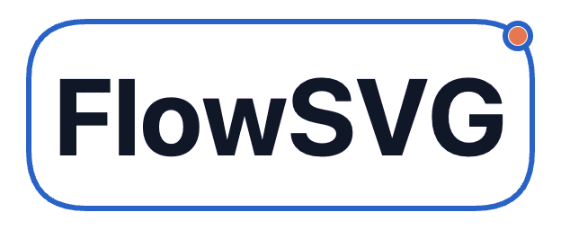

<p align="center">
  
</p>

<p align="center">面向系统和流程解释的可执行图表。</p>

<p align="center"><a href="README.md">English</a> | 简体中文</p>

<p align="center">
  <a href="https://www.npmjs.com/package/flowsvg"></a>
  <a href="https://www.npmjs.com/package/flowsvg"></a>
  <a href="https://github.com/yokingma/flow-diagram-skill"></a>
</p>

<p align="center">
  <a href="https://yokingma.github.io/FlowSVG/">在线演示</a> ·
  <a href="#flow-diagram-skill">Skill</a> ·
  <a href="#快速开始">快速开始</a> ·
  <a href="#集成与-api">API</a> ·
  <a href="apps/native-example/README.md">示例</a>
</p>

**FlowSVG SDK：面向系统和流程解释的可执行图表运行能力。支持渲染、播放、嵌入和导出。**

用同一份可编辑的 JSON 或 TypeScript 文档描述节点、连线、场景和节拍。用静态图解释结构，用动画展示流程推进和状态变化。这份文档可复用于交互式播放器、单文件离线 HTML、SVG、PNG 和 GIF。

FlowSVG 包含 SDK、共享 showcase，以及原生浏览器、React、Vue 集成示例。[Flow Diagram Skill](#flow-diagram-skill) 提供图解创作与复核能力。

核心使用 TypeScript，运行时不依赖 DOM、网络或浏览器时钟。原生浏览器、Vue、React 和 Web Component 接入复用同一套时间线与渲染结果。

可以访问[在线演示](https://yokingma.github.io/FlowSVG/)，浏览示例目录，在浏览器中播放图解，并查看可分享的演示链接。

## 典型示例

FlowSVG 包含一张完整的公开图形目录，以及简单的请求与响应流程、双副本 Web 服务部署和展示 Transformer 层与 KV Cache 复用的 LLM 推理过程。

图形目录把所有公开节点图形放进同一条可执行流程，并展示测量标签、正交连线、高亮和播放控制。

<p align="center"></p>

<p align="center"></p>

<p align="center"></p>

<p align="center"></p>

## 应用场景

公开演示示例的分类、介绍与图中文字统一使用英文；示例 ID 保持稳定，现有分享链接仍可使用。

| 场景 | 典型用途 |
| --- | --- |
| 演示文稿素材 | 为架构、流程和状态变化制作 SVG/PNG 图解或 GIF 动画 |
| 网页文档与产品讲解 | 嵌入支持播放、暂停和跳转的播放器 |
| 技术教学与新人培训 | 分步解释请求过程、数据流和任务生命周期 |
| 方案评审与故障复盘 | 先展示结构全貌，再演示相关交互或故障过程 |

同一份图解文档可复用于静态 SVG/PNG、GIF 动画和交互式或离线 HTML。演示文稿使用导出的素材；FlowSVG 不生成 PPTX 文件或 PowerPoint 原生形状。SVG/PNG/GIF 的支持情况取决于演示软件。

## 能做什么

- `diamond` 决策节点支持标签尺寸测量、安全区裁剪和真实轮廓连接。见[决策分支示例](packages/flowsvg/examples/decision-branch.json)。
- `parallelogram` 输入输出节点支持标签测量、安全区裁剪和真实轮廓连接。见[输入输出示例](packages/flowsvg/examples/input-output.json)。
- `predefinedProcess` 使用可测量的纯文本标签和两侧装饰竖线表达子流程调用。见[子流程示例](packages/flowsvg/examples/subprocess-call.json)。
- `document` 文档形：支持波浪带上方的居中标签、尺寸测量及真实轮廓命中。见[报告生成示例](packages/flowsvg/examples/report-generation.json)。

- 绘制节点、嵌套分组，以及直线、正交或曲线有向连线。
- 在节点中组合标题、段落、列表、标签和混合样式文字，并在设定尺寸前测量内容。
- 统一配置文档级节点、边标签和传递标记字号，用于播放器与导出。
- 用场景和节拍演示显隐、高亮、位置、内容及镜头变化。
- 设置 `flow.highlightEdge: false`，让传递标记运动时保留连线与标签的普通颜色。
- 通过内置控件播放、暂停、跳转、逐步切换、调速和循环。
- 查询指定时点的画面、命中对象，并导出静态 SVG/PNG。
- 生成单文件离线 HTML，导出支持进度与取消的 GIF。
- 使用浅色/深色主题、键盘操作和减少动画模式。
- 用文档 `emphasis` 保存高亮与传递标记配色，供播放、悬停及导出共用。核心视觉查询、浏览器、React、Vue、Web Component 播放器、PNG/GIF 和离线 HTML 支持逐字段运行时覆盖。导出调用固定嵌套配色快照，播放器 GIF 在点击时捕获覆盖。
- 校验文档，报告字段级错误和文字溢出警告；按需检查几何遮挡风险。

节点位置和尺寸由作者指定。FlowSVG 面向图解展示与播放；拖拽编辑和语义自动布局不在当前范围内。图解创作与确定性布局计划可使用 [Flow Diagram Skill](#flow-diagram-skill)。

[混合审批流程](packages/flowsvg/examples/mixed-flow.json)将四种形状、普通节点、分组和三种路由组合在同一图解中；包含标签替换、尺寸与样式变化，以及一个有意裁剪的标签。[生成脚本](packages/flowsvg/examples/create-mixed-flow.mjs)通过公开 `measureNodeLabel` 为多个标签版本预留共同高度。

安装 `flowsvg` 后，在可写目录中放置脚本并运行 `node create-mixed-flow.mjs`，再运行 `npx flowsvg mixed-flow.json --format html --output mixed-flow.html` 生成离线播放文件。

仓库内先执行 `pnpm --filter flowsvg build`，然后运行 `node packages/flowsvg/examples/create-mixed-flow.mjs`；以 `packages/flowsvg` 为静态服务根目录时，可打开 `/tests/browser-mixed-flow.html`。

## 安装

从 [npm](https://www.npmjs.com/package/flowsvg) 安装：

```sh
pnpm add flowsvg
```

包提供 ESM 与 TypeScript 类型。核心和原生播放器不依赖框架，完整接入说明见 [SDK 手册](docs/guides/sdk-guide.zh-CN.md)。

## 快速开始

### 1. 定义图解

将以下内容保存为 `diagram.ts`，供播放和导出共用：

```ts
import type { DiagramDocument } from "flowsvg";

export const diagramDocument: DiagramDocument = {
  version: 1,
  title: "Request flow",
  viewport: { width: 640, height: 280 },
  nodes: [
    { id: "client", kind: "roundedRect", x: 40, y: 100, width: 140, height: 80, label: "Client" },
    { id: "service", kind: "rect", x: 420, y: 100, width: 160, height: 80, label: "Service", visible: false }
  ],
  edges: [{ id: "request", from: "client", to: "service", label: "HTTP", route: "straight" }],
  scenes: [{
    id: "request-flow",
    label: "Request reaches the service",
    beats: [
      { durationMs: 1000, transitionMs: 250, caption: "Show the service", actions: [{ type: "show", target: "service" }] },
      { durationMs: 1000, caption: "The service handles the request", actions: [{ type: "highlight", target: "service" }] }
    ]
  }]
};
```

### 2. 在浏览器中播放

在页面中添加容器：

```html
<div id="diagram" style="width: 100%; height: 360px;"></div>
```

在客户端应用模块中创建播放器：

```ts
import { createPlayer } from "flowsvg/browser";
import "flowsvg/styles.css";
import { diagramDocument } from "./diagram.js";

const host = document.querySelector<HTMLElement>("#diagram");
if (!host) throw new Error("Diagram host is missing");

const player = createPlayer(host, diagramDocument);
player.play();
```

内置控件支持暂停、调速和跳转。可调用 `player.seek(1000)` 跳到指定毫秒；页面或组件卸载时调用 `player.destroy()`。普通 HTML 使用包导入时需要 import map 或构建工具。

### 3. 导出静态 SVG

核心入口可在无 DOM 的环境运行：

```ts
import { createDiagram } from "flowsvg";
import { diagramDocument } from "./diagram.js";

const diagram = createDiagram(diagramDocument);
const svg = diagram.renderSvg(1000);
console.log(svg);
```

`svg` 是完整 SVG 字符串，可保存到文件或用于预览。反复求值或导出时，复用已编译的 `diagram`。

浏览器 GIF 导出使用独立 [`flowsvg/export` 入口](docs/guides/sdk-guide.zh-CN.md#浏览器-gif-导出)，返回 GIF 字节并支持说明文字、进度和取消。编码在内嵌 worker 中执行。

浏览器 SDK 还可生成可控像素尺寸的 PNG，SVG/PNG 支持透明背景。参见[浏览器 PNG 与 SVG 背景](docs/guides/sdk-guide.zh-CN.md#浏览器-png-与-svg-背景)。

## 离线 HTML

Node 20+ 工具将图解数据、播放器和样式内嵌为一个 HTML 文件。接收者可断网通过 `file://` 打开。默认暂停在零时刻，显示控件和说明文字；主题使用文档主题，未指定时使用浅色。以下示例复用快速开始中的 `diagramDocument`。在 Node 中运行前，先将 `diagram.ts` 编译为 `diagram.js`。

```js
import { renderHtml } from "flowsvg/node";
import { diagramDocument } from "./diagram.js";
import { writeFile } from "node:fs/promises";
await writeFile("diagram.html", await renderHtml(diagramDocument, { theme: "dark" }));
```

命令行用法、可选 GIF 下载和可复制工具见[离线 HTML](docs/guides/sdk-guide.zh-CN.md#离线-htmlnode-20)。Node GIF 导出另需已准备的 Chromium 浏览器，详见 [Node GIF 导出](docs/guides/sdk-guide.zh-CN.md#node-gif-导出node-20)。

## 集成与 API

按读者和任务查找文档，见[中文文档地图](docs/README.zh-CN.md)。

[SDK 使用手册](docs/guides/sdk-guide.zh-CN.md) 说明集成方式、文档模型和公开 API。

| 需要做什么 | 阅读位置 |
| --- | --- |
| 创建文档、求值或导出 SVG | [快速开始](docs/guides/sdk-guide.zh-CN.md#快速开始)、[核心 API](docs/guides/sdk-guide.zh-CN.md#核心-api) |
| 在固定宽度下测量节点内容 | [内容尺寸测量](docs/guides/sdk-guide.zh-CN.md#生成文档前测量节点内容) |
| 在 Vue 组件中使用 | [Vue 集成](docs/guides/sdk-guide.zh-CN.md#vue-集成) |
| 在 React 组件中使用 | [React 集成](docs/guides/sdk-guide.zh-CN.md#react-集成) |
| 接入普通网页或自定义控件 | [原生浏览器](docs/guides/sdk-guide.zh-CN.md#原生浏览器)、[播放器 API](docs/guides/sdk-guide.zh-CN.md#播放器-api) |
| 使用自定义元素或 URL 文档 | [Web Component](docs/guides/sdk-guide.zh-CN.md#web-component) |
| 导出 PNG 图片 | [浏览器 PNG 与 SVG 背景](docs/guides/sdk-guide.zh-CN.md#浏览器-png-与-svg-背景)、[Node PNG](docs/guides/sdk-guide.zh-CN.md#node-png-导出) |
| 导出 GIF 字节或启用播放器下载 | [浏览器 GIF 导出](docs/guides/sdk-guide.zh-CN.md#浏览器-gif-导出)、[内置 GIF 下载](docs/guides/sdk-guide.zh-CN.md#内置-gif-下载) |
| 生成离线 HTML 或通过 Node 导出 GIF | [离线 HTML](docs/guides/sdk-guide.zh-CN.md#离线-htmlnode-20)、[Node GIF 导出](docs/guides/sdk-guide.zh-CN.md#node-gif-导出node-20) |
| 编写场景与动作 | [文档与时间线](docs/guides/sdk-guide.zh-CN.md#文档与时间线) |
| 监听事件、处理错误和主题 | [事件](docs/guides/sdk-guide.zh-CN.md#事件)、[主题与无障碍](docs/guides/sdk-guide.zh-CN.md#主题与无障碍)、[校验与错误](docs/guides/sdk-guide.zh-CN.md#校验与错误) |

## 环境要求

| 用途 | 要求 |
| --- | --- |
| 开发本仓库 | Node.js 22.12+、pnpm 10.12.1 |
| 单独运行 SDK 核心 | Node.js 18+，或支持 ES2022 ESM 的运行环境 |
| 浏览器播放器 | 支持 SVG、ES Modules、`requestAnimationFrame` 的现代浏览器 |
| 浏览器 PNG 导出 | Canvas 2D、图像解码和本地系统字体 |
| 浏览器 GIF 导出 | Canvas 2D、图像解码、Blob worker，且宿主内容安全策略允许使用这些能力 |
| Node HTML 生成 / CLI | Node.js 20+；生成 HTML 无需浏览器 |
| Node PNG/GIF 导出 | Node.js 20+、预装 Chromium、系统库和字体 |
| Vue / React 接入 | Vue 3.5+ / React 18+；按需安装对应框架 |

仓库的 Vue/React 示例使用 Vite 7，因此开发环境要求高于单独运行 SDK 核心的要求。包仅提供 ESM 入口。

## 开发

使用 Node.js 22.12+ 和 pnpm 10.12.1，在仓库根目录运行：

```sh
pnpm install --frozen-lockfile
pnpm build
pnpm --filter flowsvg-native-example dev
```

打开终端显示的地址。运行 React 或 Vue 示例时，将 `flowsvg-native-example` 替换为 `flowsvg-react-example` 或 `flowsvg-vue-example`。修改 SDK 源码后需要重新构建。

安装通过仓库内的固定启动脚本创建 CLI 命令入口，不会自动构建 SDK。首次构建前调用 CLI 会退出，并提示运行 `pnpm build`。

共享示例目录包含请求响应、RAG、架构、任务生命周期、数据流、部署和交互时序，使用自包含的教学数据。控件及构建配置见[原生浏览器](apps/native-example/README.md)、[React](apps/react-example/README.md) 和 [Vue](apps/vue-example/README.md) 示例说明。npm 包中也包含完整的[后台任务示例](packages/flowsvg/README.zh-CN.md#示例后台任务生命周期)。

运行 `pnpm build:examples` 构建三个示例站点。静态托管和 GitHub Pages 配置见[展示交付](docs/verification/showcase-verification.md)及 [Pages 部署](docs/development/github-pages.md)。

### 验证

```sh
pnpm typecheck
pnpm test
```

其他检查：

| 范围 | 命令 | 说明 |
| --- | --- | --- |
| SDK 浏览器行为 | `pnpm --filter flowsvg test:browser` | [SDK 验证](docs/verification/sdk-verification.md) |
| 构建后的示例与静态交付 | `pnpm test:examples` | [展示验证](docs/verification/showcase-verification.md) |
| 打包及安装后的使用方式 | `pnpm release` | [发布指南](docs/development/releasing.md) |

浏览器检查需要已准备的 Chromium 和字体，配置见[浏览器准备说明](docs/development/releasing.md#浏览器与最低运行时准备)。`pnpm release` 执行验证和发布预演；上传 npm 需要单独执行 `pnpm release:publish`。

项目约定见[术语表](GLOSSARY.md)、[架构决策](docs/adr/)和[实现约定](PATTERNS.md)。SDK 版本说明见[包变更记录](packages/flowsvg/CHANGELOG.md)。

## Flow Diagram Skill

[**Flow Diagram**](https://github.com/yokingma/flow-diagram-skill)：面向系统和流程解释的可执行图解 Skill。一次编写，支持播放、嵌入、检查和导出。它通过已发布的 `flowsvg` 包提供创作、布局计划、校验流程、复核与交付报告。

在需要创作图解的项目中安装：

```sh
npx skills add https://github.com/yokingma/flow-diagram-skill --skill flow-diagram
```

Codex 中以 `$flow-diagram` 调用，Claude Code 中以 `/flow-diagram` 调用。宿主要求、支持的助手与已知限制见该仓库说明。

SDK 版本选择与验证职责见[创作工具集成](docs/development/authoring-tools.md)。

## 许可证

[MIT](packages/flowsvg/LICENSE)。使用、修改和分发时，请保留许可证及版权声明。
