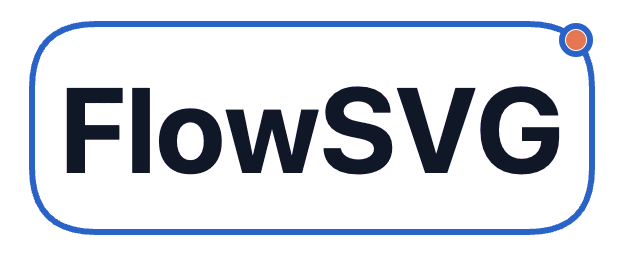

# FlowSVG 文字标志

**文档状态：配套资料。** 本页说明品牌资源的生成输入和预览方式；图片与示例是维护产物，不定义 SDK、播放器或导出契约。行为变更请回到 SDK 手册、源码和测试。

主标志使用较大的纯文字 **FlowSVG**，文字采用深黑，蓝色圆角矩形边框搭配橙色运动信号。矩形为 280 × 104 图解单位，文字字号为 60。空心标记位于右上圆角弧线的中点；实心信号从同一点出发，沿边框绕行一圈后回到原点。每圈 4.8 秒，首尾位置与运动方向连续。画布为 312 × 128 图解单位，左右各保留 16 单位留白。GIF 按 2 倍像素密度生成，使用 50fps（每帧 20ms），共 240 帧；README 以 280px 宽显示。



静态矢量版本：[浅色 SVG](flowsvg-wordmark.svg) · [深色 SVG](flowsvg-wordmark-dark.svg)

## 动态版本

[打开动态字标示例](flowsvg-wordmark.html)：文字和布局由 SDK 的 `createDiagram` 与 `renderSvg` 生成；圆角边框、右上空心标记与橙色实心信号组成品牌动画。动画使用 SVG 的 `animateMotion` 沿同一条圆角路径循环，边框运动轨迹与标志几何保持一致。文字先由 SDK 渲染，再按实际字形边界居中；静态 SVG 与 GIF 均从此示例生成。

在仓库根目录先构建 SDK，再用本地静态服务器打开示例：

```sh
pnpm --filter flowsvg build
python3 -m http.server 4173
# 浏览器访问 http://localhost:4173/docs/brand/flowsvg-wordmark.html
```

## 文件

| 文件 | 用途 |
| --- | --- |
| [flowsvg-wordmark.gif](../../packages/flowsvg/docs/images/flowsvg-wordmark.gif) | README 使用的循环动画 GIF |
| [flowsvg-wordmark.svg](flowsvg-wordmark.svg) | 浅色底静态文字标志 |
| [flowsvg-wordmark-dark.svg](flowsvg-wordmark-dark.svg) | 深色底静态文字标志 |
| [flowsvg-wordmark.html](flowsvg-wordmark.html) | 使用 FlowSVG 核心渲染文字的循环动画示例 |

GIF 适合放在 GitHub README 中；SVG 适合网页和设计工具中的无损缩放。根目录与 SDK 的中英文 README 均在顶部居中展示该 GIF。GIF 随 npm 包分发；品牌资源的使用方式由各宿主页面维护。
