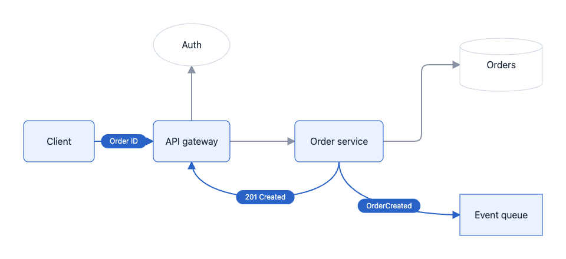
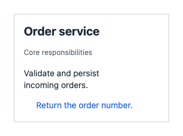
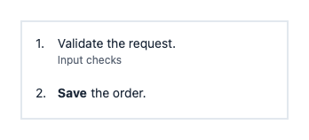
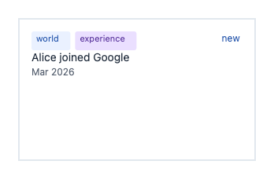
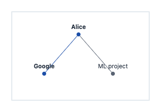
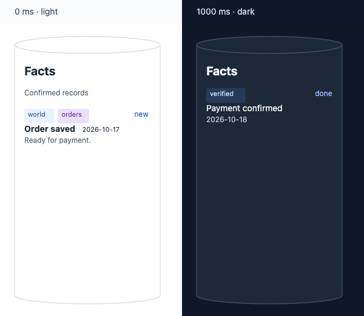

# FlowSVG SDK guide

English | [简体中文](sdk-guide.zh-CN.md)

> **Document status:** Current entry. The public types, implementation, and tests under `packages/flowsvg/` are the source of truth for behavior. This guide is the maintained English task path; verification guides describe reproducible checks and do not replace this contract.
>
> **Language parity:** The Chinese guide follows this guide's section order and public contract. Update both guides in the same change, including examples, defaults, limits, errors, and links.

FlowSVG turns JSON or TypeScript documents into animated SVG diagrams. Define nodes, edges, scenes, and beats; play them in a browser, export SVG, PNG or GIF, or share a single offline HTML file.

The ESM SDK includes a DOM-free core and native browser, Vue, React, and Web Component integrations. All integrations share the same document and timeline.

[Install](#installation) · [Quick start](#quick-start) · [Vue](#vue-integration) · [React](#react-integration) · [Native browser](#native-browser) · [Web Component](#web-component) · [Documents](#documents-and-timelines) · [Node content](#structured-node-content) · [Typography](#document-typography) · [API](#api) · [Diagnostics](#on-demand-geometry-diagnostics) · [Controls](#player-controls) · [PNG](#browser-png-and-svg-backgrounds) · [GIF](#browser-gif-export) · [Node PNG](#node-png-export) · [Node GIF / CLI](#node-gif-export-node-20) · [Offline HTML](#offline-html-node-20)

## Installation

Install from npm:

```sh
npm install flowsvg
```

ESM only, with TypeScript declarations. Core and native browser entries need no framework. Core: Node.js 18+ or an ES2022-compatible browser. Playback: DOM, SVG, and `requestAnimationFrame`. Frameworks: Vue 3.5+ or React 18+.

Browser PNG and GIF export require Canvas 2D, SVG image decoding and locally installed system fonts. GIF also requires Blob workers allowed by the host content security policy. The Node entry and CLI require Node 20+; HTML generation needs no browser, while Node PNG and GIF export need preinstalled Chromium and system fonts.

| Import path | Purpose |
| --- | --- |
| `flowsvg` | DOM-free document validation, compilation, evaluation, hit testing, and SVG export |
| `flowsvg/browser` | Native browser player |
| `flowsvg/export` | Browser PNG/GIF export, cancellation and errors; GIF progress |
| `flowsvg/node` | Node 20+ offline HTML generation and Chromium-based PNG/GIF export |
| `flowsvg/vue` | Vue component and handle types |
| `flowsvg/react` | React component and ref types |
| `flowsvg/web-component` | Explicit custom element registration; also available as `flowsvg/element` |
| `flowsvg/styles.css` | Control layout and visible focus styles |

## Quick start

### 1. Create a diagram document

Save this approximately 6.7-second order workflow as `diagram.ts`. All integration and export examples reuse this file. Compile TypeScript before running the Node examples; the `.js` import paths refer to the compiled files.

```ts
import type { DiagramDocument } from "flowsvg";

export const diagramDocument: DiagramDocument = {
  version: 1,
  title: "Order request lifecycle",
  viewport: { width: 960, height: 440 },
  nodes: [
    { id: "client", kind: "roundedRect", x: 40, y: 205, width: 120, height: 70, label: "Client" },
    { id: "gateway", kind: "roundedRect", x: 260, y: 205, width: 130, height: 70, label: "API gateway" },
    { id: "auth", kind: "ellipse", x: 260, y: 40, width: 130, height: 72, label: "Auth" },
    { id: "orders", kind: "roundedRect", x: 500, y: 205, width: 150, height: 70, label: "Order service" },
    { id: "database", kind: "cylinder", x: 780, y: 65, width: 140, height: 90, label: "Orders" },
    { id: "events", kind: "rect", x: 780, y: 330, width: 140, height: 70, label: "Event queue" }
  ],
  edges: [
    { id: "request", from: "client", to: "gateway", route: "straight" },
    { id: "authorize", from: "gateway", to: "auth", route: "straight", fromPort: "top", toPort: "bottom" },
    { id: "create", from: "gateway", to: "orders", route: "straight" },
    { id: "persist", from: "orders", to: "database", route: "orthogonal", fromPort: "right", toPort: "left" },
    { id: "publish", from: "orders", to: "events", route: "curved", fromPort: "bottom", toPort: "left" },
    { id: "result", from: "orders", to: "gateway", route: "curved", fromPort: "bottom", toPort: "bottom" }
  ],
  scenes: [
    { id: "request", label: "Receive and authorize", beats: [
      { durationMs: 800, caption: "Receive the order request", actions: [
        { type: "flow", target: "request", direction: "forward", text: "POST" }
      ] },
      { durationMs: 800, caption: "Validate the access token", actions: [
        { type: "flow", target: "authorize", direction: "forward", text: "Token" }
      ] }
    ] },
    { id: "create-order", label: "Create the order", beats: [
      { durationMs: 1000, caption: "Send the authorized request to the order service", actions: [
        { type: "flow", target: "create", direction: "forward", text: "Create" }
      ] },
      { durationMs: 1000, caption: "Persist the new order", actions: [
        { type: "flow", target: "persist", direction: "forward", text: "INSERT" }
      ] }
    ] },
    { id: "response", label: "Publish and respond", beats: [
      { durationMs: 1600, caption: "Publish OrderCreated and return the order number", actions: [
        { type: "flow", target: "publish", direction: "forward", text: "OrderCreated" },
        { type: "flow", target: "result", direction: "forward", text: "201 Created" },
        { type: "flow", target: "request", direction: "reverse", text: "Order ID" }
      ] }
    ] }
  ]
};
```

Halfway through the final beat with the light theme, the event and response messages move together. Only their participating nodes are highlighted.



### 2. Evaluate and export SVG

```ts
import { createDiagram, renderSvg } from "flowsvg";
import { diagramDocument } from "./diagram.js";

const diagram = createDiagram(diagramDocument);
const frame = diagram.evaluateAt(125);
console.log(diagram.totalDuration, frame.sceneId, frame.warnings);

const svg = diagram.renderSvg(125, { theme: "dark" });
const finalSvg = renderSvg(diagramDocument, diagram.totalDuration);
```

Both results are static SVG strings. Reuse `createDiagram` for repeated queries; use `renderSvg` for a single export.

## Vue integration

Create a component in your Vue application, with `diagram.ts` in the same directory:

```vue
<script setup lang="ts">
import { ref } from "vue";
import { FlowPlayer, type FlowPlayerHandle } from "flowsvg/vue";
import type { PlayerErrorDetail } from "flowsvg/browser";
import "flowsvg/styles.css";
import { diagramDocument } from "./diagram.js";

const player = ref<FlowPlayerHandle | null>(null);
const timeMs = ref(0);

function handleError({ error }: PlayerErrorDetail): void {
  console.error(error);
}
</script>

<template>
  <FlowPlayer
    ref="player"
    :document="diagramDocument"
    :speed="1.25"
    :gif-export="true"
    theme="dark"
    @timeupdate="timeMs = $event.timeMs"
    @error="handleError"
  />
  <button type="button" @click="player?.play()">Play</button>
  <button type="button" @click="player?.seek(0)">Back to start</button>
  <output>{{ timeMs }} ms</output>
</template>
```

Unmounting destroys the player. In scripts, call methods through `player.value`; templates unwrap the ref. Events pass their detail directly: `stepchange`, `timeupdate`, `playstatechange`, `loopchange`, and `error`. Callback props are also supported.

## React integration

```tsx
import { useRef } from "react";
import { FlowPlayer, type FlowPlayerHandle } from "flowsvg/react";
import "flowsvg/styles.css";
import { diagramDocument } from "./diagram.js";

export default function DiagramExample() {
  const player = useRef<FlowPlayerHandle | null>(null);

  return (
    <section>
      <FlowPlayer
        ref={player}
        document={diagramDocument}
        speed={1.25}
        gifExport
        theme="dark"
        onError={({ error }) => console.error(error)}
      />
      <button type="button" onClick={() => player.current?.play()}>Play</button>
      <button type="button" onClick={() => player.current?.seek(0)}>Back to start</button>
    </section>
  );
}
```

The component releases resources on unmount. Callbacks are `onStepChange`, `onTimeUpdate`, `onPlayStateChange`, `onLoopChange`, and `onError`.

### Vue / React props and updates

| Prop | Default or behavior |
| --- | --- |
| `document` | Required diagram document; a new object reference triggers a reload, pausing at zero on success |
| `speed` | Positive playback multiplier, default `1`; changes update the speed |
| `loop` | Default `false`; changes update live loop mode without rebuilding or changing time/playback |
| `theme` | `light` / `dark`; falls back to the document theme, then light |
| `controls` | Default `true`; set to `false` to hide built-in controls |
| `gifExport` | Default `false`; enable GIF progress, cancel and download controls; requires visible controls |
| `reducedMotion` | Follows the browser's reduced-motion preference when omitted |
| `hoverFill` | Default `false`: hover highlights the border only; set `true` to also highlight the background and content |
| `initialTimeMs` | Applied only on initial mount; use `seek` for later changes |
| `className` / `style` | Host container styles |

Changing `theme`, `controls`, `gifExport`, `reducedMotion`, or `hoverFill` recreates the player, paused at zero, without reapplying `initialTimeMs`. Reload documents with a new object reference. Handles expose eight methods listed under [Player API](#player-api); calls before mount or after unmount throw.

Both entries support server-side imports. SSR renders a container; the player is created on client mount. Use `renderSvg` for server-side diagram previews.

## Native browser

Add a container to your page:

```html
<div id="diagram" style="width: 100%; height: 360px;"></div>
```

Create the player in a client-side application module:

```ts
import { createPlayer } from "flowsvg/browser";
import "flowsvg/styles.css";
import { diagramDocument } from "./diagram.js";

const host = document.querySelector<HTMLElement>("#diagram");
if (!host) throw new Error("Diagram host is missing");

const player = createPlayer(host, diagramDocument, { theme: "light", gifExport: true });
player.play();
```

`createPlayer` replaces the container children. Call `destroy()` on disposal and before reusing the container. Plain HTML requires an import map or build tooling for package imports.

## Web Component

Place the element in HTML, then register it explicitly from a client-side module:

```html
<flowsvg-player gif-export></flowsvg-player>
```

```ts
import { defineFlowPlayer, type FlowPlayerElement } from "flowsvg/web-component";
import "flowsvg/styles.css";
import { diagramDocument } from "./diagram.js";

defineFlowPlayer();
const element = document.querySelector<FlowPlayerElement>("flowsvg-player");
if (element) element.document = diagramDocument;
```

Registration defaults to `<flowsvg-player>` and is idempotent. Assign objects to `element.document`, JSON strings to the HTML `document` attribute, or a JSON URL to `src`. URLs resolve against the page and follow browser CORS rules.

Attributes: `autoplay`, `controls`, `speed`, `theme`, `reduced-motion`, `hover-fill`, `gif-export`, and `loop`. Controls default on; autoplay, loop, hover fill and GIF export default off. Use `controls="false"` to hide controls. Changes to theme, controls, GIF, or motion/hover options preserve time and playback state; `autoplay` explicitly starts or pauses playback. Removal cancels requests and destroys the player; reconnection uses the retained document.

Methods: `play`, `pause`, `seek`, `step`, `setSpeed`, `setLoop`, `getState`, and `destroy`. Update documents through `element.document`. Before mount or after destruction, `getState()` returns `undefined`. Playback/error events bubble across Shadow DOM boundaries.

Register in a DOM environment. DOM-free imports are safe, but that module instance cannot register after a DOM is added later.

## Documents and timelines

| Document field | Contract |
| --- | --- |
| `version` | Currently `1` |
| `viewport` | Finite positive authored `width` and `height`; optional `fitHeight: { padding }` fits the current full-view height |
| `nodes` | Node array; `id`, `kind`, `x`, `y`, `width`, and `height` are required |
| `edges` | Edge array; `id`, `from`, and `to` are required; endpoints reference nodes or group boundaries |
| `scenes` | `[]` creates a static diagram; each scene has a unique `id`, a `label`, and nonempty `beats` |
| `title` / `theme` | Optional title and `light` / `dark` document theme |
| `typography` | Optional node, edge and flow-label sizes; see [document typography](#document-typography) |

Node and edge IDs are globally unique. Shapes: `rect`, `roundedRect`, `ellipse`, `cylinder`, `group`; unreleased source also supports `diamond`, `parallelogram`, `document` and `predefinedProcess`. Group borders are rounded by default. `parentId` names a parent group; child coordinates are group-relative. Labels are plain text; `visible` defaults to `true`. Node styles: `fill`, `stroke`, `strokeWidth`, `textColor`, `dashed` (group borders). Edge styles: `stroke`, `strokeWidth`, `dashed`. Colors use hexadecimal RGB/RGBA, such as `#2563eb` or `#2563eb80`.

Routes: `straight` (default), `orthogonal`, or `curved`. Curves follow endpoint ports without avoiding other nodes. Orthogonal routes round bends by default; SVG output, flow markers, bounds and hit testing share that geometry. Rounding adapts to short segments and obstacle/arrow clearance. Orthogonal routes avoid visible ordinary nodes and use a fixed fallback if blocked; shortest paths and zero crossings are not guaranteed. Set `fromPort` / `toPort` to `top`, `right`, `bottom`, or `left`. Orthogonal routes prefer bridges at the gap midpoint when arrow space permits and single outside channels for matching port sides. Separate ancestor frames add outside clearance; shared containers remain traversable. Orthogonal routes reserve outward endpoint segments and a straight arrow approach scaled to the evaluated stroke width, shortened when adjacent nodes leave insufficient space. Curved and orthogonal inputs on the same target side receive separate positions ordered by source position, with document order breaking ties; hidden edges keep their positions. Positions use the central portion of the side, so crowded or very small nodes can still require more space. Curved ports set tangents. Omitted ports follow the dominant center-to-center axis; ellipse endpoints lie on the contour. Simple labels wrap by estimated width and remain visible on height overflow, with a `text-overflow` warning.

Edges can connect nodes or group boundaries. Group endpoints follow evaluated geometry and explicit ports. Hidden ancestors mask connected edges. Transfers highlight the endpoint group, not its descendants, unless `highlightParticipants: false` disables endpoint highlights. Group frames are excluded from routing obstacles.

### Beats and actions

Each beat has a positive authored `durationMs` and an `actions` array, with optional `transitionMs` and `caption`. Transition duration defaults to `min(250, durationMs)` and must be within `[0, durationMs]` in the document. Compilation caps the transition at the effective beat duration. An omitted caption inherits the previous caption; an empty string clears it.

| Action | Example or update fields |
| --- | --- |
| `show` / `hide` | `{ type: "show", target: "service" }`; targets a node, group, or edge |
| `highlight` / `unhighlight` | Changes the highlight layer; removing a highlight reveals the latest ordinary style |
| `flow` | `{ type: "flow", target: "request", direction: "forward" }`; moves a beat-local marker along an edge. `direction` is `forward` or `reverse`; the static edge arrow does not change. Add `text: "Request"` for a horizontal text capsule; omit `text` for a solid dot. Set `highlightParticipants: false` to keep the marker and edge highlight without automatic endpoint highlights (default `true`). |
| `updateNode` | `value` supports `x`, `y`, `width`, `height`, `label`, `content`, `fill`, `stroke`, and `opacity` |
| `updateEdge` | `value` supports `label`, `stroke`, `strokeWidth`, and `opacity` |
| `focus` | `target` is a node/group ID; `null` restores the current full view |

`updateNode.value.content` replaces all content at beat start, regardless of transition duration, and persists across beats/scenes. `label` switches to simple-label mode; `content` switches to structured content. `content: null` clears either mode without restoring old labels or resizing. Assigning both modes, or assigning one repeatedly within a beat, produces a field-path error.

Scenes share a millisecond timeline and inherit the previous scene’s final state. Text changes at beat start; interpolated values change during the transition. Beats include their start and exclude their end; the final time returns the completed frame. Hidden nodes/groups mask connected edges; showing them restores each edge’s saved visibility.

A beat supports one transfer per distinct edge. A beat with one flow targets 180 diagram units/second, with a minimum movement time of 400 ms. The marker holds at the destination for exactly 500 ms. The effective beat duration is movement time plus 500 ms, replacing the authored `durationMs`; later beats shift accordingly. Use separate no-flow beats for longer reading time. Timing uses the routed path at the beat’s target visual state, including inherited updates, parent positions, ports, obstacles and stroke width. During moving layouts, markers follow the current path using that reference duration; camera scaling can change screen speed. Multiple flows share linear progress over the authored `durationMs`, so longer paths move faster. The 500 ms interval is measured at speed 1. Global player speed scales movement, arrival hold and separate reading beats together. Markers and endpoint highlights expire at beat end; the next beat supplies a new transfer group. Explicit highlights and ordinary styles persist. `highlightParticipants: false` leaves node highlighting to explicit actions; it does not disable the marker or temporary edge highlight.

For a single flow, the sender paints immediately. After arrival, the receiver fill and stroke fade in over 200 ms. Automatic node and edge highlights then stay fully painted for 100 ms and fade out over 200 ms before the beat ends. Reverse flows swap sender and receiver. Logical `highlighted` flags and markers last for the whole beat; content, geometry and explicit actions retain their authored timing. Explicit highlights take precedence, and `highlightParticipants: false` disables automatic endpoint paint. Reduced motion skips both fades while preserving the 500 ms post-arrival interval. Multiple flows retain their existing synchronized timing and paint. Player speed scales the fades with the timeline; SVG and export evaluate the same colors.

Transfer `text` is escaped, stays horizontal, and uses estimated capsule widths without font measurement. It does not replace the edge label or create an interaction target. An empty string still produces a capsule.

Set `viewport.fitHeight: { padding: 24 }` to fit full-view height to current painted nodes, edges, labels and active flow markers plus bottom padding. Padding must be finite and nonnegative. The camera keeps origin `(0, 0)` and authored width, and rounds height outward to whole diagram units. Empty frames use authored height. The browser aspect ratio and static SVG follow the evaluated camera; node size and placement stay authored. Explicit focus retains the authored viewport aspect ratio and bounds; clearing focus returns to the current fitted full view. Nonrepresentable fitted heights throw `DiagramValidationError` during evaluation.

## API

### Core API

Import from `flowsvg`:

| API | Result and behavior |
| --- | --- |
| `validateDocument(input: unknown)` | Returns `{ path, message }[]`; an empty array means authored structure and value checks passed |
| `createDiagram(document)` | Validates, copies, and compiles into a `Diagram`; invalid documents throw `DiagramValidationError` |
| `renderSvg(document, timeMs = 0, options?)` | Compiles once and exports a static SVG string |
| `diagram.totalDuration` | Compiled timeline duration, including single-flow movement and arrival holds; `0` for a static document |
| `diagram.beats` | Frozen effective intervals: `{ sceneId, beatId, beatIndex, startMs, endMs, caption? }`; use these for navigation and export timing. `beatIndex` is scene-local; captions include inherited text |
| `diagram.evaluateAt(timeMs, options?)` | Returns `DiagramFrameState` |
| `diagram.diagnoseAt(timeMs, options?)` | Return `GeometryWarning[]` on demand, excluding text overflow |
| `diagram.renderSvg(timeMs = 0, options?)` | Exports SVG from the same evaluation result |
| `diagram.hitTest(timeMs, point, options?)` | Returns `{ id, type: "node" \| "edge" }` or `null`, using document coordinates |
| `measureNodeContent({ kind, width, content, typography? })` | Returns a recommended fixed height and unresolved per-version overflow diagnostics; see [content measurement](#measure-content-before-creating-a-document) |
| `measureNodeLabel({ kind, width, label, typography? })` | Unreleased: measure shared preset-label height and unresolved width issues; see [decision labels](#decision-labels-and-measurement). |
| `wrapText(label, maxWidth, typography?)` | Wraps text with fixed width estimates and returns an array of lines |

`validateDocument` checks authored structure and values. Compilation also rejects non-finite derived movement or accumulated timing with `DiagramValidationError` at the affected beat’s `durationMs` path. Input documents retain their authored durations.

`EvaluateOptions`: `{ theme?: "light" | "dark"; reducedMotion?: boolean }`. Times clamp to `[0, totalDuration]`; non-finite values become zero. Hit testing skips hidden/zero-opacity objects, then checks ordinary nodes, edges, and group backgrounds in that order.

`DiagramFrameState` includes time, scene/beat IDs, progress, evaluated nodes/edges, camera, caption, and warnings. Coordinates are absolute. Static documents have `null` scene/beat IDs; beat IDs use `${scene.id}:${beatIndex}` with zero-based indexes. Active edges expose `flow` direction, progress, point, and optional text. Markers are absent after the beat, on hidden edges, or with reduced motion.

Types and member JSDoc are included: `DiagramDocument`, `DiagramNode`, `DiagramEdge`, `Scene`, `Beat`, `DiagramBeat`, `Action`, `Diagram`, `DiagramFrameState`, `EvaluateOptions`, `ValidationIssue`, `LayoutWarning`, `GeometryWarning`, `GeometryWarningCode`, and `TextOverflowWarning`.

### On-demand geometry diagnostics

```ts
const risks = diagram.diagnoseAt(500, { theme: "light", reducedMotion: false });
for (const risk of risks) {
  console.log(risk.code, risk.path, risk.objectId, risk.relatedObjectIds, risk.warningKey);
}
```

`diagnoseAt` uses `evaluateAt` time and visual options. It returns only `edge-node-overlap`, `label-node-overlap` and `label-overlap`. Ordinary evaluation, SVG rendering and playback do not run these pair checks. `frame.warnings` retains separate `text-overflow` results.

In unreleased source, preset labels with zero safe-area width or height contribute no painted overlaps; `text-overflow` remains available. Visible `predefinedProcess` side-line strokes participate under the parent node identity, including transparent-fill styles. The hollow interior contributes no fill paint.

The SDK checks visible portions inside the effective camera. Ordinary node, group and edge labels can overflow their shapes; structured lines are first clipped to `safeArea`. Inline spans share one label identity, and transparent span gaps do not become visible text. Different lines of one ordinary edge label compare foreground regions, so their shared background halo alone does not create a self-conflict. Halo checks remain active against other label fields, owners and nodes. Own labels and ancestor containment are excluded, while group titles covering children remain eligible. Edge paths exclude endpoints and group boundaries; edge labels have no endpoint exemption. Hidden, zero-opacity and fully transparent paint is excluded. A transparent fill can retain a visible outline; semi-transparent paint and edge-label background halos remain eligible. Flow capsules, content graphics and player captions are outside label checks.

Fill checks use bounding boxes only as a prefilter, then actual rectangle, rounded, ellipse and cylinder contours. Routes reuse SDK samples: 32 intervals per ordinary cubic, 16 per separated cubic segment and 16 per orthogonal bend. Curved node strokes use 256 contour intervals per revolution, retaining the cylinder cap and internal horizontal seam; rectangle strokes retain square miters. Contact tolerance is `1e-6` diagram units. Finite sampling, estimated text rectangles and the lack of pixel analysis for dash gaps can miss risks or flag risks without actual painted-pixel occlusion. Warnings do not prove final-layer pixel occlusion or continuous collision coverage. Review actual outputs at their intended display size.

Each result has `code`, `path`, `objectId`, `relatedObjectIds`, `warningKey` and `message`. `warningKey` is a versioned canonical JSON array encoding: `["flowsvg-layout-warning", 1, code, left, right]`. Participants include object type, ID, role, field path and line/subobject position. Label pairs sort participant encodings; label–node and path–node pairs preserve role direction. Different fields and lines retain separate identities, while spans on one line do not create duplicates. Two lines in one node can conflict, so a related ID may equal `objectId`. Prose, coordinates, time and visual options are excluded from the key. Consumers must separately bind source bytes, SDK identity, time and visual options before recording a decision about one occurrence. The SDK never moves, hides or rewrites objects.

### Player API

Import `createPlayer(host, document, options?)` from `flowsvg/browser`. `PlayerOptions` extends core visual options with `controls?: boolean`, `loop?: boolean`, `gifExport?: boolean` and `hoverFill?: boolean`.

| Method or property | Behavior |
| --- | --- |
| `element` | The original host element and event target |
| `play()` / `pause()` | Starts playback or pauses on the current frame; static diagrams cannot start; loop mode restarts from the timeline end |
| `seek(timeMs)` | Clamps to the timeline and retains playback state; reaching the end pauses |
| `step(1)` / `step(-1)` | Pauses and jumps to the adjacent beat start; stepping backward inside a beat goes to its start, and backward at a beat start goes to the previous beat |
| `setSpeed(speed)` | Sets a finite positive multiplier; ignores invalid values |
| `setLoop(loop)` | Updates loop mode without changing the position or playing state |
| `load(document)` | Pauses at zero on success; validation failure emits error and retains the document, time, and playback state |
| `getState()` | Returns `PlayerState`: `timeMs`, `totalDuration`, `playing`, `loop`, `speed`, and `frame` |
| `destroy()` | Idempotently cleans up DOM, listeners, and scheduling; stops events, while state remains readable |

Players start paused at zero with controls enabled. Page hiding pauses playback; returning leaves it paused. Loop defaults to false, so playback stops at the end. Enable `loop: true` or press **Loop** to repeat the whole timeline, retaining elapsed remainder and speed. Manual end seeks and steps pause; pressing Play at the end restarts only when loop is enabled. Successful loads retain loop preference and pause at zero. Static diagrams disable timeline controls. Framework handles expose these methods except `element` and `destroy`.

Hover highlights node borders, including groups. Set `hoverFill: true` to include backgrounds and content paint. Leaving clears hover while retaining flow and explicit highlights. Pointer cancellation, document replacement and destruction also clear hover. `PlayerState.frame` and static SVG exclude hover.

### Events

Native players dispatch `CustomEvent` on the host element:

| Event | `detail` |
| --- | --- |
| `timeupdate` | Current `PlayerState`, sent after the frame updates |
| `stepchange` | Current `PlayerState`, sent when the scene or beat changes, before that update's timeupdate |
| `playstatechange` | Current `PlayerState`, sent when playing/paused state changes |
| `loopchange` | Current `PlayerState`, sent only when loop mode changes |
| `error` | `PlayerErrorDetail`: retained player state and `error` |
| `hover` / `click` | `PlayerInteractionDetail` or `null`; aliases are `objecthover` / `objectclick` |

Interaction detail contains `id`, `type`, `point` (document coordinates), `timeMs`, `sceneId`, and `beatId`; misses return `null`. Adapters forward the five playback/error events. Web Component errors before mount may lack player state.

`hover` also updates when a frame change moves another object under a stationary pointer. Pointer leave/cancel emits `null`.

```ts
import type { PlayerEventMap } from "flowsvg/browser";

function handleTimeUpdate(event: Event): void {
  const { detail } = event as PlayerEventMap["timeupdate"];
  console.log(detail.timeMs, detail.frame.caption);
}

player.element.addEventListener("timeupdate", handleTimeUpdate);
```

This example reuses `player` from the native integration. Remove any listeners your application adds when disposing of the host.

## Player controls

### Default setup

The player provides Play/Pause, previous/next beat, progress, scene, speed and Loop controls by default. You do not need to create buttons or menus. Import the default CSS once in your application entry for the complete control layout, colors and interaction feedback:

```ts
import { createPlayer } from "flowsvg/browser";
import "flowsvg/styles.css";
import { diagramDocument } from "./diagram.js";

const host = document.querySelector<HTMLElement>("#diagram");
if (!host) throw new Error("Diagram host is missing");

const player = createPlayer(host, diagramDocument);
```

This example reuses the [native browser](#native-browser) container and starts paused at zero. Call `player.destroy()` before disposing of the page. Vue, React and Web Component integrations also provide controls by default; import the same CSS in your chosen integration. Set `controls: false` to hide controls. GIF downloads are optional and require enabling `gifExport` separately.

### Control colors

Keep the default CSS and set the existing five variables on the host or an ancestor to customize control colors:

```css
#diagram {
  --flowsvg-control-background: #101828;
  --flowsvg-control-color: #f4f7fb;
  --flowsvg-control-border: #64748b;
  --flowsvg-control-accent: #60a5fa;
  --flowsvg-control-focus: #fbbf24;
}
```

These variables control the background, text, border, accent and keyboard-focus colors, respectively. No extra host class is required. Control colors do not change the diagram or its exported colors; core themes and document styles determine diagram colors. See [Themes and accessibility](#themes-and-accessibility).

### Control sizes

Standard sizing is the default: buttons and choice triggers have a minimum height of `2.75rem` (44 pixels with a 16-pixel root font). Add `flowsvg-compact` to a host or ancestor for a compact height of `2rem` (32 pixels with the same root font):

```html
<div id="diagram" class="flowsvg-compact" style="width: 100%; height: 360px;"></div>
```

Vue, React and Web Component players can also sit inside a container with `flowsvg-compact`. Remove the class to restore standard sizing. Both sizes retain rounded neutral controls, an accent-tinted Play/Pause button and visible hover, pressed, disabled and keyboard-focus states. The progress slider takes a full row on narrow screens. Control transitions respect the system reduced-motion preference; control sizes do not change diagram geometry.

### Optional advanced use: reuse a choice menu

Use this interface only when building host settings; normal player setup and styling do not require it. `flowsvg/browser` retains the public `SelectControl` and `SelectChoice` exports for hosts that need the player's menu styling and keyboard interaction.

Create `new SelectControl(document, "Theme", onChange)`, append its `element`, then call `render([{ value: "light", label: "Light" }, { value: "dark", label: "Dark" }], "light")`. `SelectChoice` contains string `value` and `label` fields; choice values must be unique within a control. The callback receives a requested value; the caller owns committed state and must call `render` to reflect it. The optional third `render` argument is a disabled flag, defaulting to `false`; an empty choice list also disables the trigger. Call `destroy()` before removing the host to release outside-dismissal listeners and remove the menu element. The menu reuses the imported `flowsvg/styles.css`, color variables and size class above.

## Decision labels and measurement

This unreleased source capability is not in published 0.2.3. `diamond` supports plain `label` only, with no structured `content`, including empty blocks. Timeline `content: null` retains existing clearing semantics. Its four vertices are side midpoints; the centered half-width/half-height inner rectangle reserves a further 12 diagram units on every side. The label is centered as complete line boxes with one fixed width.

```ts
import { createDiagram, measureNodeLabel } from "flowsvg";

const width = 200;
const labels = ["Ready?", "One\nTwo"];
const measurement = measureNodeLabel({ kind: "diamond", width, label: labels });
const diagram = createDiagram({ version: 1, viewport: { width: 300, height: 300 },
  nodes: [{ id: "decision", kind: "diamond", x: 20, y: 20, width,
    height: measurement.height, label: labels[1] }], edges: [], scenes: [] });
```

This example returns height 128. Inspect `measurement.diagnostics` before adopting the size. `measureNodeLabel` accepts `diamond`, `parallelogram`, `document` and `predefinedProcess` in this source milestone, a finite positive width, a string or nonempty readonly label-version array, and optional existing `DiagramTypography`. It returns `{ height, diagnostics }`; each unresolved width issue contains `versionIndex`, `path`, `dimension: "width"`, and `message`. A single string uses version zero. Import `NodeLabelMeasurementInput`, `NodeLabelMeasurement`, and `NodeLabelMeasurementDiagnostic` from `flowsvg` for typed consumers.

Versions share the maximum required height, including complete line boxes. With label height L, diamond height is 2 × (L + 24). Empty labels still return positive clearance height. Measurement and rendering share deterministic wrapping without DOM font metrics, input mutation or scene scanning. When one grapheme cannot fit, it occupies its own measured line and retains a width diagnostic; increasing height cannot solve that issue. Increase width or shorten the label. Invalid input or a non-finite computed height throws `DiagramValidationError` with field/version paths.

Chinese and explicit newlines/blank lines are supported. Latin words remain whole when possible, but overwide words and URLs split only between complete graphemes. Nonempty text outside the safe area is clipped and reports `text-overflow`, without font reduction, ellipsis, source-text replacement or automatic node resizing. Positive tiny dimensions remain valid; nonpositive/non-finite dimensions are validation errors. Empty labels do not overflow solely because their safe area is zero.

Cardinal and automatic connections in every route family, same-side inputs, hits and diagnostics follow the real contour. Clipped-away text cannot enlarge hit targets, diagnostics or fitted height. Group movement and timeline resizing use current geometry; node kind remains immutable during a timeline. SVG, players and exports reuse the core result. Existing node kinds and `measureNodeContent` keep their current behavior. The SDK ships an English decision-branch example with a measured update and intentional overflow.

`parallelogram` expresses input/output with the same plain-label restrictions, wrapping, clipping and diagnostics. Its top edge slants right by S = min(width / 4, 24) diagram units. The rectangular safe area reserves S + 12 units on both horizontal sides and 12 units on both vertical sides. With complete label height L, `measureNodeLabel` returns L + 24; multiple versions share the largest height. No slant configuration is exposed. Cardinal/automatic connections, hits and diagnostics use the actual slanted outline. See the [input/output example](../../packages/flowsvg/examples/input-output.json).

## Document report labels

The unreleased `document` preset represents a report or file artifact using plain `label` only. It rejects structured `content`, including empty blocks; timeline `content: null` still clears text. The top and sides are straight. The bottom wave occupies B = min(height / 4, 24) diagram units. With 12-unit padding, the label safe area is `(12, 12, max(0, width - 24), max(0, height - B - 24))`. Labels are centered above the wave, with the same grapheme wrapping, clipping and overflow diagnostics as decision labels.

`measureNodeLabel({ kind: "document", width: 240, label: ["Report ready", "Revenue\nBy region\nFinal report"] })` returns height 108. For complete line-box height L and T = L + 24, the suggested height is 4T/3 when T ≤ 72, otherwise T + 24. Width diagnostics remain actionable after adopting the height. Ports, hits and diagnostics follow the actual wave; the empty space below its raised section is outside the node. See the [report generation example](../../packages/flowsvg/examples/report-generation.json), including grouped motion, resizing, label changes and deliberate overflow.

## Predefined process labels

The unreleased `predefinedProcess` kind expresses a call to a defined subprocess. It is one ordinary node with a rectangular outer contour and two decorative vertical lines; it does not execute a subprocess or contain child nodes. Each line is inset by D = min(width / 6, 12). The label safe area starts at (D + 12, 12), with width max(0, width − 2D − 24) and height max(0, height − 24), relative to the node.

Use plain `label`; structured `content` objects are rejected, including empty block arrays. Timeline `content: null` keeps its clearing semantics. Labels use the same centering, grapheme wrapping, clipping and overflow diagnostics as decision labels. `measureNodeLabel({ kind: "predefinedProcess", width: 200, label: ["A", "A\nB"] })` returns height 64. The suggested height is the full line-box height plus 24. Only the outer rectangle supplies connections and routing obstacles; clicks on either internal line return the parent node identity.

The SDK-owned [subprocess-call example](../../packages/flowsvg/examples/subprocess-call.json) includes measured labels, resizing, emphasis and intentional overflow. Run `pnpm --filter flowsvg build`, serve `packages/flowsvg` from the workspace, and open `/tests/browser-predefined-process.html` to play the public browser example.

The unreleased [mixed approval flow](../../packages/flowsvg/examples/mixed-flow.json) combines all four presets, an ordinary node, a group and three route families. It includes label replacement, size and style changes, and one deliberately clipped label. Its [generator](../../packages/flowsvg/examples/create-mixed-flow.mjs) reserves a shared height for label versions through public `measureNodeLabel`.

After installing an SDK build with this feature, place the script in a writable directory and run `node create-mixed-flow.mjs`, then `npx flowsvg mixed-flow.json --format html --output mixed-flow.html` to generate offline playback.

In this repository, first run `pnpm --filter flowsvg build`, then `node packages/flowsvg/examples/create-mixed-flow.mjs`; serve `packages/flowsvg` and open `/tests/browser-mixed-flow.html`. This capability has not been published to npm.

## Document typography

The optional document `typography` accepts `nodeLabel`, `edgeLabel` and `flowLabel`, defaulting independently to 16, 14 and 12. Sizes use diagram units, rather than PNG pixels or PowerPoint points.

```ts
import { createDiagram, measureNodeContent, type DiagramTypography, type NodeContent } from "flowsvg";

const typography: DiagramTypography = { nodeLabel: 32, edgeLabel: 24, flowLabel: 20 };
const content: NodeContent = { blocks: [{ type: "paragraph", text: "A presentation note" }] };
const { height, diagnostics } = measureNodeContent({ kind: "rect", width: 480, content, typography });
const diagram = createDiagram({ version: 1, viewport: { width: 1280, height: 720 }, typography,
  nodes: [{ id: "note", kind: "rect", x: 40, y: 40, width: 480, height, content }], edges: [], scenes: [] });
// Inspect diagnostics and diagram.evaluateAt(0).warnings, then review SVG at its intended display size.
```

Ordinary node labels and group headings use the node size; edge labels use the edge size. Wrapping, line height, estimated bounds, node label hits and rendering share these metrics. Transfer text remains single-line. Capsule width, height, baseline and `fitHeight` bounds follow its effective size without adding an interaction target.

Existing-shape labels, edge labels and `wrapText` preserve complete Latin words, including internal apostrophes and hyphens. Break between words when a line is too narrow; keep an overwide word intact even if it exceeds the estimated width. Other scripts retain code-point wrapping, and explicit blank lines remain. Purely vertical edge labels use the narrower endpoint width as their horizontal text budget. Fonts do not shrink automatically; increase authored spacing or node width when labels overlap. GIF captions use the same Latin word boundaries with measured font widths. An overwide caption word produces `caption-overflow`; increase the export width or shorten the caption.

Default title, body, auxiliary, tag, status and graph-label sizes scale by `nodeLabel / 16`. Explicit block, list, item and span sizes retain their existing inheritance order. Content retains its line-height rule: `max(20, largest current line size × 1.35)`. Node dimensions, graph coordinates and fixed block heights, padding and gaps do not grow automatically. Remeasure with the same typography; width overflow and graph-internal height overflow can remain unresolved. Multiple content versions share the largest required height.

Font changes retain scenes, beats and effective compiled duration. Later explicit geometry changes can alter path length, so reread `diagram.beats`. Core, browser players, portable HTML, React, Vue, Web Components and GIF share these rules.

Presentation material can start at 1280×720 with 32/24/20 sizes; Web prose illustrations can start at 960×600 with 20/18/16. The SDK stores concrete dimensions and sizes. Importing a document does not apply a delivery preset. Review text at its intended display size.

Positive finite source sizes can still overflow derived line heights, whole-text widths or capsules. Validation, compilation or evaluation throws `DiagramValidationError` with `typography.nodeLabel`, `typography.edgeLabel` or `typography.flowLabel`; reduce that size or shorten the text. Measurement shares the same validation and resolution rules.

## Themes and accessibility

Theme: explicit option → document theme → light. The core ignores system preferences. Browser motion follows `prefers-reduced-motion` unless overridden; the core defaults to full motion. Reduced motion completes transitions immediately and hides transfer markers, preserving duration.

Both themes use neutral borders and blue highlights. Document styles override ordinary colors; timeline and hover highlights overlay those styles. Explicit content colors and tag fills remain unchanged. Diagram text uses system fonts with Chinese fallbacks.

With canvas focus, Space toggles playback and arrow keys step through beats. The progress slider keeps native keys. Scene and speed use custom select-only comboboxes: arrows open and navigate; Home/End move to the first/last option; Enter/Space commit; Escape cancels; Tab closes without trapping focus. Typing a character highlights a matching option. Outside presses dismiss the menu. Captions use a polite live region; SVGs have accessible names.

## Validation and errors

Validation rejects unknown fields, bad references, cyclic groups, duplicate beat assignments, invalid colors, and invalid dimensions/durations. Text is escaped. For external JSON, call `validateDocument` and inspect each issue’s `path` and `message`.

`createDiagram` and initial `createPlayer` calls throw `DiagramValidationError` for invalid documents. Its `issues` contain field paths. Later `load` failures emit `error` and retain the old state. Text overflow is nonblocking; inspect `frame.warnings`.

## Built-in GIF downloads

All four hosts accept `gifExport: true`; Web Component markup uses `gif-export` and the element property is `gifExport`. The host integration examples enable it; the default setup example leaves it off. The default is `false`, and `controls: false` hides GIF controls too. The browser exporter loads on the first export click, while normal import and playback do not load it.

Click **Export GIF** to download the complete timeline at 1× with the task's resolved theme and default export settings. The controls show progress, **Cancel export**, completion and a readable failure message. Downloads use a sanitized document title or `FlowSVG.gif`. Playback, speed and seeking remain independent; hover and controls never enter the GIF.

Each player owns at most one task. A successful document load retains the old task's captured document/theme. Later input-object mutations cannot change that snapshot. Destroying the player, unmounting a component, or rebuilding an adapter for option changes cancels its task and prevents late downloads. Cancellation or failure permits retry. For custom settings and programmatic error handling, use the separate `exportGif` function below.

## Browser PNG and SVG backgrounds

Import `exportPng` from `flowsvg/export` for complete decodable `Uint8Array` bytes. The call does not download or change player state.

```ts
import { createDiagram } from "flowsvg";
import { exportPng } from "flowsvg/export";
import { diagramDocument } from "./diagram.js";

const compiled = createDiagram(diagramDocument);
const png = await exportPng(diagramDocument, {
  timeMs: compiled.totalDuration, width: 1280,
  theme: "light", background: "transparent", reducedMotion: false,
  signal: new AbortController().signal
});
const svg = compiled.renderSvg(compiled.totalDuration, { background: "transparent" });
```

`timeMs` defaults to 0. Nonfinite, negative or out-of-range times fail; static documents accept only 0. The range uses actual compiled duration. `reducedMotion` defaults to false, retaining the selected flow markers and transitions. Explicit true uses existing evaluation semantics without changing timing. Exports contain only the diagram, without controls, caption regions, automatic cropping or added headers.

`width` must be positive and finite, defaults to document `viewport.width`, and rounds to at least 1 pixel. Height uses the rounded width and selected effective camera ratio, rounded to at least 1 pixel. PNG retains `fitHeight` and focus. Limits are 8192 pixels per side and 32,000,000 total pixels after rounding. Computable failures precede resource allocation and never shrink output. GIF limits remain separate.

`background` defaults to `theme`. `transparent` removes both the SVG whole-diagram fill and initial canvas fill while preserving node paint, edge-label halos and other diagram shapes. Core `renderSvg` accepts the same field in `SvgRenderOptions` and remains DOM-free. Ordinary core evaluation retains its existing time-clamping contract. GIF remains opaque.

`PngExportError.code` is `options`, `document`, `limit`, `environment`, `rasterization`, `encoding` or `cancelled`. Browser support requires Canvas 2D, SVG image decoding and locally installed system fonts. Inputs are fixed before the first asynchronous step; success, failure and cancellation release task canvas, image and URL resources. Ordinary SDK and playback imports do not load PNG rasterization. Portable `FlowSVGExport.exportPng` uses the same implementation. The initial release exposes the SDK API without a player PNG button.

## Browser GIF export

Import the separate browser entry when exporting:

```ts
import { exportGif } from "flowsvg/export";
import { diagramDocument } from "./diagram.js";
const controller = new AbortController();
const bytes = await exportGif(diagramDocument, {
  theme: "dark",
  includeCaptions: true,
  signal: controller.signal,
  onProgress: ({ phase, completed, total }) => console.log(phase, completed, total)
});
// Save or download bytes in your application. To cancel a pending task, call controller.abort().
```

`exportGif` returns `Promise<Uint8Array>` and snapshots the document/options at invocation. It leaves playback and downloads to your application. Output is opaque; text uses locally installed system fonts. A worker performs palette quantization and encoding.

Progress phases are `preparing`, `sampling`, `encoding` and `complete`. Import `GifExportError` from the same entry to inspect `code`: `options`, `limit`, `document`, `caption-overflow`, `environment`, `rasterization`, `encoding` or `cancelled`. Error messages describe corrective actions.

Limits: 120 effective animation seconds, 1800 samples, 1801 encoded frames including long-hold splits, and a 1920px final long edge including captions. Reduce duration, fps or dimensions when the corresponding limit is exceeded.

### GIF options

| GIF option | Contract |
| --- | --- |
| `startMs`, `endMs` | Compiled timeline milliseconds, default full timeline. Require `0 <= startMs < endMs <= duration`; static documents accept only zero. The range inherits earlier scene state. Ordinary samples exclude the end; intermediate holds show end-left and the global end shows completion. |
| `speed`, `fps` | Positive finite speed, default 1; integer fps from 1 to 30, default 15. Effective animation duration is range / speed. GIF delays use cumulative centisecond rounding. |
| `width` | Positive diagram width, rounded to pixels; default `min(viewport.width, 1280)` without upscaling. Height preserves the authored viewport ratio; captions add height below. `viewport.fitHeight` is ignored for GIF frames, keeping pixel dimensions and diagram scale stable. |
| `includeCaptions`, `captionHeight` | Captions default on with height 80px. Nonnegative height is rounded to pixels. The 16px system font uses 22px lines, 16px horizontal padding and 12px vertical padding. Wrapping preserves explicit newlines. Every effective caption is measured before sampling; overflow reports its scene/beat and requires more space, shorter text or disabled captions. |
| `loopCount` | Default 0 loops forever; integers 1–65,536 specify total plays. One plays once. Larger values fail explicitly. |
| `finalHoldMs` | Finite nonnegative extra delay, default 1000ms; zero adds no delay. Global completion still appears with zero delay. Static output lasts at least 10ms. Long holds split into 16-bit GIF delays and count toward the 1801 encoded-frame limit. |
| `theme`, `reducedMotion` | Theme selects explicit / document / light. Motion defaults to full animation regardless of system preferences. Explicit `reducedMotion: true` completes transitions and hides flow markers while preserving duration. |
| `signal`, `onProgress` | AbortSignal cancels task-owned work and releases resources. The callback receives phase, completed and total counts; a cancelled task never reports complete. |

Invalid runtime values, empty/out-of-range segments and computable resource limits fail before canvas allocation or sampling. Caption overflow uses `GifExportError.code === "caption-overflow"`; it never silently clips text or shrinks the font. GIF palette quantization and local system fonts can change pixels between environments.

## Node PNG export

```ts
import { exportPng } from "flowsvg/node";
import { writeFile } from "node:fs/promises";
import { diagramDocument } from "./diagram.js";

const png = await exportPng(diagramDocument, {
  executablePath: "/path/to/installed/chromium",
  timeMs: 0,
  width: 1280,
  background: "transparent"
});
await writeFile("diagram.png", png);
```

Node PNG uses the same browser exporter and image options as `flowsvg/export`. It requires Node 20+ and preinstalled Chrome/Chromium. Choose `executablePath` or an existing Playwright `browser`; the options are mutually exclusive. The SDK never downloads a browser and the export context is offline.

The call snapshots the document and settings before asynchronous work. Invalid documents, options and pixel limits fail before browser allocation. Success, failure and cancellation close task contexts, owned browsers and temporary files, including resources acquired after cancellation. A supplied browser remains caller-owned and open. Launch, temporary-file and bridge failures use `PngExportError.code: "environment"`; browser rasterization, encoding and cancellation retain their distinct codes. The API returns bytes; saving them is the caller's responsibility. The SDK CLI has no PNG command.

## Node GIF export (Node 20+)

The Node entry runs the same exporter in an isolated Chromium context. Prepare Chromium, system libraries and fonts before going offline. Package installation and export do not download a browser. To use an existing Chromium, set `executablePath` as below. Alternatively, install a matching browser explicitly:

```sh
npm install playwright-core@1.58.2
npx --no-install playwright-core install chromium
```

On supported Linux systems, add `--with-deps` to the install command to prepare system libraries. Install fonts separately.

```js
import { exportGif } from "flowsvg/node";
import { diagramDocument } from "./diagram.js";
import { writeFile } from "node:fs/promises";
const bytes = await exportGif(diagramDocument, {
  executablePath: "/path/to/installed/chromium",
  theme: "dark", fps: 15, loopCount: 1,
  onProgress: ({ phase, completed, total }) => console.log(phase, completed, total)
});
await writeFile("diagram.gif", bytes);
```

All browser export options, progress phases, error codes and `AbortSignal` cancellation apply. Use `browser` to supply an already launched or connected Playwright `Browser`, including one obtained with `chromium.connectOverCDP`. Choose `browser` or `executablePath`; passing both is an options error. The function closes its own context/pages and any browser it launches, including on failure or cancellation. It keeps a supplied browser and the caller's pages open. Functions return bytes and do not write files.

The CLI reads a `DiagramDocument` JSON file, not TypeScript source:

```sh
npx --no-install flowsvg diagram.json --output diagram.gif --format gif --executable-path /path/to/chromium --width 640 --fps 15 --loop-count 1
```

GIF CLI flags match the [GIF options](#gif-options): `--theme`, `--start-ms`, `--end-ms`, `--speed`, `--width`, `--fps`, `--no-captions`, `--caption-height`, `--loop-count`, `--final-hold-ms`, `--reduced-motion` and `--executable-path`. Run `npx --no-install flowsvg --help` for usage. Progress goes to stderr. Both output formats preserve existing files unless `--overwrite` is set. Failure, SIGINT or SIGTERM exits nonzero without publishing a partial file.

## Offline HTML (Node 20+)

Generate a single file with the player, styles and document embedded. Opening the HTML through `file://` requires no network. Generation requires no browser or additional runtime dependencies.

```js
import { renderHtml } from "flowsvg/node";
import { diagramDocument } from "./diagram.js";
import { writeFile } from "node:fs/promises";
await writeFile("diagram.html", await renderHtml(diagramDocument, { theme: "dark" }));
```

```sh
npx --no-install flowsvg diagram.json --output diagram.html --format html
```

`renderHtml(document, options)` returns `Promise<string>`. All options are optional: `theme: "light" | "dark"`, `autoplay: boolean`, `loop: boolean`, `controls: boolean` and `gifExport: boolean`. Defaults use the document/light theme, pause at zero with loop off and show playback controls and captions. Live loop mode is independent of GIF `loopCount`. The CLI reads document JSON and accepts `--theme`, `--autoplay`, `--no-controls`, `--gif-export` and `--overwrite`.

GIF export defaults off, so basic HTML excludes the encoder. Set `gifExport: true` or pass `--gif-export` to embed the same-version GIF exporter and its worker. Recipients can download GIFs with progress and cancellation through offline `file://`, without sidecar scripts, remote fonts or network access. Required system fonts must already be installed. Exports use the full timeline at 1× and include captions. `controls: false` hides playback and GIF controls.

## Structured node content

### Fixed-size node content

`rect`, `roundedRect`, and `cylinder` support `content`; ellipses and groups support labels only. `content` and `label` are mutually exclusive, even with an empty label. `content.blocks` contains ordered `title`, `paragraph`, `list`, or `graph` blocks. Paragraph roles are `body` (default) and `auxiliary`. An empty block array displays only the shape.

```ts
import type { DiagramNode } from "flowsvg";

const service = {
  id: "service", kind: "rect", x: 24, y: 24, width: 260, height: 312,
  content: {
    style: { padding: 16, blockGap: 14 },
    blocks: [
      { type: "title", text: "Order service" },
      { type: "paragraph", role: "auxiliary", text: "Core responsibilities" },
      { type: "paragraph", text: "Validate and persist incoming orders." },
      { type: "paragraph", text: "Return the order number.", style: { color: "#2563eb", align: "right" } }
    ]
  }
} satisfies DiagramNode;
```

The `service` node rendered with the light theme:



Text fields accept strings or `ContentTextSpan[]`: `{ text, style?: { fontSize, fontWeight, color } }`. Spans inherit block styles; alignment belongs to the block. Structured-content wrapping preserves newlines and Unicode graphemes, prefers spaces, and breaks long words or URLs as needed. Ordinary node and edge labels use the word-safe rules in [document typography](#document-typography).

Text styles: positive finite `fontSize`, integer `fontWeight` from 100–900, hexadecimal `color`, and `align` (`left`, `center`, `right`). Content `padding` and `blockGap` are finite and nonnegative. Defaults in diagram units: title 20/700, body 14/400, auxiliary 12/400, padding 16, block gap 14.

Lists accept `marker` (`none` by default, `bullet`, or `number`), `items`, and `style`. Items support `tags`, `status`, `body`, `auxiliary`, `style`, `auxiliaryStyle`, and `statusStyle`. List style sets body typography and nonnegative finite `itemGap` (default 12); item styles override it. Auxiliary text defaults to muted 12-unit text. Continuation and auxiliary lines align with the body. Omitted parts take no space; explicit blank text preserves a line.

```ts
import type { ContentBlock } from "flowsvg";

const steps: ContentBlock = { type: "list", marker: "number", style: { itemGap: 16 }, items: [
  { body: "Validate the request.", auxiliary: "Input checks" },
  { body: [{ text: "Save", style: { fontWeight: 700 } }, { text: " the order." }] }
] };
```

The `steps` block rendered in a 300 × 180 rectangle with `content: { blocks: [steps] }`:



Tags accept `{ text, style?: { fontSize, fontWeight, color, fill, shape } }`, with font size 11 by default. Tag rows start at the item's left edge; each text line is centered inside its own tag background using the rendered font's advance width. `shape` is `rounded` by default; set `shape: "pill"` for capsule corners based on the final tag height. Shape does not change text layout or theme colors. List `tagGap` defaults to 6 and must be finite and nonnegative. Status is right-aligned 12-unit accent text; `statusStyle` accepts `fontSize`, `fontWeight`, and `color`. When space is insufficient, tags wrap and status moves below. Body and auxiliary text follow.

```ts
import type { ContentBlock } from "flowsvg";

const records: ContentBlock = { type: "list", items: [{
  tags: [{ text: "world" }, { text: "experience", style: { fill: "#eadfff", color: "#57319b" } }],
  status: "new", body: "Alice joined Google", auxiliary: "Mar 2026"
}] };
```

The `records` block rendered in a 300 × 180 rectangle with `content: { blocks: [records] }`:



Content keeps authored node dimensions and clips to a shape-specific safe area. Overflow emits `text-overflow` with the node ID, `nodes[index].content` path and direction. Increase node dimensions or shorten text; fonts do not shrink automatically. Content has one node-level interaction target, with no internal links, buttons, images or HTML. Clipped text adds no hit area.

`EvaluatedNode.contentLayout` exposes absolute layout geometry and overflow flags. Browser rendering and SVG export share this layout; content does not change ports or routes.

### Measure content before creating a document

`measureNodeContent({ kind, width, content, typography? })` returns `{ height, diagnostics }`. Import the function and `NodeContentMeasurementInput`, `NodeContentMeasurement`, and `NodeContentMeasurementDiagnostic` from `flowsvg`. `kind` accepts `rect`, `roundedRect`, or `cylinder`; `width` must be finite and greater than zero. `content` accepts one `NodeContent` or a nonempty readonly array of content versions.

```ts
import { measureNodeContent, type DiagramNode, type NodeContent } from "flowsvg";

const initial: NodeContent = { blocks: [{ type: "title", text: "Task" }] };
const completed: NodeContent = { blocks: [
  { type: "title", text: "Task" },
  { type: "paragraph", text: "Saved successfully.\nReady for the next step." }
] };
const width = 240;
const single = measureNodeContent({ kind: "roundedRect", width, content: initial });
const shared = measureNodeContent({ kind: "roundedRect", width, content: [initial, completed] });
const task = {
  id: "task", kind: "roundedRect", x: 24, y: 24, width,
  height: shared.height, content: initial
} satisfies DiagramNode;
```

`single.height` fits the initial content. `shared.height` is the largest required height across both versions, so a later `updateNode.value.content` replacement can keep the same node dimensions. Include every version explicitly: measurement does not inspect documents, scenes, or beats. Call it while generating the document, then store explicit width and height. Add extra space or apply an author-defined minimum with `Math.max(minimumHeight, shared.height)` when needed.

Measurement uses the existing content styles, wrapping, full line boxes, block/item/tag gaps, padded tag backgrounds, fixed graph block heights, and shape safe areas. The result is a positive finite height even for valid empty content. It leaves input objects and arrays unchanged. Evaluation and SVG reuse the same layout; playback never resizes nodes automatically.

Inspect `diagnostics` even when a height is returned. Each diagnostic includes zero-based `versionIndex`, `path` such as `content[1].blocks[0]`, `dimension` (`width` or `height`), and `message`. A single input uses version index `0`. Width overflow requires a wider node or changed content. A `height` diagnostic identifies content outside a graph block's own fixed height; increasing the outer node height cannot fix it. Measurement does not shrink fonts, truncate text, change width, or move graph entities. Invalid input throws `DiagramValidationError` with field paths, including nested content validation errors and an empty version collection.

Finite input values can still produce a required height outside JavaScript’s finite number range. Measurement then throws `DiagramValidationError`; `issues` includes `content[index]` for every affected version. Reduce the relevant font size, padding, block gaps, or graph block heights. Representable finite heights continue to use the same layout rules.

The function runs without DOM, browser fonts, network, or clocks. Its deterministic estimates match SDK evaluation and SVG layout. They do not promise pixel-level measurements for arbitrary external fonts.

### Entity graphs inside nodes

A `graph` block draws an undirected entity graph with authored local coordinates:

```ts
import type { ContentGraphBlock } from "flowsvg";

const entities: ContentGraphBlock = {
  type: "graph", height: 130,
  nodes: [
    { id: "alice", label: "Alice", x: 120, y: 30, highlighted: true },
    { id: "google", label: "Google", x: 50, y: 110, highlighted: true },
    { id: "ml", label: "ML project", x: 190, y: 110 }
  ],
  edges: [{ from: "alice", to: "google" }, { from: "alice", to: "ml" }]
};
```

The `entities` block rendered in a 280 × 180 rectangle with `content: { blocks: [entities] }`:



`height` reserves a positive fixed section. Entity centers use nonnegative finite `x`/`y` offsets from its top-left. IDs are local to each block; edges reference those IDs. Highlighted entities use accent dots and bold labels; edges use accent paint when both endpoints are highlighted. Overflow reports a warning and clips at the parent node; interactions target that node.

Replace `content` to change entity selections at a beat start. Evaluated primitives are available through `contentLayout.graphs`.

### Author a complete Facts timeline

Choose fixed dimensions and ordered blocks. Use unmarked lists for records, bullets for capabilities, and numbers for steps. This document works with all four integrations:

```ts
import { createDiagram, type DiagramDocument, type NodeContent } from "flowsvg";

const facts: NodeContent = { blocks: [
  { type: "title", text: "Facts" },
  { type: "paragraph", role: "auxiliary", text: "Confirmed records" },
  { type: "list", marker: "none", items: [{
    tags: [{ text: "world" }, { text: "orders", style: { fill: "#eadfff", color: "#57319b" } }],
    status: "new",
    body: [{ text: "Order saved", style: { fontWeight: 700 } }, { text: " 2026-10-17", style: { fontSize: 11 } }],
    auxiliary: "Ready for payment."
  }] }
] };
const updated: NodeContent = { blocks: [
  { type: "title", text: "Facts" },
  { type: "list", items: [{ tags: [{ text: "verified" }], status: "done", body: "Payment confirmed", auxiliary: "2026-10-18" }] }
] };
const document: DiagramDocument = {
  version: 1, viewport: { width: 300, height: 480 },
  nodes: [{ id: "facts", kind: "cylinder", x: 24, y: 20, width: 240, height: 440, content: facts }], edges: [],
  scenes: [{ id: "records", label: "Records", beats: [
    { durationMs: 1000, actions: [] },
    { durationMs: 1000, actions: [{ type: "updateNode", target: "facts", value: { content: updated } }] },
    { durationMs: 1000, actions: [{ type: "updateNode", target: "facts", value: { label: "Archived" } }] },
    { durationMs: 1000, actions: [{ type: "updateNode", target: "facts", value: { content: facts } }] },
    { durationMs: 1000, actions: [{ type: "updateNode", target: "facts", value: { content: null } }] }
  ] }]
};
const diagram = createDiagram(document);
console.log(diagram.evaluateAt(1000).warnings);
const svg = diagram.renderSvg(1000, { theme: "dark", reducedMotion: true });
```

The initial light-theme frame at 0 ms and the updated dark-theme frame at 1000 ms:



Check `frame.warnings` before sharing. Prefer default content colors for contrast across themes and highlights.

## Contract ownership

These documentation entries serve different readers and keep different levels of detail:

| Entry | Owns | Duplication boundary |
| --- | --- | --- |
| [Published package README](../../packages/flowsvg/README.md) | The self-contained npm installation path, common defaults, limits, and error behavior | Must remain usable from the published package without this repository; link here for repository-only depth |
| This SDK guide | The complete repository reference for the public API, document model, timeline, playback, export, and diagnostics | The primary source for detailed SDK behavior and cross-host links |
| [Host READMEs](../../apps/native-example/README.md), [React](../../apps/react-example/README.md), [Vue](../../apps/vue-example/README.md) | Host lifecycle, development commands, build/deploy behavior, and host-specific failure handling | Summarize the compiled timeline and link back here for shared SDK rules |
| [Flow Diagram Skill](https://github.com/yokingma/flow-diagram-skill) (independent project) | Authoring-tool commands, layout plans, reports, revision history, and review/export workflow | Bundles the execution references for its exact SDK baseline; SDK users can use this guide without installing the Skill. See [repository boundaries](../development/repository-split.md) |

When a description conflicts with behavior, use the public types, implementation, and tests as the fact source. The [documentation map](../README.md) records the language and ownership policy.

## License

[MIT](../../packages/flowsvg/LICENSE). Use, modify, and distribute with the license and copyright notice retained.

Repository maintainers can run `pnpm --filter flowsvg test:browser` after preparing Chromium. SDK build, tests and release verification use SDK-owned inputs and require no example builds.
