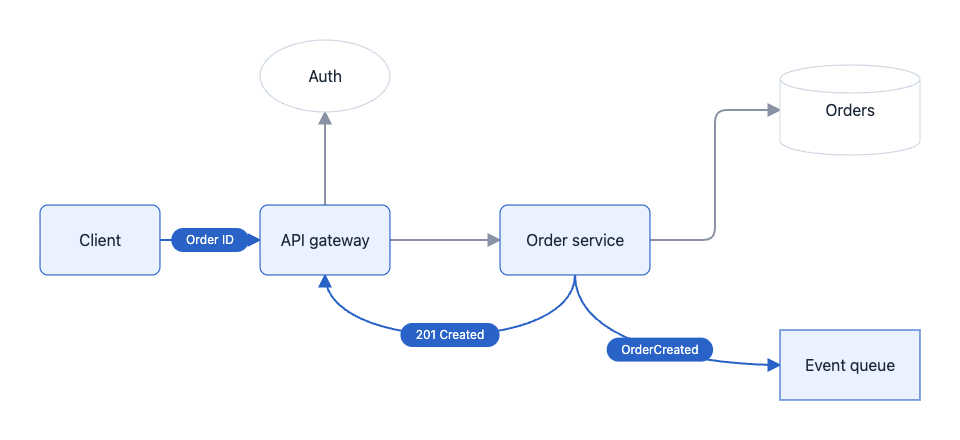
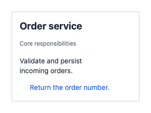
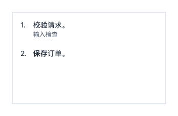
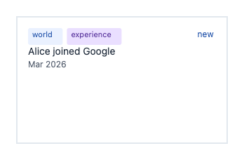
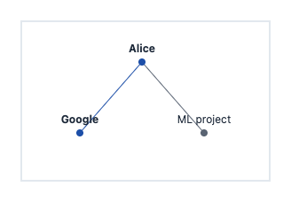
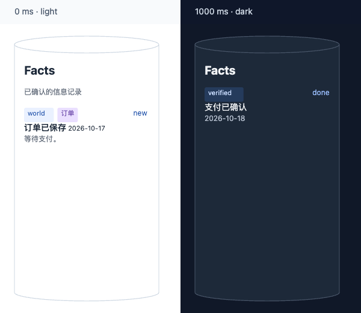

# FlowSVG SDK 使用手册

[English](sdk-guide.md) | 简体中文

> **文档状态：当前入口。** `packages/flowsvg/` 下的公开类型、实现与测试是行为事实来源。本手册是维护中的中文任务路径；验证说明描述可重现的检查方法，不替代当前契约。
>
> **语言同步：** 本手册与英文手册保持相同的章节顺序和公共契约。修改时同步更新两份手册，包括示例、默认值、限制、错误行为和链接。

FlowSVG（流形）将 JSON 或 TypeScript 文档转换为 SVG 动画图解。定义节点、连线、场景与节拍，即可在浏览器播放、导出 SVG、PNG 或 GIF，或分享一个离线 HTML 文件。

SDK 使用 ESM，提供无 DOM 核心及原生浏览器、Vue、React、Web Component 接入。各接入方式共用同一文档和时间线。

[安装](#安装) · [快速开始](#快速开始) · [Vue](#vue-集成) · [React](#react-集成) · [原生浏览器](#原生浏览器) · [Web Component](#web-component) · [文档](#文档与时间线) · [节点内容](#节点内容) · [字号](#文档级字号) · [API](#api) · [诊断](#按需几何风险诊断) · [播放器控件](#播放器控件) · [PNG](#浏览器-png-与-svg-背景) · [GIF](#浏览器-gif-导出) · [Node PNG](#node-png-导出) · [Node GIF / CLI](#node-gif-导出node-20) · [离线 HTML](#离线-htmlnode-20)

## 安装

从 npm 安装：

```sh
npm install flowsvg
```

仅提供 ESM，类型声明随包提供。核心与原生浏览器入口无需框架。核心要求 Node.js 18+ 或兼容 ES2022 的浏览器；播放要求 DOM、SVG 和 `requestAnimationFrame`；框架最低版本为 Vue 3.5、React 18。

浏览器 PNG 和 GIF 导出要求 Canvas 2D、SVG 图像解码与本机已安装的系统字体。GIF 还要求宿主内容安全策略允许 Blob worker。Node 入口及 CLI 要求 Node 20+；生成 HTML 无需浏览器，Node PNG 和 GIF 导出须预装 Chromium 和系统字体。

| 导入路径 | 用途 |
| --- | --- |
| `flowsvg` | 无 DOM 的文档校验、编译、求值、命中与 SVG 导出 |
| `flowsvg/browser` | 原生浏览器播放器 |
| `flowsvg/export` | 浏览器 PNG/GIF 导出、取消与错误；GIF 进度 |
| `flowsvg/node` | Node 20+ 离线 HTML 生成与 Chromium PNG/GIF 导出 |
| `flowsvg/vue` | Vue 组件与实例类型 |
| `flowsvg/react` | React 组件与 ref 类型 |
| `flowsvg/web-component` | 显式注册自定义元素；也可使用 `flowsvg/element` |
| `flowsvg/styles.css` | 控件布局与可见焦点样式 |

## 快速开始

### 1. 创建图解文档

将这个约 6.7 秒的订单流程保存为 `diagram.ts`。后续集成与导出示例均复用此文件。运行 Node 示例前先编译 TypeScript；`.js` 导入路径指向编译后的文件。

```ts
import type { DiagramDocument } from "flowsvg";

export const diagramDocument: DiagramDocument = {
  version: 1,
  title: "订单请求生命周期",
  viewport: { width: 960, height: 440 },
  nodes: [
    { id: "client", kind: "roundedRect", x: 40, y: 205, width: 120, height: 70, label: "Client" },
    { id: "gateway", kind: "roundedRect", x: 260, y: 205, width: 130, height: 70, label: "API gateway" },
    { id: "auth", kind: "ellipse", x: 260, y: 40, width: 130, height: 72, label: "Auth" },
    { id: "orders", kind: "roundedRect", x: 500, y: 205, width: 150, height: 70, label: "Order service" },
    { id: "database", kind: "cylinder", x: 780, y: 65, width: 140, height: 90, label: "Orders" },
    { id: "events", kind: "rect", x: 780, y: 330, width: 140, height: 70, label: "Event queue" }
  ],
  edges: [
    { id: "request", from: "client", to: "gateway", route: "straight" },
    { id: "authorize", from: "gateway", to: "auth", route: "straight", fromPort: "top", toPort: "bottom" },
    { id: "create", from: "gateway", to: "orders", route: "straight" },
    { id: "persist", from: "orders", to: "database", route: "orthogonal", fromPort: "right", toPort: "left" },
    { id: "publish", from: "orders", to: "events", route: "curved", fromPort: "bottom", toPort: "left" },
    { id: "result", from: "orders", to: "gateway", route: "curved", fromPort: "bottom", toPort: "bottom" }
  ],
  scenes: [
    { id: "request", label: "接收与认证", beats: [
      { durationMs: 800, caption: "接收订单请求", actions: [
        { type: "flow", target: "request", direction: "forward", text: "POST" }
      ] },
      { durationMs: 800, caption: "校验访问令牌", actions: [
        { type: "flow", target: "authorize", direction: "forward", text: "Token" }
      ] }
    ] },
    { id: "create-order", label: "创建订单", beats: [
      { durationMs: 1000, caption: "将已认证请求交给订单服务", actions: [
        { type: "flow", target: "create", direction: "forward", text: "Create" }
      ] },
      { durationMs: 1000, caption: "将新订单写入数据库", actions: [
        { type: "flow", target: "persist", direction: "forward", text: "INSERT" }
      ] }
    ] },
    { id: "response", label: "发布事件与响应", beats: [
      { durationMs: 1600, caption: "发布 OrderCreated 事件，同时返回订单号", actions: [
        { type: "flow", target: "publish", direction: "forward", text: "OrderCreated" },
        { type: "flow", target: "result", direction: "forward", text: "201 Created" },
        { type: "flow", target: "request", direction: "reverse", text: "Order ID" }
      ] }
    ] }
  ]
};
```

浅色主题下的最后一拍中段画面：事件与响应消息同时传递，仅高亮当前参与的节点。



### 2. 求值并导出 SVG

```ts
import { createDiagram, renderSvg } from "flowsvg";
import { diagramDocument } from "./diagram.js";

const diagram = createDiagram(diagramDocument);
const frame = diagram.evaluateAt(125);
console.log(diagram.totalDuration, frame.sceneId, frame.warnings);

const svg = diagram.renderSvg(125, { theme: "dark" });
const finalSvg = renderSvg(diagramDocument, diagram.totalDuration);
```

两种调用均返回静态 SVG 字符串。重复查询时复用 `createDiagram`；单次导出用 `renderSvg`。

## Vue 集成

在 Vue 应用中创建组件，`diagram.ts` 与组件放在同一目录：

```vue
<script setup lang="ts">
import { ref } from "vue";
import { FlowPlayer, type FlowPlayerHandle } from "flowsvg/vue";
import type { PlayerErrorDetail } from "flowsvg/browser";
import "flowsvg/styles.css";
import { diagramDocument } from "./diagram.js";

const player = ref<FlowPlayerHandle | null>(null);
const timeMs = ref(0);

function handleError({ error }: PlayerErrorDetail): void {
  console.error(error);
}
</script>

<template>
  <FlowPlayer
    ref="player"
    :document="diagramDocument"
    :speed="1.25"
    :gif-export="true"
    theme="dark"
    @timeupdate="timeMs = $event.timeMs"
    @error="handleError"
  />
  <button type="button" @click="player?.play()">播放</button>
  <button type="button" @click="player?.seek(0)">回到开头</button>
  <output>{{ timeMs }} ms</output>
</template>
```

卸载时自动销毁。脚本中通过 `player.value` 调用方法，模板自动解包 ref。事件直接传入 detail：`stepchange`、`timeupdate`、`playstatechange`、`loopchange`、`error`，也支持对应回调 props。

## React 集成

```tsx
import { useRef } from "react";
import { FlowPlayer, type FlowPlayerHandle } from "flowsvg/react";
import "flowsvg/styles.css";
import { diagramDocument } from "./diagram.js";

export default function DiagramExample() {
  const player = useRef<FlowPlayerHandle | null>(null);

  return (
    <section>
      <FlowPlayer
        ref={player}
        document={diagramDocument}
        speed={1.25}
        gifExport
        theme="dark"
        onError={({ error }) => console.error(error)}
      />
      <button type="button" onClick={() => player.current?.play()}>播放</button>
      <button type="button" onClick={() => player.current?.seek(0)}>回到开头</button>
    </section>
  );
}
```

组件卸载时自动清理资源。回调为 `onStepChange`、`onTimeUpdate`、`onPlayStateChange`、`onLoopChange`、`onError`。

### Vue / React 的参数与更新行为

| Prop | 默认或含义 |
| --- | --- |
| `document` | 必填图解文档；对象引用变化时重新加载，成功后暂停在零时刻 |
| `speed` | 正数倍率，默认 `1`；变化时更新速度 |
| `loop` | 默认 `false`；变化时更新循环模式，不重建或改变时间与播放状态 |
| `theme` | `light` / `dark`；未指定时使用文档主题，最终默认为浅色 |
| `controls` | 默认 `true`，设为 `false` 隐藏内置控件 |
| `gifExport` | 默认 `false`；开启 GIF 进度、取消与下载控件；要求显示播放控件 |
| `reducedMotion` | 未指定时跟随浏览器减少动画偏好 |
| `hoverFill` | 默认 `false`：悬停只高亮边框；设为 `true` 时同时高亮背景和内容 |
| `initialTimeMs` | 仅初次挂载时应用；后续跳转用 `seek` |
| `className` / `style` | 宿主容器样式 |

修改 `theme`、`controls`、`gifExport`、`reducedMotion` 或 `hoverFill` 会重建播放器，暂停在零时刻，不再应用 `initialTimeMs`。更新文档需提供新对象引用。实例暴露[播放器 API](#播放器-api)中的八个方法；挂载前或卸载后调用会抛出错误。

两种入口均支持服务端导入。SSR 输出容器，客户端挂载后创建播放器。服务端图解预览使用 `renderSvg`。

## 原生浏览器

在页面中放置容器：

```html
<div id="diagram" style="width: 100%; height: 360px;"></div>
```

在应用的客户端模块中创建播放器：

```ts
import { createPlayer } from "flowsvg/browser";
import "flowsvg/styles.css";
import { diagramDocument } from "./diagram.js";

const host = document.querySelector<HTMLElement>("#diagram");
if (!host) throw new Error("Diagram host is missing");

const player = createPlayer(host, diagramDocument, { theme: "light", gifExport: true });
player.play();
```

`createPlayer` 替换容器子元素。卸载或复用容器前调用 `destroy()`。原生 HTML 使用包导入路径时，需配置 import map 或构建工具。

## Web Component

先在 HTML 中放置元素，再从客户端模块显式注册：

```html
<flowsvg-player gif-export></flowsvg-player>
```

```ts
import { defineFlowPlayer, type FlowPlayerElement } from "flowsvg/web-component";
import "flowsvg/styles.css";
import { diagramDocument } from "./diagram.js";

defineFlowPlayer();
const element = document.querySelector<FlowPlayerElement>("flowsvg-player");
if (element) element.document = diagramDocument;
```

默认注册 `<flowsvg-player>`，重复注册安全。对象赋给 `element.document`；JSON 字符串赋给 HTML `document` 属性；JSON URL 赋给 `src`。URL 相对页面解析，遵循浏览器 CORS 规则。

支持 `autoplay`、`controls`、`speed`、`theme`、`reduced-motion`、`hover-fill`、`gif-export`、`loop`。默认显示控件，关闭自动播放、循环、悬停背景与 GIF 导出；`controls="false"` 隐藏控件。主题、控件、GIF 及动画/悬停选项变化时保留时间和播放状态；`autoplay` 则直接控制播放或暂停。移除元素会取消请求并销毁播放器，重新连接时使用保留的文档。

方法：`play`、`pause`、`seek`、`step`、`setSpeed`、`setLoop`、`getState`、`destroy`。更换文档使用 `element.document`。挂载前或销毁后，`getState()` 返回 `undefined`。播放与错误事件可冒泡并穿越 Shadow DOM 边界。

请在 DOM 环境注册。无 DOM 导入安全，但该模块实例不能在稍后补上 DOM 后用于注册。

## 文档与时间线

| 文档字段 | 约定 |
| --- | --- |
| `version` | 当前为 `1` |
| `viewport` | 有限且为正的作者 `width`、`height`；可选 `fitHeight: { padding }` 按当前完整画面调整高度 |
| `nodes` | 节点列表，`id`、`kind`、`x`、`y`、`width`、`height` 必填 |
| `edges` | 连线列表，`id`、`from`、`to` 必填；端点引用节点或分组边界 |
| `scenes` | `[]` 表示静态图；场景具有唯一 `id`、`label` 和非空 `beats` |
| `title` / `theme` | 可选标题与 `light` / `dark` 文档主题 |
| `typography` | 可选的节点、连线与流动标记字号，见[文档级字号](#文档级字号) |

节点与连线 ID 全局唯一。形状：`rect`、`roundedRect`、`ellipse`、`cylinder`、`group`；未发布源码还支持 `diamond` 和 `document`。分组边框默认为圆角。`parentId` 指向父分组，子节点坐标相对分组原点。标签为纯文本，`visible` 默认 `true`。节点样式：`fill`、`stroke`、`strokeWidth`、`textColor`、`dashed`（分组边框）；连线样式：`stroke`、`strokeWidth`、`dashed`。颜色使用十六进制 RGB/RGBA，如 `#2563eb`、`#2563eb80`。

路由：`straight`（默认）、`orthogonal`、`curved`。曲线跟随端口切线，不避让其他节点；正交路径默认使用圆角转弯；SVG、流动标记、边界和命中检测共用该几何。圆角按短线段、障碍物与箭头空间收缩。正交路径避开可见普通节点，受阻时固定回退，不保证最短路径或零交叉。`fromPort` / `toPort` 可设为 `top`、`right`、`bottom`、`left`。箭头空间允许时，正交路径优先将跨接线段放在节点间隔中点；相同朝向的端口优先使用单一外侧通道，并为双方各自的祖先分组边框预留空间，共同祖先分组不推动通道外移。正交路径保留向外的端点线段，并按求值后的线宽为箭头预留直线末段；相邻节点空间不足时缩短预留距离。同一目标侧的曲线和正交入线按来源位置分配独立连接位置，来源位置相同时按文档顺序排列；隐藏连线仍保留位置。连接位置限制在该侧的中央区域，节点过小或入线过多时仍需增加空间。曲线端口决定切线。省略时按中心连线主方向选择，椭圆端点位于轮廓。普通标签按估算宽度换行；高度溢出时仍显示全文，并报告 `text-overflow`。

连线可连接节点或分组边界。分组端点跟随当前几何和显式端口；祖先隐藏时遮蔽连线。传递默认高亮端点分组，不联动子节点；`highlightParticipants: false` 关闭传递引起的端点高亮。分组边框不作为布线障碍。

### 节拍与动作

每个节拍包含作者设置的时长 `durationMs`（正数）和 `actions`，可选 `transitionMs` 与 `caption`。过渡时长默认 `min(250, durationMs)`，文档取值范围为 `[0, durationMs]`，编译时限制在实际节拍时长内；`caption` 省略时继承前文，空字符串可清空。

| 动作 | 示例或可更新字段 |
| --- | --- |
| `show` / `hide` | `{ type: "show", target: "service" }`，作用于节点、分组或连线 |
| `highlight` / `unhighlight` | 改变高亮层，取消高亮后显示最新普通样式 |
| `flow` | `{ type: "flow", target: "request", direction: "forward" }`；在一个节拍内让标记沿连线移动。`direction` 为 `forward` 或 `reverse`，不会改变静态箭头方向；添加 `text: "请求"` 显示水平文字胶囊，省略 `text` 显示实心圆点。`highlightParticipants` 默认 `true`；设为 `false` 时保留标记和连线高亮，关闭自动端点高亮。 |
| `updateNode` | `value` 支持 `x`、`y`、`width`、`height`、`label`、`content`、`fill`、`stroke`、`opacity` |
| `updateEdge` | `value` 支持 `label`、`stroke`、`strokeWidth`、`opacity` |
| `focus` | `target` 为节点/分组 ID；`null` 恢复当前完整画面 |

`updateNode.value.content` 在节拍起点整体替换内容，不受过渡时长影响，结果继承到后续节拍与场景。`label` 切换到普通标签，`content` 切换到节点内容；`content: null` 清空任一模式，不恢复旧标签或改变尺寸。同一节拍同时赋值两种模式或重复赋值会报告字段路径错误。

场景共用毫秒时间线，继承前一场景的最终状态。文字在节拍起点切换，插值属性在过渡期变化。节拍左闭右开，最终时间返回完成画面。隐藏节点/分组会遮蔽关联连线，重新显示时恢复各连线保存的显隐状态。

每拍可在多条不同连线上各传递一次。单条流动动画以 180 图解单位/秒为目标速度，移动时间至少为 400 ms。标记到达后统一停留 500 ms。实际节拍时长为移动时间加 500 ms，替代作者 `durationMs`，后续节拍随之调整。较长的阅读时间使用独立的无传递节拍。SDK 按节拍目标画面中的路由长度确定时长，包含继承的更新、分组位置、端口、障碍和描边宽度。布局移动时，标记使用该参考时长沿当前路径移动；镜头缩放会改变屏幕速度。多条流动动画继续共用作者 `durationMs` 内的线性进度，因此路径越长，移动越快。500 ms 到达区间以 1 倍速计。全局播放倍率同时影响移动、到达停留和独立阅读节拍。标记和端点临时高亮在拍末消失，下一拍提供新的一组传递；显式高亮和普通样式继续继承。`highlightParticipants: false` 让显式动作决定节点高亮，不关闭标记或连线临时高亮。

单条传递的发送端立即高亮。到达后，接收端的填充色和描边色用 200ms 渐入；节点和连线的自动高亮随后保持 100ms，再用 200ms 渐出，拍末进入下一拍。反向传递交换发送端和接收端。逻辑 `highlighted` 标志和标记在整拍内生效；内容、几何和显式动作保留作者设定的时机。显式高亮优先，`highlightParticipants: false` 关闭自动端点着色。减少动画模式跳过渐入和渐出，保留 500ms 到达区间；多条传递保留原有同步时序与着色。播放倍率随时间轴缩放渐变，SVG 和导出求值相同的颜色。

传递 `text` 按纯文本转义，始终水平，胶囊宽度按固定规则估算。文字不替换连线标签，也不产生独立交互目标；空字符串仍显示胶囊。

设置 `viewport.fitHeight: { padding: 24 }` 后，SDK 按当前可见节点、连线、文字及活动传递标记的绘制范围，加底部内边距确定完整画面高度。`padding` 须为有限非负数。镜头保持 `(0, 0)` 原点和作者宽度，高度向上取整为整数图解单位。空画面使用作者高度。浏览器宽高比和静态 SVG 跟随求值后的镜头；节点尺寸和位置仍由作者定义。显式聚焦保留作者视口的宽高比和边界；清除聚焦后恢复当前自适应完整画面。求值过程中无法表示的高度会抛出 `DiagramValidationError`。

## API

### 核心 API

从 `flowsvg` 导入：

| API | 返回与行为 |
| --- | --- |
| `validateDocument(input: unknown)` | 返回 `{ path, message }[]`；空数组表示作者数据的结构和数值检查通过 |
| `createDiagram(document)` | 校验、复制并编译，返回 `Diagram`；非法文档抛出 `DiagramValidationError` |
| `renderSvg(document, timeMs = 0, options?)` | 一次性编译并导出静态 SVG 字符串 |
| `diagram.totalDuration` | 包含单条流动动画移动和到达停留的全局总时长，静态文档为 `0` |
| `diagram.beats` | 冻结的有效区间：`{ sceneId, beatId, beatIndex, startMs, endMs, caption? }`；导航和导出按此安排时间。`beatIndex` 为场景内索引，说明文字包含继承结果 |
| `diagram.evaluateAt(timeMs, options?)` | 返回 `DiagramFrameState` |
| `diagram.diagnoseAt(timeMs, options?)` | 按需返回 `GeometryWarning[]`，不重复返回文字溢出 |
| `diagram.renderSvg(timeMs = 0, options?)` | 导出相同求值结果的 SVG |
| `diagram.hitTest(timeMs, point, options?)` | 在文档坐标中返回 `{ id, type: "node" \| "edge" }` 或 `null` |
| `measureNodeContent({ kind, width, content, typography? })` | 返回推荐的固定高度及各内容版本未解决的溢出诊断，见[内容尺寸测量](#生成文档前测量节点内容) |
| `measureNodeLabel({ kind, width, label, typography? })` | 未发布：测量预置形状标签的共用高度与宽度诊断，见[决策标签](#决策标签与测量)。 |
| `wrapText(label, maxWidth, typography?)` | 按固定字宽估算换行，返回文本行数组 |

`validateDocument` 检查作者数据的结构和数值。编译时，SDK 还会在对应节拍的 `durationMs` 路径报告非有限的移动时长或累计时间，并抛出 `DiagramValidationError`。输入文档保留作者设置的时长。

`EvaluateOptions`：`{ theme?: "light" | "dark"; reducedMotion?: boolean }`。时间限制在 `[0, totalDuration]`，非有限值按零处理。命中跳过隐藏/零透明度对象，依次检查普通节点、连线、分组背景。

`DiagramFrameState` 包含时间、场景/节拍 ID、进度、求值后的节点/连线、镜头、说明文字及警告。坐标为绝对坐标。静态图的场景/节拍 ID 为 `null`；节拍 ID 为 `${scene.id}:${beatIndex}`，索引从零开始。活动连线的 `flow` 提供方向、进度、位置及可选文字；拍末、隐藏或减少动画时不显示标记。

类型及成员 JSDoc 随包提供：`DiagramDocument`、`DiagramNode`、`DiagramEdge`、`Scene`、`Beat`、`DiagramBeat`、`Action`、`Diagram`、`DiagramFrameState`、`EvaluateOptions`、`ValidationIssue`、`LayoutWarning`、`GeometryWarning`、`GeometryWarningCode`、`TextOverflowWarning`。

### 按需几何风险诊断

```ts
const risks = diagram.diagnoseAt(500, { theme: "light", reducedMotion: false });
for (const risk of risks) {
  console.log(risk.code, risk.path, risk.objectId, risk.relatedObjectIds, risk.warningKey);
}
```

`diagnoseAt` 采用 `evaluateAt` 的时间范围与视觉选项，只返回 `edge-node-overlap`、`label-node-overlap`、`label-overlap`。普通求值、SVG 渲染及播放器不运行新增成对检查。`frame.warnings` 继续提供独立的 `text-overflow`。

SDK 使用有效镜头中的可见部分。普通节点、分组和边标签可溢出所属形状；结构化文字先按 `safeArea` 裁剪。同一行的 span 共用一个标签身份，透明 span 之间的空白不合成可见文字。同一普通边标签的不同文字行比较前景文字区域，共享的背景描边本身不构成内部冲突；与其他字段、对象或节点的背景描边检查仍保留。标签与自身或祖先容器的合法重叠不提示；分组标题遮挡子节点仍提示。连线路径排除端点节点和分组边界，边标签没有端点豁免。隐藏、零透明度和全透明图元不参与；透明填充的可见描边、半透明图元和边标签底色描边仍参与。传递标记胶囊、内容图形和播放器说明文字不属于标签检查范围。

填充先做包围盒筛选，再按矩形、圆角、椭圆和圆柱的实际轮廓判断。曲线路径复用 SDK 采样：普通三次曲线 32 段、分离曲线每段 16 个采样区间、正交圆角 16 段。弯曲节点描边使用每周 256 个轮廓区间，保留圆柱顶盖与内部横线；矩形描边保留方形接角。接触容差为 `1e-6` 图解单位。有限采样、文字矩形估算及不逐像素分析虚线间隙可能漏报或提示实际像素未遮挡的风险；警告不证明最终绘制层的像素遮挡，也不保证连续动画无碰撞。实际交付仍须按目标尺寸查看。

每条结果包含 `code`、`path`、`objectId`、`relatedObjectIds`、`warningKey`、`message`。`warningKey` 为带版本的规范 JSON 数组编码：`["flowsvg-layout-warning", 1, code, left, right]`。参与项包含对象类型、ID、角色、字段路径及文字行/子对象位置。标签对按参与项编码排序；标签与节点、路径与节点保留角色方向。同一对象不同字段或文字行保留不同身份，同一标签行的多个 span 不产生重复警告。同一节点内部的两行也可能产生警告，相关对象 ID 可以与 `objectId` 相同。说明文字、坐标、时间及视觉选项不参与 key。调用方应另外绑定源字节哈希、SDK 身份、时间和视觉选项，才能记录某一次风险的决定。SDK 不自动移动、隐藏或修改对象。

### 播放器 API

从 `flowsvg/browser` 导入 `createPlayer(host, document, options?)`。`PlayerOptions` 包含核心视觉选项以及 `controls?: boolean`、`loop?: boolean`、`gifExport?: boolean` 和 `hoverFill?: boolean`。

| 方法或属性 | 行为 |
| --- | --- |
| `element` | 创建时传入的宿主元素，也是事件目标 |
| `play()` / `pause()` | 播放或保留当前画面并暂停；静态图不会开始播放；循环模式允许从终点重新开始 |
| `seek(timeMs)` | 限制到时间线范围；保留播放状态，抵达终点时暂停 |
| `step(1)` / `step(-1)` | 暂停并跳到相邻节拍起点；节拍中途后退到本拍起点，在起点后退到上一拍 |
| `setSpeed(speed)` | 设置有限正数倍率，忽略非法值 |
| `setLoop(loop)` | 更新循环模式，保留时间位置和播放状态 |
| `load(document)` | 成功后暂停并回到零；校验失败时发出 error，保留原文档、时间和播放状态 |
| `getState()` | 返回 `PlayerState`：`timeMs`、`totalDuration`、`playing`、`loop`、`speed`、`frame` |
| `destroy()` | 幂等清理 DOM、监听器与调度；之后停止事件，状态仍可读取 |

创建时暂停在零时刻，默认显示控件。页面隐藏时暂停，恢复后保持暂停；循环默认关闭，播放在终点停止。设置 `loop: true` 或点击 **Loop** 后循环整条时间线，保留经过时间的余量和速度。手动跳到终点或单步操作仍暂停；循环开启时，在终点点击播放会从头开始。成功加载文档保留循环偏好，并暂停在零时刻。静态图禁用时间控件。框架实例提供表中方法，但不暴露 `element` 和 `destroy`。

悬停高亮节点边框，也适用于分组。`hoverFill: true` 同时高亮背景与内容。移出时清除悬停，保留传递与显式高亮。指针取消、文档替换和销毁也会清除悬停。`PlayerState.frame` 和静态 SVG 不含悬停。

### 事件

原生播放器在宿主元素上派发 `CustomEvent`：

| 事件 | `detail` |
| --- | --- |
| `timeupdate` | 当前 `PlayerState`，画面更新后发送 |
| `stepchange` | 当前 `PlayerState`，场景或节拍改变时发送，早于该次 timeupdate |
| `playstatechange` | 当前 `PlayerState`，播放/暂停状态变化时发送 |
| `loopchange` | 当前 `PlayerState`，仅在循环模式变化时发送 |
| `error` | `PlayerErrorDetail`：保留的播放器状态与 `error` |
| `hover` / `click` | `PlayerInteractionDetail` 或 `null`；也提供 `objecthover` / `objectclick` 同义事件 |

交互 detail 包含 `id`、`type`、`point`（文档坐标）、`timeMs`、`sceneId`、`beatId`，未命中为 `null`。包装层转发五类播放/错误事件；Web Component 挂载前的错误可能没有播放器状态。

指针移动会发送 `hover`；画面更新导致未移动的指针命中其他对象时也发送。移出或取消时发送 `null`。

```ts
import type { PlayerEventMap } from "flowsvg/browser";

function handleTimeUpdate(event: Event): void {
  const { detail } = event as PlayerEventMap["timeupdate"];
  console.log(detail.timeMs, detail.frame.caption);
}

player.element.addEventListener("timeupdate", handleTimeUpdate);
```

上例沿用原生集成创建的 `player`。宿主自行添加的监听器由宿主移除。

## 播放器控件

### 默认接入

播放器默认提供播放/暂停、前后节拍、进度、场景、速度和 Loop 循环控件，无需自行创建按钮或菜单。在应用入口引入一次默认 CSS，即可获得完整的控件布局、颜色和交互反馈：

```ts
import { createPlayer } from "flowsvg/browser";
import "flowsvg/styles.css";
import { diagramDocument } from "./diagram.js";

const host = document.querySelector<HTMLElement>("#diagram");
if (!host) throw new Error("Diagram host is missing");

const player = createPlayer(host, diagramDocument);
```

上例沿用[原生浏览器](#原生浏览器)的容器，初始暂停在零时刻；页面卸载前调用 `player.destroy()`。Vue、React 和 Web Component 同样默认提供控件，只需在对应集成中引入这份 CSS。`controls: false` 隐藏控件；GIF 下载不是默认功能，需要单独开启 `gifExport`。

### 颜色定制

无需修改默认 CSS。把现有五个变量设置在宿主或其祖先元素上，即可调整控件颜色：

```css
#diagram {
  --flowsvg-control-background: #101828;
  --flowsvg-control-color: #f4f7fb;
  --flowsvg-control-border: #64748b;
  --flowsvg-control-accent: #60a5fa;
  --flowsvg-control-focus: #fbbf24;
}
```

这些变量依次控制背景、文字、边框、强调色和键盘焦点颜色，不要求额外的宿主类。控件颜色不改变图解或导出颜色；图解颜色由核心主题和文档样式决定，见[主题与无障碍](#主题与无障碍)。

### 尺寸选择

标准尺寸默认启用，按钮和选择触发器的最小高度为 `2.75rem`（根字号为 16 像素时是 44 像素）。在宿主或祖先元素添加 `flowsvg-compact`，即可使用 `2rem`（同条件下为 32 像素）的紧凑尺寸：

```html
<div id="diagram" class="flowsvg-compact" style="width: 100%; height: 360px;"></div>
```

Vue、React 和 Web Component 也可以放入带有 `flowsvg-compact` 类的容器。移除该类即可恢复标准尺寸。两种尺寸都保留圆角中性控件、浅强调色的播放/暂停按钮，以及悬停、按下、禁用和键盘焦点反馈；窄屏下进度条单独占一行。控件过渡遵循系统的减少动画偏好，控件尺寸不改变图解几何。

### 可选进阶：复用选择菜单

只有在自建宿主设置时才需要此接口；普通播放器接入和换肤无需使用。`flowsvg/browser` 保留 `SelectControl` 和 `SelectChoice` 的公共导出，供宿主复用播放器的菜单样式与键盘交互。

创建 `new SelectControl(document, "Theme", onChange)`，挂载其 `element`，再调用 `render([{ value: "light", label: "Light" }, { value: "dark", label: "Dark" }], "light")`。`SelectChoice` 包含字符串 `value` 和 `label`，同一控件内的选项值必须唯一。回调接收用户请求的值；调用方持有已确认状态，并调用 `render` 同步显示。`render` 的第三个可选布尔参数控制禁用，默认 `false`；空选项列表也会禁用触发器。移除宿主前调用 `destroy()`，释放外部点击监听并移除菜单元素。菜单复用已引入的 `flowsvg/styles.css`，以及上述颜色变量和尺寸类。

## 决策标签与测量

此项是尚未发布的源码新增能力，不属于已发布的 0.2.3。`diamond` 仅支持纯文本 `label`，拒绝结构化 `content`，包括空内容块。时间线 `content: null` 保留既有清空语义。四个顶点位于四边中点，居中内接矩形取节点宽高的一半，再向内保留每侧 12 个图解单位。标签完整行框整体居中，各行共用相同宽度。

```ts
import { createDiagram, measureNodeLabel } from "flowsvg";

const width = 200;
const labels = ["Ready?", "One\nTwo"];
const measurement = measureNodeLabel({ kind: "diamond", width, label: labels });
const diagram = createDiagram({ version: 1, viewport: { width: 300, height: 300 },
  nodes: [{ id: "decision", kind: "diamond", x: 20, y: 20, width,
    height: measurement.height, label: labels[1] }], edges: [], scenes: [] });
```

此示例返回高度 128，采用尺寸前先检查 `measurement.diagnostics`。本次源码里程碑的 `measureNodeLabel` 接受 `diamond`、`document`、有限正数宽度、单字符串或非空只读标签版本数组，以及可选的现有 `DiagramTypography`。返回 `{ height, diagnostics }`；未解决的宽度诊断包含 `versionIndex`、`path`、`dimension: "width"` 和 `message`。单字符串使用版本索引零。从 `flowsvg` 导入类型 `NodeLabelMeasurementInput`、`NodeLabelMeasurement` 与 `NodeLabelMeasurementDiagnostic`。

多个版本取共同最大高度，包含完整行框。标签行框高为 L 时，菱形高度为 2 × (L + 24)。空标签仍返回带形状留白的正数高度。测量与渲染共享确定性换行，不读取 DOM 字体、不修改输入、不扫描场景。连一个字素也放不下时，按其独占一行测量并保留宽度诊断；增加高度无法解决，请加宽或缩短标签。非法输入或无法表示为有限数的高度通过带有字段/版本位置的 `DiagramValidationError` 报错。

支持中文、显式换行及空行。英文尽量整词换行，超宽单词或 URL 仅在完整字素之间拆分。非空文字超出安全区时裁剪并报告 `text-overflow`，不缩字、不加省略号、不替换源文字、不自动改变节点尺寸。极小正数尺寸合法，非正数或非有限尺寸仍为校验错误；空标签不因安全区为零而溢出。

四方向端口、所有路由类型的自动连接、同侧多入线、命中与诊断遵循真实轮廓。裁剪掉的文字不扩大命中、诊断或自适应高度。分组移动和时间线尺寸变化使用当前几何；时间线仍不可修改节点类型。SVG、播放器和导出共享核心结果。旧形状及 `measureNodeContent` 保持原行为。SDK 附带英文决策分支示例，覆盖测量后的更新和有意溢出。

## 文档形报告标签

未发布的 `document` 预置形状仅用纯文本 `label` 表达报告或文件产物，拒绝结构化 `content`，包括空内容块；时间线 `content: null` 仍可清空文字。顶边及两侧为直线，底部波浪带高度 B = min(height / 4, 24)，单位为图解单位。每侧内边距为 12，标签安全区为 `(12, 12, max(0, width - 24), max(0, height - B - 24))`。标签在波浪带上方整体居中，沿用决策标签的完整字素换行、裁剪和溢出诊断规则。

`measureNodeLabel({ kind: "document", width: 240, label: ["Report ready", "Revenue\nBy region\nFinal report"] })` 返回高度 108。完整行框高度为 L、T = L + 24 时，T ≤ 72 的建议高度为 4T/3，否则为 T + 24。采用建议高度后仍需处理宽度诊断。端口、命中与诊断均沿真实波浪轮廓计算，波浪凹入处下方的空白不属于节点。见[报告生成示例](../../packages/flowsvg/examples/report-generation.json)，其中包含分组运动、尺寸变化、标签替换及刻意溢出。

## 文档级字号

图解文档的可选 `typography` 接受 `nodeLabel`、`edgeLabel` 和 `flowLabel`，默认分别为 16、14、12。字号使用图解单位，不是 PNG 像素或 PPT 点数。每个字段独立使用默认值。

```ts
import { createDiagram, measureNodeContent, type DiagramTypography, type NodeContent } from "flowsvg";

const typography: DiagramTypography = { nodeLabel: 32, edgeLabel: 24, flowLabel: 20 };
const content: NodeContent = { blocks: [{ type: "paragraph", text: "供演示文稿使用的说明" }] };
const { height, diagnostics } = measureNodeContent({ kind: "rect", width: 480, content, typography });
const diagram = createDiagram({ version: 1, viewport: { width: 1280, height: 720 }, typography,
  nodes: [{ id: "note", kind: "rect", x: 40, y: 40, width: 480, height, content }], edges: [], scenes: [] });
// 检查 diagnostics 和 diagram.evaluateAt(0).warnings，再按目标展示尺寸查看 SVG。
```

普通节点和分组标题使用节点字号；边标签使用边字号。换行、行高、估算边界、节点标签命中和绘制共用同一组指标。传递标记文字保持单行，胶囊宽高、基线及 `fitHeight` 边界随有效字号改变，且不新增交互目标。

既有形状的标签、边标签和 `wrapText` 保留完整的拉丁字母单词，包括单词内的撇号和连字符。行宽不足时在单词之间换行；单个单词超宽时保留全文，允许超出估算行宽。其他文字沿用按 Unicode 码点换行的规则，并保留显式空行。纯竖向连线标签以两个端点中较窄节点的宽度作为水平排字范围。字号不自动缩小；标签发生遮挡时，请增加节点间距或节点宽度。GIF 说明文字按实际字体宽度排版，并使用相同的拉丁字母单词边界。说明文字中的单词超宽时报告 `caption-overflow`；请增加导出宽度或缩短说明文字。

结构化内容的默认标题、正文、辅助文字、文字标签、状态及实体图标签字号按 `nodeLabel / 16` 调整。显式块、列表、条目和 span 字号按原有继承顺序保留。内容仍使用现有行高规则：`max(20, 当前行最大字号 × 1.35)`。节点宽高、实体图坐标及固定块高、padding 和 gap 不自动改变；重新测量后仍须处理宽度不足和固定实体图块内部溢出。多个内容版本测量取最大所需高度。

字号变化不会改变场景、节拍或实际编译时长。随后显式修改节点尺寸或位置可能改变路径长度，因此应重新读取 `diagram.beats`。核心、浏览器播放器、portable HTML、React、Vue、Web Component 与 GIF 共用上述规则。

PPT 素材的创作起点可用 1280×720、32/24/20；Web 正文插图可用 960×600、20/18/16。SDK 保存具体尺寸与字号，导入图解不会自动应用用途预设。仍须在目标展示尺寸下检查文字。

有限正数字号仍可能让派生行高、整段文字宽度或胶囊尺寸溢出。校验、编译或求值会抛出 `DiagramValidationError`，通过 `typography.nodeLabel`、`typography.edgeLabel` 或 `typography.flowLabel` 定位；请减小相关字号或缩短文字。内容测量共用相同验证与解析规则。

## 主题与无障碍

主题：显式选项 → 文档主题 → 浅色，核心不读取系统偏好。浏览器动画默认跟随 `prefers-reduced-motion`，核心默认正常动画。减少动画会立即完成过渡并隐藏传递标记，保留总时长。

两种主题都使用中性边框和蓝色高亮。文档样式覆盖普通颜色，时间线与悬停高亮叠加在其上。显式内容颜色和标签底色保持不变。图解文字使用系统字体，并提供中文字体回退。

画布聚焦后，Space 播放/暂停，方向键逐拍移动；进度条保留原生按键。场景和速度使用自定义选择框：方向键展开并移动，Home/End 移到首项或末项，Enter/Space 确认，Escape 取消，Tab 关闭菜单并继续移动焦点。输入单个字符可高亮匹配项。点击外部区域关闭菜单。说明文字使用礼貌播报区，SVG 提供可访问名称。

## 校验与错误

校验拒绝未知字段、错误引用、循环分组、重复节拍赋值、非法颜色和尺寸/时长。文本按纯文本转义。检查外部 JSON 时，调用 `validateDocument` 并读取各条 `path`、`message`。

`createDiagram` 和首次 `createPlayer` 遇到非法文档会抛出 `DiagramValidationError`，`issues` 包含字段路径。后续 `load` 失败时发送 `error`，保留旧状态。文字溢出不阻止渲染，可读取 `frame.warnings`。

## 内置 GIF 下载

四种宿主均接受 `gifExport: true`；Web Component 的 HTML 属性为 `gif-export`，元素对象属性为 `gifExport`。前面的宿主集成示例开启 GIF 下载，默认接入示例保持关闭。该选项默认 `false`；`controls: false` 同时隐藏 GIF 控件。首次点击导出才加载浏览器导出模块，普通导入与播放不加载该模块。

点击 **Export GIF**，按完整时间线、1×、任务开始时已解析的主题及默认设置导出。控件显示进度、**Cancel export**、完成和可读错误；成功时下载安全处理后的文档标题文件名，无标题时用 `FlowSVG.gif`。播放、调速与跳转独立运行；GIF 不包含控件或悬停效果。

每个播放器最多一个任务。成功加载新文档时，旧任务继续使用固定的文档和主题；后续修改输入对象不改变快照。销毁播放器、卸载组件或因选项变化重建宿主时取消其任务，并阻止后续下载。取消或失败后可重试。需要自定义设置或程序化错误处理时，使用下面独立的 `exportGif` 函数。

## 浏览器 PNG 与 SVG 背景

从 `flowsvg/export` 导入 `exportPng`，返回完整可解码 `Uint8Array`，不自动下载，也不改变播放器状态。

```ts
import { createDiagram } from "flowsvg";
import { exportPng } from "flowsvg/export";
import { diagramDocument } from "./diagram.js";

const compiled = createDiagram(diagramDocument);
const png = await exportPng(diagramDocument, {
  timeMs: compiled.totalDuration, width: 1280,
  theme: "light", background: "transparent", reducedMotion: false,
  signal: new AbortController().signal
});
const svg = compiled.renderSvg(compiled.totalDuration, { background: "transparent" });
```

`timeMs` 默认 0，拒绝非有限数、负数与超出实际编译时长的时间；静态图仅接受 0。`reducedMotion` 默认 false，保留所选时间的传递标记及过渡。显式 true 沿用已有求值含义，不改变时间线。导出不附加播放器控件、标题栏或说明文字区，不自动裁边。

`width` 为有限正数，默认文档 `viewport.width`，取整且至少为 1。高度按取整宽度和所选有效 camera 比例计算，取整且至少为 1。PNG 保留 `fitHeight` 与 focus。每边上限为 8192 像素，总像素上限为 32,000,000；按取整后尺寸在资源分配前检查，拒绝超限，不自动缩小。这些限制独立于 GIF。

`background` 默认为 `theme`。`transparent` 同时去除 SVG 整图底色和 canvas 初始底色，保留节点填充、边标签可读性背景与其余图形。核心 `renderSvg` 的 `SvgRenderOptions` 接受相同字段，保持无 DOM；普通求值时间的 clamp 合同不变。GIF 仍是不透明输出。

`PngExportError.code` 区分 `options`、`document`、`limit`、`environment`、`rasterization`、`encoding` 和 `cancelled`。浏览器需 Canvas 2D、SVG 图像解码和本机系统字体。调用在首个异步步骤前固定输入；成功、失败与取消均释放任务 canvas、图像及 URL。普通 SDK 与播放入口不提前加载 PNG 栅格化代码；portable `FlowSVGExport.exportPng` 使用同一实现。首批只提供 SDK API，播放器没有 PNG 按钮。

## 浏览器 GIF 导出

需要导出时，导入独立浏览器入口：

```ts
import { exportGif } from "flowsvg/export";
import { diagramDocument } from "./diagram.js";
const controller = new AbortController();
const bytes = await exportGif(diagramDocument, {
  theme: "dark",
  includeCaptions: true,
  signal: controller.signal,
  onProgress: ({ phase, completed, total }) => console.log(phase, completed, total)
});
// 应用自行保存或下载 bytes。任务未完成时可调用 controller.abort() 取消。
```

`exportGif` 返回 `Promise<Uint8Array>`，在调用时固定文档与选项快照。播放与下载由应用控制。输出不透明，文字使用本机已安装的系统字体。worker 负责调色板量化和编码。

进度阶段为 `preparing`、`sampling`、`encoding` 和 `complete`。从同一入口导入 `GifExportError`，可读取 `code`：`options`、`limit`、`document`、`caption-overflow`、`environment`、`rasterization`、`encoding` 或 `cancelled`。错误消息说明处理方法。

限制：动画有效时长最多 120 秒、采样最多 1800 帧、编码最多 1801 帧（含长停留拆分），最终长边（含说明区域）最多 1920px。超限时，按对应限制缩短时长、降低帧率或减小尺寸。

### GIF 选项

| GIF 选项 | 契约 |
| --- | --- |
| `startMs`、`endMs` | 编译后时间线的毫秒数，默认完整时间线。须满足 `0 <= startMs < endMs <= 总时长`；静态文档仅接受零。片段继承此前场景状态。普通采样不含终点；中间片段停留显示终点前画面，整体终点显示完成状态。 |
| `speed`、`fps` | 速度须为正有限数，默认 1；帧率须为 1–30 的整数，默认 15。动画有效时长为源区间时长除以速度。GIF 延迟按累计百分之一秒取整，避免逐帧误差累积。 |
| `width` | 正数图解宽度，四舍五入为像素；默认 `min(viewport.width, 1280)`，不放大。高度保持作者视口比例，说明区域在下方增加高度。GIF 帧忽略 `viewport.fitHeight`，保持像素尺寸和图解比例稳定。 |
| `includeCaptions`、`captionHeight` | 默认开启说明区域，高 80px。非负高度四舍五入为像素。系统字体 16px，行高 22px，水平内边距 16px、垂直内边距 12px。自动换行保留显式换行。采样前测量所有有效说明；溢出报告场景/节拍，应增加空间、缩短文字或关闭说明。 |
| `loopCount` | 默认 0 表示无限循环；1–65,536 的整数表示总播放次数，1 只播放一次。超过上限时明确报错。 |
| `finalHoldMs` | 有限非负额外延迟，默认 1000ms；零不增加延迟，但保留零延迟的整体完成画面。静态输出至少显示 10ms。长停留按 GIF 16 位延迟拆帧，计入 1801 编码帧上限。 |
| `theme`、`reducedMotion` | 主题依次采用显式选项、文档主题、浅色。默认完整动画，不继承系统减少动画偏好。显式 `reducedMotion: true` 立即完成过渡并隐藏传递标记，保留时间线时长。 |
| `signal`、`onProgress` | AbortSignal 取消任务并释放任务资源。回调报告阶段、完成数及总数；取消的任务不报告完成。 |

非法运行时值、空或越界区间及可计算的资源超限，会在分配画布或采样前报错。说明溢出使用 `GifExportError.code === "caption-overflow"`，不静默裁剪或缩字。GIF 调色量化和本机系统字体允许不同环境间的像素差异。

## Node PNG 导出

```ts
import { exportPng } from "flowsvg/node";
import { writeFile } from "node:fs/promises";
import { diagramDocument } from "./diagram.js";

const png = await exportPng(diagramDocument, {
  executablePath: "/path/to/installed/chromium",
  timeMs: 0,
  width: 1280,
  background: "transparent"
});
await writeFile("diagram.png", png);
```

Node PNG 复用 `flowsvg/export` 的浏览器导出实现及图片选项。需要 Node 20+ 和已安装的 Chrome/Chromium。`executablePath` 与 Playwright `browser` 互斥。SDK 不下载浏览器，导出 context 处于离线状态。

入口在异步操作前保存文档与选项快照。非法文档、选项及超出像素限制的请求在浏览器分配前失败。成功、失败和取消均释放任务 context、自建 browser 及临时文件，包括取消后才取得的资源。传入的 browser 仍由调用方持有并保持打开。启动、临时文件和桥接失败使用 `PngExportError.code: "environment"`；浏览器栅格化、编码和取消保留各自的错误代码。API 返回字节，调用方负责保存文件。SDK CLI 不提供 PNG 命令。

## Node GIF 导出（Node 20+）

Node 入口在隔离的 Chromium context 中运行同一导出器。断网前须准备 Chromium、系统库和字体。安装包和调用导出函数都不会下载浏览器。使用已有 Chromium 时，按下例设置 `executablePath`。也可显式安装匹配的浏览器：

```sh
npm install playwright-core@1.58.2
npx --no-install playwright-core install chromium
```

在受支持的 Linux 系统中，给安装命令添加 `--with-deps` 可准备系统库。字体须单独安装。

```js
import { exportGif } from "flowsvg/node";
import { diagramDocument } from "./diagram.js";
import { writeFile } from "node:fs/promises";
const bytes = await exportGif(diagramDocument, {
  executablePath: "/path/to/installed/chromium",
  theme: "dark", fps: 15, loopCount: 1,
  onProgress: ({ phase, completed, total }) => console.log(phase, completed, total)
});
await writeFile("diagram.gif", bytes);
```

浏览器导出的全部选项、进度阶段、错误代码及 `AbortSignal` 取消契约同样适用。可以用 `browser` 传入已经启动或连接的 Playwright `Browser`，包括通过 `chromium.connectOverCDP` 获得的会话。`browser` 与 `executablePath` 二选一，同时传入会报告选项错误。函数在成功、失败和取消时关闭自己创建的 context、页面与浏览器，保留传入的浏览器及用户页面。函数返回字节，不写文件。

CLI 读取 `DiagramDocument` 格式的 JSON 文件，不接受 TypeScript 源文件：

```sh
npx --no-install flowsvg diagram.json --output diagram.gif --format gif --executable-path /path/to/chromium --width 640 --fps 15 --loop-count 1
```

GIF 命令行选项对应 [GIF 选项](#gif-选项)：`--theme`、`--start-ms`、`--end-ms`、`--speed`、`--width`、`--fps`、`--no-captions`、`--caption-height`、`--loop-count`、`--final-hold-ms`、`--reduced-motion` 和 `--executable-path`。运行 `npx --no-install flowsvg --help` 查看用法。进度输出到 stderr。两种格式均默认保留已有文件，指定 `--overwrite` 才覆盖。失败、SIGINT 或 SIGTERM 取消时以非零状态退出，不发布半成品。

## 离线 HTML（Node 20+）

生成工具将图解数据、播放器和样式内嵌为一个 HTML 文件。接收者可断网通过 `file://` 打开。生成 HTML 不需要浏览器或额外运行依赖。

```js
import { renderHtml } from "flowsvg/node";
import { diagramDocument } from "./diagram.js";
import { writeFile } from "node:fs/promises";
await writeFile("diagram.html", await renderHtml(diagramDocument, { theme: "dark" }));
```

```sh
npx --no-install flowsvg diagram.json --output diagram.html --format html
```

`renderHtml(document, options)` 返回 `Promise<string>`。以下选项均可省略：`theme: "light" | "dark"`、`autoplay: boolean`、`loop: boolean`、`controls: boolean` 和 `gifExport: boolean`。默认采用文档主题或浅色主题，暂停在零时刻并关闭循环，显示播放控件和说明文字。实时循环与 GIF 的 `loopCount` 独立。CLI 读取文档 JSON，接受 `--theme`、`--autoplay`、`--no-controls`、`--gif-export` 和 `--overwrite`。

GIF 导出默认关闭，基础 HTML 不包含编码器。设置 `gifExport: true` 或传入 `--gif-export` 后，生成工具内嵌同版本 GIF 导出器和 worker。接收者可断网通过 `file://` 下载 GIF，查看进度并取消任务，无需旁置脚本、远程字体或网络；所需系统字体须已安装。导出使用完整时间线、1× 速度并包含说明文字。`controls: false` 同时隐藏播放和 GIF 控件。

## 节点内容

### 固定节点内的节点内容

`rect`、`roundedRect`、`cylinder` 支持 `content`；椭圆和分组仅支持普通标签。`content` 与 `label` 互斥，空标签也算声明。`content.blocks` 按顺序排列 `title`、`paragraph`、`list`、`graph` 内容块。段落角色为 `body`（默认）或 `auxiliary`（辅助文字）；空数组只显示形状。

```ts
import type { DiagramNode } from "flowsvg";

const service = {
  id: "service", kind: "rect", x: 24, y: 24, width: 260, height: 312,
  content: {
    style: { padding: 16, blockGap: 14 },
    blocks: [
      { type: "title", text: "Order service" },
      { type: "paragraph", role: "auxiliary", text: "Core responsibilities" },
      { type: "paragraph", text: "Validate and persist incoming orders." },
      { type: "paragraph", text: "Return the order number.", style: { color: "#2563eb", align: "right" } }
    ]
  }
} satisfies DiagramNode;
```

`service` 节点在浅色主题下的渲染结果：



文字字段接受字符串或 `ContentTextSpan[]`：`{ text, style?: { fontSize, fontWeight, color } }`。片段继承内容块样式，对齐由内容块决定。结构化内容换行使用宽度估算，保留显式换行和完整 Unicode 字素，优先在空格处断行，必要时拆分长单词或 URL。普通节点和连线标签遵循[文档级字号](#文档级字号)中的整词规则。

文字样式：有限正数 `fontSize`、100–900 整数 `fontWeight`、十六进制 `color`、`align`（`left`、`center`、`right`）。内容的 `padding`、`blockGap` 为非负有限数。默认值按图解单位计：标题 20/700、正文 14/400、辅助文字 12/400、内边距 16、块间距 14。

列表接受 `marker`（默认 `none`，可选 `bullet`、`number`）、`items` 和 `style`。条目支持 `tags`、`status`、`body`、`auxiliary`、`style`、`auxiliaryStyle`、`statusStyle`。列表样式设置正文样式和非负有限数 `itemGap`（默认 12），条目样式可覆盖。辅助文字默认使用 12 单位弱化色。续行与辅助文字对齐正文。缺省部分不占空间，显式空文字保留一行。

```ts
import type { ContentBlock } from "flowsvg";

const steps: ContentBlock = { type: "list", marker: "number", style: { itemGap: 16 }, items: [
  { body: "校验请求。", auxiliary: "输入检查" },
  { body: [{ text: "保存", style: { fontWeight: 700 } }, { text: "订单。" }] }
] };
```

将 `steps` 放入 300 × 180 的矩形，设置 `content: { blocks: [steps] }`：



文字标签接受 `{ text, style?: { fontSize, fontWeight, color, fill, shape } }`，默认字号 11。标签行从项目左侧开始排列；标签内每行文字根据实际渲染字体的排字宽度，在各自背景内水平居中。`shape` 默认为 `rounded`；设为 `shape: "pill"` 时，圆角随标签最终高度形成胶囊。形状不改变文字排版或主题颜色。列表 `tagGap` 默认 6，须为非负有限数。状态靠右，使用 12 单位强调色；`statusStyle` 支持 `fontSize`、`fontWeight`、`color`。空间不足时，标签换行，状态移至下方。正文、辅助文字随后排列。

```ts
import type { ContentBlock } from "flowsvg";

const records: ContentBlock = { type: "list", items: [{
  tags: [{ text: "world" }, { text: "experience", style: { fill: "#eadfff", color: "#57319b" } }],
  status: "new", body: "Alice joined Google", auxiliary: "Mar 2026"
}] };
```

将 `records` 放入 300 × 180 的矩形，设置 `content: { blocks: [records] }`：



内容保持节点原尺寸，按形状对应的安全区裁剪。溢出时报告带节点 ID、`nodes[index].content` 路径和方向的 `text-overflow`。请增大节点或精简文字；字体不会自动缩小。内容只有节点级交互，不支持内部链接、按钮、图片或 HTML。裁剪文字不扩大命中范围。

`EvaluatedNode.contentLayout` 提供绝对坐标布局与溢出标志。浏览器与静态 SVG 共用该布局；内容不改变端口或路由。

### 生成文档前测量节点内容

`measureNodeContent({ kind, width, content, typography? })` 返回 `{ height, diagnostics }`。从 `flowsvg` 导入函数及 `NodeContentMeasurementInput`、`NodeContentMeasurement`、`NodeContentMeasurementDiagnostic` 类型。`kind` 支持 `rect`、`roundedRect`、`cylinder`；`width` 须为有限正数。`content` 接受一份 `NodeContent`，或包含至少一份内容版本的只读数组。

```ts
import { measureNodeContent, type DiagramNode, type NodeContent } from "flowsvg";

const initial: NodeContent = { blocks: [{ type: "title", text: "Task" }] };
const completed: NodeContent = { blocks: [
  { type: "title", text: "Task" },
  { type: "paragraph", text: "Saved successfully.\nReady for the next step." }
] };
const width = 240;
const single = measureNodeContent({ kind: "roundedRect", width, content: initial });
const shared = measureNodeContent({ kind: "roundedRect", width, content: [initial, completed] });
const task = {
  id: "task", kind: "roundedRect", x: 24, y: 24, width,
  height: shared.height, content: initial
} satisfies DiagramNode;
```

`single.height` 容纳初始内容。`shared.height` 取两份内容版本所需高度的最大值，后续通过 `updateNode.value.content` 替换内容时可以保持节点尺寸稳定。作者须显式提供全部版本；测量不扫描图解文档、场景或节拍。请在生成文档时调用，再将明确的宽高写入节点。需要额外留白或作者侧最小高度时，可使用 `Math.max(minimumHeight, shared.height)` 组合结果。

测量沿用内容已有样式、换行、完整行框、块／项目／标签间距、标签背景内边距、实体图内容块固定高度及形状安全区。合法空内容也返回有限正数高度。测量不修改输入对象或数组。求值和 SVG 共用相同排版；播放器不自动改变节点尺寸。

返回高度后仍须检查 `diagnostics`。每项诊断包含从零开始的 `versionIndex`、例如 `content[1].blocks[0]` 的 `path`、`dimension`（`width` 或 `height`）及 `message`。单份内容的版本索引为 `0`。宽度不足需要增加节点宽度或修改内容。`height` 诊断表示实体图内容越过内容块自身的固定高度，增加外层节点高度无法解决。测量不缩小字号、截断文字、改变宽度或移动实体图节点。非法输入抛出带字段路径的 `DiagramValidationError`，覆盖嵌套内容校验错误和空版本集合。

即使各输入值均为有限数，合计所需高度也可能超出 JavaScript 的有限数值范围。此时测量抛出 `DiagramValidationError`，`issues` 使用 `content[index]` 定位每个受影响的版本。请减小相关字号、内边距、块间距或实体图内容块高度。仍可表示为有限数的高度沿用相同排版规则。

函数不依赖 DOM、浏览器字体、网络或时钟。确定性估算与 SDK 求值及 SVG 排版一致，不承诺任意外部字体的像素级实测精度。

### 节点内的实体关系小图

`graph` 内容块按作者指定的局部坐标绘制无向实体关系图：

```ts
import type { ContentGraphBlock } from "flowsvg";

const entities: ContentGraphBlock = {
  type: "graph", height: 130,
  nodes: [
    { id: "alice", label: "Alice", x: 120, y: 30, highlighted: true },
    { id: "google", label: "Google", x: 50, y: 110, highlighted: true },
    { id: "ml", label: "ML project", x: 190, y: 110 }
  ],
  edges: [{ from: "alice", to: "google" }, { from: "alice", to: "ml" }]
};
```

将 `entities` 放入 280 × 180 的矩形，设置 `content: { blocks: [entities] }`：



`height` 预留固定正数高度。实体中心 `x`/`y` 是相对区域左上角的非负有限坐标。ID 仅在块内唯一，关系端点引用块内 ID。高亮实体使用强调色圆点与粗体；关系两端均高亮时使用强调色。溢出时报告警告，并按父节点裁剪；交互命中父节点。

在节拍起点替换 `content` 可切换实体选中状态。求值后的图形几何可从 `contentLayout.graphs` 读取。

### 编写完整 Facts 时间线

先确定尺寸，再排列内容块。记录用无标记列表，能力清单用圆点，步骤用编号。下例可用于全部四种接入方式：

```ts
import { createDiagram, type DiagramDocument, type NodeContent } from "flowsvg";

const facts: NodeContent = { blocks: [
  { type: "title", text: "Facts" },
  { type: "paragraph", role: "auxiliary", text: "已确认的信息记录" },
  { type: "list", marker: "none", items: [{
    tags: [{ text: "world" }, { text: "订单", style: { fill: "#eadfff", color: "#57319b" } }],
    status: "new",
    body: [{ text: "订单已保存", style: { fontWeight: 700 } }, { text: " 2026-10-17", style: { fontSize: 11 } }],
    auxiliary: "等待支付。"
  }] }
] };
const updated: NodeContent = { blocks: [
  { type: "title", text: "Facts" },
  { type: "list", items: [{ tags: [{ text: "verified" }], status: "done", body: "支付已确认", auxiliary: "2026-10-18" }] }
] };
const document: DiagramDocument = {
  version: 1, viewport: { width: 300, height: 480 },
  nodes: [{ id: "facts", kind: "cylinder", x: 24, y: 20, width: 240, height: 440, content: facts }], edges: [],
  scenes: [{ id: "records", label: "记录", beats: [
    { durationMs: 1000, actions: [] },
    { durationMs: 1000, actions: [{ type: "updateNode", target: "facts", value: { content: updated } }] },
    { durationMs: 1000, actions: [{ type: "updateNode", target: "facts", value: { label: "已归档" } }] },
    { durationMs: 1000, actions: [{ type: "updateNode", target: "facts", value: { content: facts } }] },
    { durationMs: 1000, actions: [{ type: "updateNode", target: "facts", value: { content: null } }] }
  ] }]
};
const diagram = createDiagram(document);
console.log(diagram.evaluateAt(1000).warnings);
const svg = diagram.renderSvg(1000, { theme: "dark", reducedMotion: true });
```

左图为 0 ms 的浅色主题初始画面，右图为 1000 ms 的深色主题替换后画面：



分享前检查 `frame.warnings`。优先使用默认内容颜色，保持主题与高亮下的对比度。

## 契约归属

以下入口服务不同读者，保留不同层级的细节：

| 入口 | 负责内容 | 重复边界 |
| --- | --- | --- |
| [已发布包 README](../../packages/flowsvg/README.zh-CN.md) | 自足的 npm 安装路径、共同默认值、限制和错误行为 | 发布包脱离本仓库也必须可用；仓库内的深入说明回到本手册 |
| 本 SDK 手册 | 公共 API、文档模型、时间线、播放、导出和诊断的完整仓库参考 | 详细 SDK 行为和跨宿主链接的主要来源 |
| [宿主 README](../../apps/native-example/README.md)、[React](../../apps/react-example/README.md)、[Vue](../../apps/vue-example/README.md) | 宿主生命周期、开发命令、构建／部署行为和宿主特有的失败处理 | 只摘要编译后时间线，并回链本手册的共同 SDK 规则 |
| [Flow Diagram Skill](https://github.com/yokingma/flow-diagram-skill)（独立项目） | 创作命令、布局计划、报告、版本修订和复核／导出工作流 | 安装单元自带精确 SDK 基线所需的执行资料；SDK 用户无需安装 Skill 即可使用本手册。见[仓库边界](../development/repository-split.md) |

如果文字与行为冲突，以公开类型、实现和测试为事实来源。[文档地图](../README.zh-CN.md)记录语言和文档归属规则。

## License

[MIT](../../packages/flowsvg/LICENSE)。可使用、修改及分发；保留许可证与版权声明。

仓库维护者准备 Chromium 后可运行 `pnpm --filter flowsvg test:browser`。SDK 构建、测试与发布验收使用 SDK 自有输入，无需构建示例工程。
