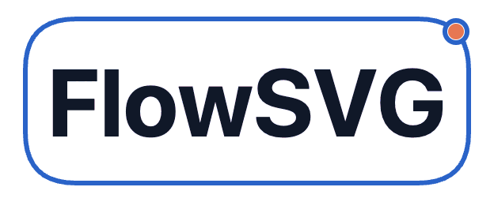

<p align="center">
  
</p>

<p align="center">Declarative SVG diagrams with timeline playback and SVG/PNG/GIF export.</p>

<p align="center">English | <a href="https://cdn.jsdelivr.net/npm/flowsvg@0.4.1/README.zh-CN.md">简体中文</a></p>

<p align="center">
  <a href="https://www.npmjs.com/package/flowsvg"></a>
  <a href="https://www.npmjs.com/package/flowsvg"></a>
</p>

<p align="center">
  <a href="#featured-examples">Examples</a> ·
  <a href="#quick-start">Quick&nbsp;start</a> ·
  <a href="#integrations">Integrations</a> ·
  <a href="#export">Export</a> ·
  <a href="#authoring">Authoring</a> ·
  <a href="#control-playback">Playback&nbsp;API</a> ·
  <a href="https://github.com/yokingma/FlowSVG/blob/main/docs/guides/sdk-guide.md">Full&nbsp;guide</a> ·
  <a href="https://yokingma.github.io/FlowSVG/">Live&nbsp;demo</a>
</p>

Define nodes, edges, scenes and beats in one JSON or TypeScript document. Use the same document in a native browser, Vue, React or Web Component player, or generate standalone offline HTML.

Node positions and dimensions are explicit. FlowSVG renders and animates the layout you author.

## Featured examples

<p align="center"></p>

<p align="center"><em><a href="https://yokingma.github.io/FlowSVG/?example=basic-shapes">Basic shapes</a>: Explore every public node shape, measured labels, orthogonal connections and highlights.</em></p>

<p align="center"></p>

<p align="center"><em><a href="https://yokingma.github.io/FlowSVG/?example=request-response">Request and response</a>: Follow a request through the gateway, authentication and inventory checks to the order service and back.</em></p>

<p align="center"></p>

<p align="center"><em><a href="https://yokingma.github.io/FlowSVG/?example=web-service-deployment">Web service deployment</a>: See two service replicas, health checks and rerouting after a failure.</em></p>

<p align="center"></p>

<p align="center"><em><a href="https://yokingma.github.io/FlowSVG/?example=llm-inference">LLM inference</a>: Follow Transformer layers, causal prefill and KV-cache reuse.</em></p>

## Install

```sh
npm install flowsvg
```

The package provides ESM entries and TypeScript declarations.

| Usage | Requirements |
| --- | --- |
| DOM-free core | Node 18+ or an ES2022-compatible browser |
| Browser playback | DOM, SVG and `requestAnimationFrame` |
| Vue / React | Vue 3.5+ / React 18+ |
| Node export tools | Node 20+; image exports also require prepared Chromium |

## Quick start

Use these examples in an application with package import support, such as a bundled TypeScript project. Run player code on the client after the host element exists.

### 1. Define a diagram

Save as `diagram.ts`:

```ts
import type { DiagramDocument } from "flowsvg";

export const diagram: DiagramDocument = {
  version: 1,
  viewport: { width: 640, height: 240 },
  nodes: [
    { id: "client", kind: "roundedRect", x: 40, y: 90, width: 140, height: 64, label: "Client" },
    { id: "service", kind: "roundedRect", x: 400, y: 90, width: 180, height: 64, label: "Service" }
  ],
  edges: [{ id: "request", from: "client", to: "service", route: "orthogonal" }],
  scenes: [{
    id: "request-response",
    label: "Request and response",
    beats: [
      { durationMs: 1000, caption: "Send request", actions: [
        { type: "flow", target: "request", direction: "forward", text: "Request" }
      ] },
      { durationMs: 1000, caption: "Return response", actions: [
        { type: "flow", target: "request", direction: "reverse" }
      ] }
    ]
  }]
};
```

The request uses a text capsule; the response uses a dot moving in reverse.

- A beat with one `flow` derives its duration from the route length, replacing `durationMs`.
- Read actual boundaries from `createDiagram(diagram).beats`.
- Add a separate no-flow beat for reading time.

### 2. Play in a browser

Add a host to your page:

```html
<div id="diagram"></div>
```

Create the player in a client-side module:

```ts
import { createPlayer } from "flowsvg/browser";
import "flowsvg/styles.css";
import { diagram } from "./diagram.js";

const host = document.querySelector<HTMLElement>("#diagram");
if (!host) throw new Error("Diagram host is missing");

const player = createPlayer(host, diagram, { loop: true });
player.play();
// On disposal: player.destroy();
```

You should see a request travel from Client to Service, followed by a response in reverse. Built-in controls pause, seek, step and change speed.

- **Start:** players begin paused; `play()` starts this example.
- **Repeat:** `loop: true` repeats the whole timeline.
- **Styles:** import the CSS once per application.
- **Cleanup:** call `destroy()` when disposing of a native player.

## Integrations

Use the same `diagram.ts` with either component below. Components start paused and manage player cleanup; press Play to start. Import the CSS once per application.

### Vue

```vue
<script setup lang="ts">
import { FlowPlayer } from "flowsvg/vue";
import "flowsvg/styles.css";
import { diagram } from "./diagram.js";
</script>

<template>
  <FlowPlayer :document="diagram" loop />
</template>
```

For component refs, props and events, see [Control playback](#control-playback).

### React

```tsx
import { FlowPlayer } from "flowsvg/react";
import "flowsvg/styles.css";
import { diagram } from "./diagram.js";

export function Diagram() {
  return <FlowPlayer document={diagram} loop />;
}
```

For refs, callbacks and document updates, see [Control playback](#control-playback).

### Web Component

Add the element to your page, then register it and assign the diagram from a client-side module:

```html
<flowsvg-player loop></flowsvg-player>
```

```ts
import { defineFlowPlayer, type FlowPlayerElement } from "flowsvg/web-component";
import "flowsvg/styles.css";
import { diagram } from "./diagram.js";

defineFlowPlayer();
const element = document.querySelector<FlowPlayerElement>("flowsvg-player");
if (!element) throw new Error("Diagram element is missing");
element.document = diagram;
```

`defineFlowPlayer(tagName = "flowsvg-player")` returns the registered constructor, or `undefined` without a custom-element registry. The same entry is available as `flowsvg/element`.

Supply the document and `emphasis` colors through element properties; use HTML attributes for loop, autoplay and other supported options. See [Web Component](https://github.com/yokingma/FlowSVG/blob/main/docs/guides/sdk-guide.md#web-component) for loading, properties and events.

## Control playback

Native players and Vue/React refs share these methods:

| Task | Methods |
| --- | --- |
| Play or pause | `play()`, `pause()` |
| Move through the timeline | `seek(timeMs)`, `step(1)` / `step(-1)` |
| Change playback | `setSpeed(speed)`, `setLoop(loop)` |
| Read or replace the diagram | `getState()`, `load(document)` |

Native players also expose `element` and `destroy()`. Web Components use the same playback methods but reload through `.document` instead of `load()`.

Players start paused. Replacing a framework component's document reloads it at zero; replacing visual options recreates the player. See [Component props and updates](https://github.com/yokingma/FlowSVG/blob/main/docs/guides/sdk-guide.md#vue--react-props-and-updates) for configuration and [Player API](https://github.com/yokingma/FlowSVG/blob/main/docs/guides/sdk-guide.md#player-api) for handle methods.

### Events

Native players dispatch `CustomEvent`s on `player.element`; Vue handlers and React callbacks receive the detail directly. Web Components dispatch the same playback and error events.

| Event | Vue / React | Detail |
| --- | --- | --- |
| `stepchange` | `onStepChange` | `PlayerState`; scene or beat changed. |
| `timeupdate` | `onTimeUpdate` | `PlayerState`; playback position changed. |
| `playstatechange` | `onPlayStateChange` | `PlayerState`; playing state changed. |
| `loopchange` | `onLoopChange` | `PlayerState`; loop setting changed. |
| `error` | `onError` | `PlayerErrorDetail`, including the retained player state and an `Error`. |

Invalid initial documents throw `DiagramValidationError`. A later `load()` failure emits `error` and keeps the current player state. See [Events](https://github.com/yokingma/FlowSVG/blob/main/docs/guides/sdk-guide.md#events) for ordering, interaction events and framework-specific details, and [Validation and errors](https://github.com/yokingma/FlowSVG/blob/main/docs/guides/sdk-guide.md#validation-and-errors) for validation behavior.

## Export

### SVG in Node or a browser

```ts
import { createDiagram } from "flowsvg";
import { diagram } from "./diagram.js";

const compiled = createDiagram(diagram);
const svg = compiled.renderSvg(0, { background: "transparent" });
```

`svg` is a complete SVG string. Reuse `compiled` to render or evaluate other times in milliseconds. Omitting `background` uses the theme background.

### PNG and GIF in a browser

```ts
import { exportGif, exportPng } from "flowsvg/export";
import { diagram } from "./diagram.js";

const png = await exportPng(diagram, {
  timeMs: 0,
  width: 1280,
  background: "transparent"
});
const gif = await exportGif(diagram, { width: 640, fps: 15 });
```

Both functions return `Promise<Uint8Array>`; await the bytes, then save or download them in your application.

| Format | Browser requirements |
| --- | --- |
| PNG | Canvas 2D and SVG image decoding |
| GIF | PNG requirements plus Blob workers allowed by the host content security policy |

Text uses locally installed system fonts.

### Offline HTML in Node

Node 20+ can generate a single offline player file without Chromium. Save this as `export-html.mjs` in the directory where you ran `npm install flowsvg`:

```js
import { readFile, writeFile } from "node:fs/promises";
import { renderHtml } from "flowsvg/node";

const diagram = JSON.parse(await readFile(
  "node_modules/flowsvg/examples/job-lifecycle.json", "utf8"
));
await writeFile("job-lifecycle.html", await renderHtml(diagram, { loop: true }));
```

```sh
node export-html.mjs
```

Open `job-lifecycle.html` to play the bundled retry, failure and cancellation example. The file embeds the diagram, player and styles and works offline.

Alternatively, use the CLI with any diagram JSON:

```sh
npx --no-install flowsvg node_modules/flowsvg/examples/job-lifecycle.json --format html --output job-lifecycle.html
```

The CLI preserves existing files; pass `--overwrite` to replace one. `renderHtml` accepts `theme`, `emphasis`, `autoplay`, `loop`, `controls` and `gifExport`. Defaults use the document/light theme, start paused with loop off, show controls and omit GIF export assets. See [Offline HTML](https://github.com/yokingma/FlowSVG/blob/main/docs/guides/sdk-guide.md#offline-html-node-20).

### PNG and GIF in Node

`flowsvg/node` also exports `exportPng` and `exportGif`, both returning `Promise<Uint8Array>`.

1. Prepare Chromium and system fonts before going offline; the SDK does not download a browser.
2. Pass either `executablePath` or a caller-owned Playwright `browser`.
3. Save the returned bytes with `writeFile`.

See [Node PNG export](https://github.com/yokingma/FlowSVG/blob/main/docs/guides/sdk-guide.md#node-png-export) and [Node GIF export](https://github.com/yokingma/FlowSVG/blob/main/docs/guides/sdk-guide.md#node-gif-export-node-20) for complete examples and browser installation. The CLI supports HTML and GIF; use the SDK API for PNG.

### Visual options and export limits

Core queries, SVG, PNG and GIF share these visual options:

| Option | Behavior |
| --- | --- |
| `theme` | `"light"` or `"dark"`; defaults to the document theme, then `"light"` |
| `emphasis` | Optional `fill`, `stroke` and `markerText` colors; each field falls back to the document, then the theme |
| `reducedMotion` | Defaults to `false` for core queries and exports; hides flow markers and completes visual transitions without changing timing |

Players also accept `theme` and `emphasis`; their reduced-motion default follows the browser preference. HTML generation accepts `theme` and `emphasis`. See [Themes and accessibility](https://github.com/yokingma/FlowSVG/blob/main/docs/guides/sdk-guide.md#themes-and-accessibility) for color formats, validation and runtime updates.

- **PNG:** select a frame with `timeMs`. Each side is at most 8192 pixels, with at most 32,000,000 total pixels. SVG and PNG accept `background: "transparent"`.
- **GIF:** uses fixed viewport dimensions; animation duration is limited to 120 seconds and the final long edge to 1920 pixels. Browser GIF export requires Blob workers allowed by the host CSP.
- **Player downloads:** set `gifExport: true` with controls enabled to show GIF downloads. There is no built-in PNG button.

See [Browser PNG](https://github.com/yokingma/FlowSVG/blob/main/docs/guides/sdk-guide.md#browser-png-and-svg-backgrounds), [Browser GIF](https://github.com/yokingma/FlowSVG/blob/main/docs/guides/sdk-guide.md#browser-gif-export) and [Built-in GIF downloads](https://github.com/yokingma/FlowSVG/blob/main/docs/guides/sdk-guide.md#built-in-gif-downloads) for defaults, all options, limits and error codes.

## Authoring

- Set node positions and dimensions explicitly. Child coordinates are relative to their parent group.
- Use `scenes: []` for a static diagram. Scenes and beats add playback; a beat with one `flow` derives its duration from the route length. Read effective timing from `createDiagram(document).beats`.
- Use plain `label` for `diamond`, `parallelogram`, `document` and `predefinedProcess`. Measure label versions with `measureNodeLabel` before assigning height.
- Rectangles, rounded rectangles and cylinders support structured `content`: titles, paragraphs, lists, tags and entity graphs. Use `measureNodeContent` to choose a shared height for all content versions, then inspect its `diagnostics`.

Playback uses authored dimensions. Measurement does not automatically resize nodes or resolve width overflow. Text uses system fonts and deterministic width estimates; inspect output at its intended display size, especially with custom fonts or mixed scripts.

See [Documents and timelines](https://github.com/yokingma/FlowSVG/blob/main/docs/guides/sdk-guide.md#documents-and-timelines), [Label measurement](https://github.com/yokingma/FlowSVG/blob/main/docs/guides/sdk-guide.md#decision-labels-and-measurement) and [Node content](https://github.com/yokingma/FlowSVG/blob/main/docs/guides/sdk-guide.md#structured-node-content) for the schema, actions, measurement examples and typography.

## Core API — `flowsvg`

| Entry | Purpose |
| --- | --- |
| `createDiagram(document)` | Validate and compile once; reuse the returned diagram |
| `diagram.evaluateAt(timeMs)` | Read nodes, edges, camera, captions and text-overflow warnings |
| `diagram.renderSvg(timeMs, options?)` | Render a complete SVG string |
| `diagram.hitTest(timeMs, point)` | Find a node or edge at diagram coordinates |
| `diagram.diagnoseAt(timeMs)` | Check estimated geometric overlap risks on demand |
| `validateDocument(input)` | Inspect field and reference issues before compilation |

Times are milliseconds; positions and dimensions use diagram units. Core queries clamp times to the compiled timeline. Invalid documents throw `DiagramValidationError` when compiled. Geometry diagnostics report estimated risks and leave the layout unchanged.

See [Core API](https://github.com/yokingma/FlowSVG/blob/main/docs/guides/sdk-guide.md#core-api), [Geometry diagnostics](https://github.com/yokingma/FlowSVG/blob/main/docs/guides/sdk-guide.md#on-demand-geometry-diagnostics) and [Validation and errors](https://github.com/yokingma/FlowSVG/blob/main/docs/guides/sdk-guide.md#validation-and-errors) for complete signatures and contracts. Public types and JSDoc are included in the package.

## Documentation and examples

The [full SDK guide](https://github.com/yokingma/FlowSVG/blob/main/docs/guides/sdk-guide.md) covers complete APIs and advanced use:

| Task | Guide |
| --- | --- |
| Configure component props and updates | [Vue / React props and updates](https://github.com/yokingma/FlowSVG/blob/main/docs/guides/sdk-guide.md#vue--react-props-and-updates) |
| Set colors, typography and motion preferences | [Themes and accessibility](https://github.com/yokingma/FlowSVG/blob/main/docs/guides/sdk-guide.md#themes-and-accessibility) · [Typography](https://github.com/yokingma/FlowSVG/blob/main/docs/guides/sdk-guide.md#document-typography) |
| Customize controls or reuse `SelectControl` | [Player controls](https://github.com/yokingma/FlowSVG/blob/main/docs/guides/sdk-guide.md#player-controls) |
| Inspect warnings and geometric risks | [Geometry diagnostics](https://github.com/yokingma/FlowSVG/blob/main/docs/guides/sdk-guide.md#on-demand-geometry-diagnostics) |

The guides track the repository's `main` branch. Use the declarations and changelog shipped with your installed version for version-specific API details.

The package includes JSON examples under `node_modules/flowsvg/examples/`: `job-lifecycle.json`, `decision-branch.json`, `input-output.json`, `report-generation.json`, `subprocess-call.json` and `mixed-flow.json`. Render any of them with the offline HTML command above.

[Changelog](https://cdn.jsdelivr.net/npm/flowsvg@0.4.1/CHANGELOG.md) · [MIT](https://cdn.jsdelivr.net/npm/flowsvg@0.4.1/LICENSE)
