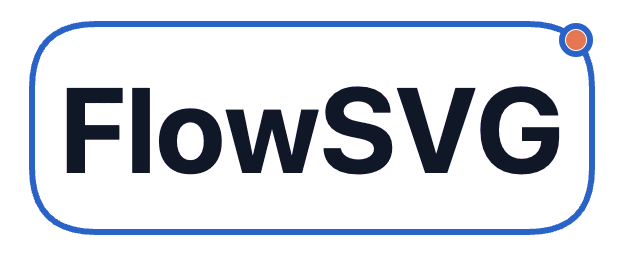
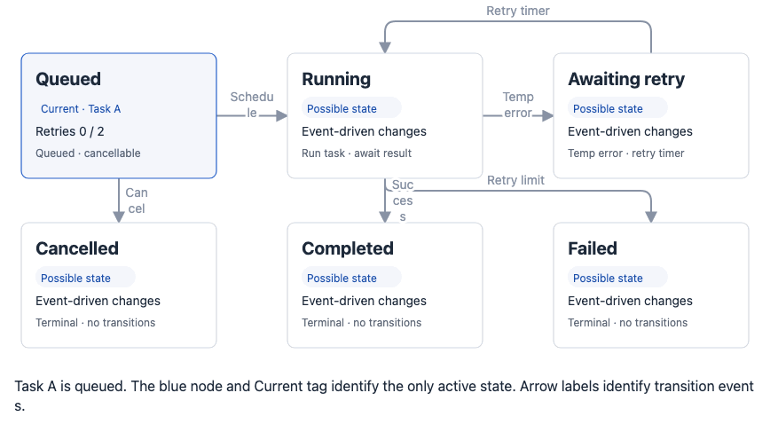

<p align="center">
  
</p>

<p align="center">Declarative SVG diagrams with timeline playback and SVG/PNG/GIF export.</p>

<p align="center">English | <a href="https://cdn.jsdelivr.net/npm/flowsvg@0.3.1/README.zh-CN.md">简体中文</a></p>

<p align="center">
  <a href="https://www.npmjs.com/package/flowsvg"></a>
  <a href="https://www.npmjs.com/package/flowsvg"></a>
</p>

<p align="center">
  <a href="#quick-start">Quick&nbsp;start</a> ·
  <a href="#integrations">Integrations</a> ·
  <a href="#export">Export</a> ·
  <a href="#authoring">Authoring</a> ·
  <a href="#control-playback">Playback&nbsp;API</a> ·
  <a href="#core-api--flowsvg">Core&nbsp;API</a>
</p>

Define nodes, edges, scenes and beats in one JSON or TypeScript document. Use the same document in a native browser, Vue, React or Web Component player, or generate standalone offline HTML.

Node positions and dimensions are explicit. FlowSVG renders and animates the layout you author.

## Featured examples

These four diagrams show how FlowSVG explains a complete node-shape catalog, a simple request flow, a deployed service topology and a layered model architecture with the same authored document, playback timeline and export path.

### Basic shapes

The catalog puts every public node shape into one executable flow and demonstrates measured labels, orthogonal connections, highlights and playback.

<p align="center"></p>

### Request and response

The client sends a request through an API gateway while authentication and inventory checks run in parallel. The order service returns the result through the gateway.

<p align="center"></p>

### Web service deployment

The diagram shows a public HTTPS entry, two application replicas, cache and database tiers, independent replication, health checks and later rerouting to the healthy replica.

<p align="center"></p>

### LLM inference

Token positions move through Transformer layers, causal prefill and KV-cache updates before next-token sampling. The diagram keeps state vectors, cache layers and model output visible in one frame.

<p align="center"></p>

## Install

```sh
npm install flowsvg
```

The package provides ESM entries and TypeScript declarations.

| Usage | Requirements |
| --- | --- |
| DOM-free core | Node 18+ or an ES2022-compatible browser |
| Browser playback | DOM, SVG and `requestAnimationFrame` |
| Vue / React | Vue 3.5+ / React 18+ |
| Node export tools | Node 20+; image exports also require prepared Chromium |

## Quick start

Use these examples in an application with package import support, such as a bundled TypeScript project. Run player code on the client after the host element exists.

### 1. Define a diagram

Save as `diagram.ts`:

```ts
import type { DiagramDocument } from "flowsvg";

export const diagram: DiagramDocument = {
  version: 1,
  viewport: { width: 640, height: 240 },
  nodes: [
    { id: "client", kind: "roundedRect", x: 40, y: 90, width: 140, height: 64, label: "Client" },
    { id: "service", kind: "roundedRect", x: 400, y: 90, width: 180, height: 64, label: "Service" }
  ],
  edges: [{ id: "request", from: "client", to: "service", route: "orthogonal" }],
  scenes: [{
    id: "request-response",
    label: "Request and response",
    beats: [
      { durationMs: 1000, caption: "Send request", actions: [
        { type: "flow", target: "request", direction: "forward", text: "Request" }
      ] },
      { durationMs: 1000, caption: "Return response", actions: [
        { type: "flow", target: "request", direction: "reverse" }
      ] }
    ]
  }]
};
```

The request uses a text capsule; the response uses a dot moving in reverse.

- A beat with one `flow` derives its duration from the route length, replacing `durationMs`.
- Read actual boundaries from `createDiagram(diagram).beats`.
- Add a separate no-flow beat for reading time.

### 2. Play in a browser

Add a host to your page:

```html
<div id="diagram"></div>
```

Create the player in a client-side module:

```ts
import { createPlayer } from "flowsvg/browser";
import "flowsvg/styles.css";
import { diagram } from "./diagram.js";

const host = document.querySelector<HTMLElement>("#diagram");
if (!host) throw new Error("Diagram host is missing");

const player = createPlayer(host, diagram, { loop: true });
player.play();
// On disposal: player.destroy();
```

You should see a request travel from Client to Service, followed by a response in reverse. Built-in controls pause, seek, step and change speed.

- **Start:** players begin paused; `play()` starts this example.
- **Repeat:** `loop: true` repeats the whole timeline.
- **Styles:** import the CSS once per application.
- **Cleanup:** call `destroy()` when disposing of a native player.

## Example: background task lifecycle

The bundled diagram JSON and GIF use English labels and captions.

The example contains three independent cases:

- Task A retries and completes.
- Task B exhausts its retries.
- Task C is cancelled before execution.

Structured cards and tags display task state and retry count. Rounded orthogonal edges carry transition events.



The package includes this document at `examples/job-lifecycle.json`.

## Integrations

Use the same `diagram.ts` with either component below. Components start paused and manage player cleanup; press Play to start. Import the CSS once per application.

### Vue

```vue
<script setup lang="ts">
import { FlowPlayer } from "flowsvg/vue";
import "flowsvg/styles.css";
import { diagram } from "./diagram.js";
</script>

<template>
  <FlowPlayer :document="diagram" loop />
</template>
```

For component refs, props and events, see [Control playback](#control-playback).

### React

```tsx
import { FlowPlayer } from "flowsvg/react";
import "flowsvg/styles.css";
import { diagram } from "./diagram.js";

export function Diagram() {
  return <FlowPlayer document={diagram} loop />;
}
```

For refs, callbacks and document updates, see [Control playback](#control-playback).

### Web Component

Add the element to your page, then register it and assign the diagram from a client-side module:

```html
<flowsvg-player loop></flowsvg-player>
```

```ts
import { defineFlowPlayer, type FlowPlayerElement } from "flowsvg/web-component";
import "flowsvg/styles.css";
import { diagram } from "./diagram.js";

defineFlowPlayer();
const element = document.querySelector<FlowPlayerElement>("flowsvg-player");
if (!element) throw new Error("Diagram element is missing");
element.document = diagram;
```

`defineFlowPlayer(tagName = "flowsvg-player")` returns the registered constructor, or `undefined` without a custom-element registry. The same entry is available as `flowsvg/element`.

| Task | Usage |
| --- | --- |
| Supply a document | Assign an object to `.document`, put JSON in the HTML `document` attribute, or set `src` to a JSON URL. URL loading follows browser CORS rules. |
| Set playback options | Use attributes such as `loop`, `gif-export` and `reduced-motion`. `autoplay` defaults to `false`, `speed` to `1`, and controls are enabled by default. |
| Control or reload | Use the methods under [Control playback](#control-playback), except `load()`. Assign `.document` again to reload. |
| Read state | `getState()` can return `undefined` before mounting or after destruction. |
| Handle events | Listen on the element. Events bubble and cross Shadow DOM boundaries; details are listed under [Events](#events). |

Web Component runtime colors use the `element.emphasis` object property, for example `element.emphasis = { stroke: "#0f766e" }`. Assign before connection or replace it later; `undefined` clears the override. Assignments copy fields, reconnection retains them, and option rebuilds restore time/playback. The getter returns a copy. Invalid values emit the existing bubbling/composed `error` event and retain the valid configuration. There is no `emphasis` HTML attribute.

## Control playback

`createPlayer(host: HTMLElement, document: DiagramDocument, options?: PlayerOptions): FlowPlayer` mounts into the host, replacing its children. Invalid initial documents throw `DiagramValidationError`.

| Method / property | Behavior |
| --- | --- |
| `play(): void` / `pause(): void` | Resume / pause at the current position. At the end, `play()` restarts only when Loop is enabled; static diagrams cannot play. |
| `seek(timeMs: number): void` | Clamp to the timeline; retain playback except at the end. Non-finite values become zero. |
| `step(direction: 1 \| -1): void` | Pause and move to a beat boundary. Backward from inside a beat goes to that beat's start. |
| `setSpeed(speed: number): void` | Set a finite positive multiplier; ignore invalid values. Default `1`. |
| `setLoop(loop: boolean): void` | Change whole-timeline looping without changing position or playback. |
| `load(document: DiagramDocument): void` | Pause at zero on success; emit `error` and retain the old document/state on failure. |
| `getState(): PlayerState` | Read `{ timeMs, totalDuration, playing, loop, speed, frame }`. Times are milliseconds. |
| `destroy(): void` | Release DOM, listeners and animation resources. Safe to repeat. Not exposed by Vue/React refs. |
| `element: HTMLElement` | Readonly host and event target. Not exposed by Vue/React refs. |

Vue/React refs expose the eight playback/state methods above. Component updates behave as follows:

| Change | Result |
| --- | --- |
| Replace the `document` object | Reload the document and pause at zero on success |
| Change `theme`, `controls`, `gifExport`, `reducedMotion` or `hoverFill`, or replace/clear `emphasis` | Recreate the player, paused at zero |

### Options and component props

| `PlayerOptions` | Default / meaning |
| --- | --- |
| `theme?: "light" \| "dark"` | Document theme, then `"light"`. |
| `emphasis?: EmphasisColors` | Per-field overrides over document colors and theme defaults. Replace the object to update framework players. |
| `controls?: boolean` | `true`; show playback controls. |
| `loop?: boolean` | `false`; loop the entire timeline. |
| `gifExport?: boolean` | `false`; show GIF download controls when `controls` is enabled. |
| `hoverFill?: boolean` | `false`; hover marks borders only. `true` also highlights backgrounds. |
| `reducedMotion?: boolean` | Follow browser preference; `true` hides flow markers and completes visual transitions immediately without changing timing. |

Vue/React components also accept these `FlowPlayerProps`:

| Prop | Meaning |
| --- | --- |
| `document: DiagramDocument` | Required diagram document |
| `speed?: number` | Playback multiplier; default `1` |
| `initialTimeMs?: number` | Initial position; applied once |
| `className`, `style` | Host container styles |

Replace `emphasis` with a new object to update colors; clearing it restores document/theme fallback. The player copies supplied fields, so later mutation does not change its paint. Framework option rebuilds do not reapply `initialTimeMs`.

Both framework entries export `FlowPlayerHandle` and `FlowPlayerProps`. Native players start through `play()` and change speed through `setSpeed()`.

### Events

Native events are `CustomEvent`s on `player.element`; read `event.detail`. Vue handlers and React callbacks receive the detail directly.

| Native / Vue event | React callback | Detail |
| --- | --- | --- |
| `stepchange` | `onStepChange` | `PlayerState`; scene/beat selection changed. |
| `timeupdate` | `onTimeUpdate` | `PlayerState`; frame updated. |
| `playstatechange` | `onPlayStateChange` | `PlayerState`; playing state changed. |
| `loopchange` | `onLoopChange` | `PlayerState`; loop setting changed. |
| `error` | `onError` | `PlayerErrorDetail`: player state plus `error: Error`. |
| `hover`, `click` | — | Browser/Web Component: `{ id, type, point, timeMs, sceneId, beatId }`, or `null` for no hit. Aliases: `objecthover`, `objectclick`. |

- **Coordinates:** interaction `point` uses diagram coordinates; `type` is `"node"` or `"edge"`.
- **Order:** when a frame update emits `stepchange`, that event precedes `timeupdate`.
- **Before mounting:** Web Component errors may omit player-state fields.

### Reuse a choice menu

Import `SelectControl` from `flowsvg/browser` and manage its lifecycle in this order:

1. Create it with `new SelectControl(owner: Document, label: string, onChange: (value: string) => void)`.
2. Append its `.element` to your container.
3. Synchronize it with `render(choices: readonly SelectChoice[], value: string, disabled = false)`. Each choice is `{ value, label }`; your application owns the committed value.
4. Call `destroy()` when disposing of the control.

## Export

### SVG in Node or a browser

```ts
import { createDiagram } from "flowsvg";
import { diagram } from "./diagram.js";

const compiled = createDiagram(diagram);
const svg = compiled.renderSvg(0, { background: "transparent" });
```

`svg` is a complete SVG string. Reuse `compiled` to render or evaluate other times in milliseconds. Omitting `background` uses the theme background.

### PNG and GIF in a browser

```ts
import { exportGif, exportPng } from "flowsvg/export";
import { diagram } from "./diagram.js";

const png = await exportPng(diagram, {
  timeMs: 0,
  width: 1280,
  background: "transparent"
});
const gif = await exportGif(diagram, { width: 640, fps: 15 });
```

Both functions return `Promise<Uint8Array>`; await the bytes, then save or download them in your application.

| Format | Browser requirements |
| --- | --- |
| PNG | Canvas 2D and SVG image decoding |
| GIF | PNG requirements plus Blob workers allowed by the host content security policy |

Text uses locally installed system fonts.

### PNG options and limits

`exportPng` returns complete PNG bytes without downloading. Use these options to select the frame and output:

| Option / output | Default and behavior |
| --- | --- |
| `timeMs` | `0`; must be within the compiled timeline. Static documents accept only `0`. |
| `width` | Document width, rounded to pixels |
| Output height | Selected camera ratio, rounded to at least 1 pixel |
| Camera and state | Preserve `fitHeight`, focus, visibility and transitions at the selected time |
| `theme`, `reducedMotion` | Use core evaluation semantics; reduced motion defaults to `false` |
| `background` | `theme` or `transparent`; default `theme` |
| `signal` | Cancel the export with an `AbortSignal` |

SVG accepts the same `background` option. Transparency removes only the whole-diagram fill; node paint and edge-label halos remain.

**Limits and failures:**

- Each side is at most 8192 pixels; total pixels are at most 32,000,000.
- Limits use rounded dimensions. Output is not automatically shrunk.
- `PngExportError.code` identifies `options`, `document`, `limit`, `environment`, `rasterization`, `encoding` or `cancelled`.
- Success, failure and cancellation release task canvas, images and URLs.

Use `exportPng` for PNG output; the player has no PNG download button.

### GIF options and limits

| `GifExportOptions` | Default / meaning |
| --- | --- |
| `theme`, `reducedMotion` | Document theme then `light`; reduced motion defaults to `false`. |
| `startMs`, `endMs`, `speed` | Full timeline at `1×`; range start is inclusive and end exclusive, except the global end includes the completed state. |
| `width`, `fps` | `min(viewport.width, 1280)` pixels; `15` samples/second (`1`–`30`, integer). |
| `includeCaptions`, `captionHeight` | `true`; fixed caption region of `80` pixels. Captions preserve complete Latin words and explicit newlines; an overwide word reports `caption-overflow`. |
| `loopCount`, `finalHoldMs` | `0` means infinite GIF looping; `1`–`65536` means total plays. Add `1000` ms of final hold by default. Independent of live player looping. |
| `signal`, `onProgress` | `AbortSignal`; callback receives `{ phase, completed, total }`. Phases: `preparing`, `sampling`, `encoding`, `complete`. |

GIF output is opaque and keeps the authored viewport dimensions and scale.

| Limit | Maximum |
| --- | --- |
| Effective animation duration | 120 seconds |
| Samples | 1800 |
| Encoded frames | 1801 |
| Final long edge, including captions | 1920 pixels |

- **Error codes:** `GifExportError.code` identifies `options`, `limit`, `document`, `caption-overflow`, `environment`, `rasterization`, `encoding` or `cancelled`.
- **Exports:** both export entries expose `GifExportError` and their option/progress types.

### Node tools

| Entry / function | Return / requirements |
| --- | --- |
| `flowsvg/node` → `renderHtml(document, options?: HtmlRenderOptions)` | `Promise<string>`; standalone offline player HTML. Node 20+, no browser required. |
| `flowsvg/node` → `exportPng(document, options?: NodePngExportOptions)` | `Promise<Uint8Array>`; Node 20+ and installed Chromium. |
| `flowsvg/node` → `exportGif(document, options?: NodeGifExportOptions)` | `Promise<Uint8Array>`; Node 20+ and installed Chromium. |

Prepare Node image export in this order:

1. Install Chromium and the required fonts before going offline. Package installation and export do not download a browser.
2. Set either `executablePath` or a caller-owned Playwright `browser`.
3. Save or use the returned bytes in your application.

Exports snapshot inputs and release task resources on success, failure and cancellation. A supplied `browser` remains open and caller-owned.

The SDK CLI supports HTML and GIF output. Use the SDK API for PNG.

To inspect CLI arguments after installation, run `npx --no-install flowsvg --help`.

When using a source checkout, first run `pnpm build` from the repository root. The CLI launcher reports this step if the build output is missing.

For offline HTML, `HtmlRenderOptions` accepts:

| Option | Default |
| --- | --- |
| `theme` | Document theme, then `light` |
| `autoplay` | `false` |
| `loop` | `false` |
| `controls` | `true` |
| `gifExport` | `false` |

### Built-in GIF downloads

Enable GIF downloads in the integration you use:

| Integration | Setting |
| --- | --- |
| Native player / offline HTML | `gifExport: true` |
| Vue / Web Component | `gif-export` |
| React | `gifExport` |

Built-in downloads export the full timeline at `1×`, using the current theme. Playback controls must be enabled.

## Authoring

### Document and actions

| Type | Required fields | Optional fields |
| --- | --- | --- |
| `Viewport` | Finite positive `width`, `height` | `fitHeight: { padding }`; finite nonnegative bottom padding |
| `DiagramDocument` | `version: 1`, `viewport`, `nodes`, `edges`, `scenes` | `title`, `theme`, `emphasis`, `typography` |
| `DiagramNode` | `id`, `kind`, `x`, `y`, `width`, `height` | `label` or `content` (mutually exclusive), `parentId`, `visible`, `style` |
| `DiagramEdge` | `id`, `from`, `to` | `route`, `fromPort`, `toPort`, `label`, `visible`, `style` |
| `Scene` | `id`, `label`, `beats` | — |
| `Beat` | `durationMs`, `actions` | `transitionMs`, `caption` |

Document `emphasis?: EmphasisColors` accepts optional `fill` (node highlight fill), `stroke` (node/edge highlight and marker background), and `markerText` (marker text). Core visual options and browser `PlayerOptions` also accept `emphasis`; each field resolves from the runtime override, document, then selected theme. The document colors apply to browser hover and every export; hover itself stays out of exports. Browser players copy runtime colors at creation and retain them through `load`, reading missing fields from the new document. Invalid runtime fields throw `TypeError` with `options.emphasis` paths before browser resources are allocated. Use hexadecimal `#RGB`, `#RGBA`, `#RRGGBB`, or `#RRGGBBAA`. `undefined` is omitted; `null`, invalid colors and unknown fields report validation paths.

- **Static documents:** use empty `scenes`.
- **Node kinds:** `rect`, `roundedRect`, `ellipse`, `cylinder`, `group`, `diamond`, `parallelogram`, `document` and `predefinedProcess`. Groups have rounded borders by default.
- **Edge routes:** `straight` (default), `orthogonal`, `curved`.
- **Ports:** `top`, `right`, `bottom`, `left`.
- **Beat timing:** `durationMs` must be positive. `transitionMs` must be in `[0, durationMs]`, defaults to `min(250, durationMs)`, and is capped at effective beat length.

Each action has `{ type, target }`, with additional fields by action type:

| Action type | Additional fields / target |
| --- | --- |
| `updateNode`, `updateEdge` | Require `value`; fields are listed below |
| `flow` | Require `direction: "forward" \| "reverse"`; optional `text`, `highlightParticipants` and `highlightEdge` (both booleans default to `true`) |
| `focus` | Target a node/group ID, or `null` for full view |

| Update | Supported `value` fields |
| --- | --- |
| `updateNode` | `x`, `y`, `width`, `height`, `label`, `content` (`null` clears it), `fill`, `stroke`, `opacity` |
| `updateEdge` | `label`, `stroke`, `strokeWidth`, `opacity` |

- **Identity:** node and edge IDs are globally unique.
- **Coordinates:** child positions are relative to their parent group.
- **Content types:** import `NodeContent` and its block types from `flowsvg`.

### Timeline rules

`show`, `hide`, `highlight`, `unhighlight`, `updateNode`, `updateEdge`, and `focus` persist across beats. `flow` lasts for its beat only. Set `highlightEdge: false` on a flow to disable its automatic edge and label coloring. Explicit highlights and interpolated ordinary style updates still apply; `highlightParticipants` independently controls endpoints. Reduced motion hides markers and respects both policies, even when no automatic visible cue remains.

Visibility caps ordinary opacity: a stored opacity of `0.4` remains `0.4` halfway through a reveal. Ancestor groups and edge endpoints also combine opacity by minimum. Explicit `highlighted` changes at beat start while its paint transitions; removing a highlight reveals the latest ordinary colors, including same-beat updates. See the [timeline contract](../../docs/guides/sdk-guide.md#beats-and-actions).

| Beat contents | Effective duration |
| --- | --- |
| One `flow` | Reference movement at 180 diagram units/second, at least 400 ms, plus a 500 ms arrival interval including highlight fades; replaces `durationMs` |
| Multiple flows or no flow | Authored `durationMs` |

Read effective boundaries from `compiled.beats`. Use separate no-flow beats for reading time.

`viewport.fitHeight: { padding: 24 }` fits current full-view height for the player, SVG and PNG.

### Decision labels and measurement

`diamond` expresses decisions with plain `label` only, rejecting structured `content` including empty block arrays. Its centered half-width/half-height inner rectangle reserves 12 diagram units per side. The complete label is centered there; words wrap normally and an overwide word or URL splits only between complete graphemes. Overflow is clipped and reported as `text-overflow`, without shrinking text or resizing the node.

Call `measureNodeLabel({ kind: "diamond", width, label, typography? })` before assigning height. `label` accepts one string or a nonempty readonly version array; `typography` uses the document's typography. The result is `{ height, diagnostics }`, with a shared finite positive height and per-version unresolved width issues. Each diagnostic contains `versionIndex`, `path`, `dimension: "width"`, and `message`; more height cannot fix insufficient width. Empty labels are valid. Invalid input or non-finite computed height throws `DiagramValidationError`. Types `NodeLabelMeasurementInput`, `NodeLabelMeasurement`, and `NodeLabelMeasurementDiagnostic` are exported from `flowsvg`.

Cardinal ports, straight/orthogonal/curved connections, hits and diagnostics use the real contour. Invisible clipped text does not enlarge hits or fitted height. Groups, timelines and exports reuse the core result. The [runnable decision example](examples/decision-branch.json) demonstrates measured label updates, resizing and an intentionally clipped node.

`parallelogram` expresses input/output with the same plain-label restrictions, wrapping, clipping and diagnostics. Its top edge slants right by S = min(width / 4, 24) diagram units. The rectangular safe area reserves S + 12 units on both horizontal sides and 12 units on both vertical sides. With complete label height L, `measureNodeLabel` returns L + 24; multiple versions share the largest height. No slant configuration is exposed. Cardinal/automatic connections, hits and diagnostics use the actual slanted outline. See the [input/output example](examples/input-output.json).

### Document report labels

The `document` preset represents a report or file artifact using plain `label` only. It rejects structured `content`, including empty blocks; timeline `content: null` still clears text. The top and sides are straight. The bottom wave occupies B = min(height / 4, 24) diagram units. With 12-unit padding, the label safe area is `(12, 12, max(0, width - 24), max(0, height - B - 24))`. Labels are centered above the wave, with the same grapheme wrapping, clipping and overflow diagnostics as decision labels.

`measureNodeLabel({ kind: "document", width: 240, label: ["Report ready", "Revenue\nBy region\nFinal report"] })` returns height 108. For complete line-box height L and T = L + 24, the suggested height is 4T/3 when T ≤ 72, otherwise T + 24. Width diagnostics remain actionable after adopting the height. Ports, hits and diagnostics follow the actual wave; the empty space below its raised section is outside the node. See the [report generation example](examples/report-generation.json), including grouped motion, resizing, label changes and deliberate overflow.

### Predefined process labels

The `predefinedProcess` kind expresses a call to a defined subprocess. It is one ordinary node with a rectangular outer contour and two decorative vertical lines; it does not execute a subprocess or contain child nodes. Each line is inset by D = min(width / 6, 12). The label safe area starts at (D + 12, 12), with width max(0, width − 2D − 24) and height max(0, height − 24), relative to the node.

Use plain `label`; structured `content` objects are rejected, including empty block arrays. Timeline `content: null` keeps its clearing semantics. Labels use the same centering, grapheme wrapping, clipping and overflow diagnostics as decision labels. `measureNodeLabel({ kind: "predefinedProcess", width: 200, label: ["A", "A\nB"] })` returns height 64. The suggested height is the full line-box height plus 24. Only the outer rectangle supplies connections and routing obstacles; clicks on either internal line return the parent node identity.

The SDK-owned [subprocess-call example](examples/subprocess-call.json) includes measured labels, resizing, emphasis and intentional overflow. Run `pnpm --filter flowsvg build`, serve `packages/flowsvg` from the workspace, and open `/tests/browser-predefined-process.html` to play the public browser example.

### Structured content and measurement

Rectangles (`rect`), rounded rectangles (`roundedRect`) and cylinders (`cylinder`) support structured `content` with titles, paragraphs, lists, tags and entity graphs.

1. Call `measureNodeContent({ kind, width, content, typography? })` before assigning fixed dimensions. Pass one `NodeContent` or a nonempty array of content versions.
2. Inspect the returned `diagnostics`, which contain `{ versionIndex, path, dimension, message }`.
3. Resolve width overflow and overflow inside fixed-height graph blocks separately; adding node height does not fix those cases.
4. Write the returned `height` into the node. For multiple versions, measurement returns the largest required height.

Playback uses the authored dimensions.

### Document typography

Set `typography: { nodeLabel: 32, edgeLabel: 24, flowLabel: 20 }` on the document. Sizes use diagram units.

| Role | Default | Applies to |
| --- | --- | --- |
| `nodeLabel` | `16` | Node labels and group headings |
| `edgeLabel` | `14` | Edge labels |
| `flowLabel` | `12` | Single-line flow capsules |

**Validation:** values must be positive and finite. Unrepresentable derived text metrics throw `DiagramValidationError` with a `typography.<role>` path.

Ordinary node labels, edge labels and `wrapText` keep Latin words intact. Overwide words can exceed the estimated line width; fonts do not shrink automatically. Purely vertical edge labels use the narrower endpoint width for horizontal wrapping. Increase authored spacing or node width if labels overlap. GIF captions use the same word boundaries with measured font widths.

**Sizing and inheritance:**

- Wrapping, drawing, node-label hits and `fitHeight` share effective sizes.
- Flow capsules follow `flowLabel`, remain single-line and do not create hit targets.
- Omitted structured-content sizes scale by `nodeLabel / 16`.
- Explicit block, list, item and span sizes retain their inheritance order.
- Node dimensions, coordinates, padding, gaps, graph-block heights and compiled timing retain authored values.

After changing sizes, pass the same `typography` to `measureNodeContent` and inspect overflow.

The [mixed approval flow](examples/mixed-flow.json) combines all four presets, an ordinary node, a group and three route families. It includes label replacement, size and style changes, and one deliberately clipped label. Its [generator](examples/create-mixed-flow.mjs) reserves a shared height for label versions through public `measureNodeLabel`.

After installing `flowsvg`, place the script in a writable directory and run `node create-mixed-flow.mjs`, then `npx flowsvg mixed-flow.json --format html --output mixed-flow.html` to generate offline playback.

In this repository, first run `pnpm --filter flowsvg build`, then `node packages/flowsvg/examples/create-mixed-flow.mjs`; serve `packages/flowsvg` and open `/tests/browser-mixed-flow.html`.

## Core API — `flowsvg`

All times are milliseconds; positions and dimensions use diagram units.

| `EvaluateOptions` | Meaning |
| --- | --- |
| `theme?: "light" \| "dark"` | Document theme, then `light` |
| `reducedMotion?: boolean` | Default `false` |

| Function | Result / behavior |
| --- | --- |
| `createDiagram(document: DiagramDocument): Diagram` | Validate, copy, freeze and compile the document for repeated queries. |
| `renderSvg(document: DiagramDocument, timeMs = 0, options?): string` | Compile and render one static SVG. |
| `validateDocument(input: unknown): ValidationIssue[]` | Check fields and references; return `{ path, message }` issues. An empty array means these checks passed; compilation can still reject non-finite derived flow timing. |
| `measureNodeContent({ kind, width, content, typography? }): NodeContentMeasurement` | Return `{ height, diagnostics }`; see [content and measurement](#structured-content-and-measurement). |
| `measureNodeLabel({ kind, width, label, typography? }): NodeLabelMeasurement` | Measure shared preset-label height and unresolved width issues; see [decision labels](#decision-labels-and-measurement). |
| `wrapText(label: string, maxWidth: number, typography?): string[]` | Estimate wrapping without the DOM. Optional typography supplies all three numeric fields: `fontSize`, `lineHeight`, `charWidth`; omitted uses node typography. |

| Compiled `Diagram` | Result / behavior |
| --- | --- |
| `totalDuration: number` | Readonly effective duration; `0` for static documents. |
| `beats: readonly DiagramBeat[]` | Compiled `{ sceneId, beatId, beatIndex, startMs, endMs, caption? }` intervals. |
| `evaluateAt(timeMs: number, options?): DiagramFrameState` | Return `{ timeMs, sceneId, beatId, beatProgress, nodes, edges, camera, caption?, warnings }`. |
| `diagnoseAt(timeMs: number, options?): GeometryWarning[]` | Return edge–node, label–node and label–label risks on demand; ordinary evaluation and playback skip pair checks. |
| `renderSvg(timeMs = 0, options?): string` | Render without recompiling. |
| `hitTest(timeMs: number, point: DiagramPoint, options?): HitObject \| null` | Hit-test `{ x, y }` in diagram coordinates; return `{ id, type }` or `null`. |

### Validation and warnings

Core query times clamp to `[0, totalDuration]`; non-finite values become zero.

| Result | Where to inspect it |
| --- | --- |
| Invalid document | `DiagramValidationError.issues`: validation paths and messages |
| Text overflow | `evaluateAt(timeMs).warnings` |
| Content measurement issues | `measureNodeContent(...).diagnostics`; see [measurement steps](#structured-content-and-measurement) |
| Estimated geometric overlap | `diagnoseAt(timeMs)`; separate from frame text-overflow warnings |

### Geometry diagnostics

`diagnoseAt` reuses the selected camera, typography, routes and content safe areas. It reports estimated edge–node, label–node and label–label overlap risks.

Preset labels with zero safe-area width or height contribute no painted overlaps; `text-overflow` remains available. Visible `predefinedProcess` side-line strokes participate under the parent node identity, including transparent-fill styles. The hollow interior contributes no fill paint.

| Result field | Meaning |
| --- | --- |
| `code` | Risk category |
| `path`, `objectId` | Source field and object |
| `relatedObjectIds` | Other participating objects |
| `warningKey` | Canonical identity distinguishing roles, fields and lines; symmetric label pairs use a fixed order, and message text is excluded |
| `message` | Human-readable explanation |

When recording a decision, bind source, SDK identity, time and visual options separately from `warningKey`.

**Scope:**

- Exclude own labels, ancestor containment, path endpoints and group-boundary crossings.
- Include edge labels covering endpoints and group titles covering children.
- Skip hidden, zero-opacity and clipped portions.
- Keep visible outlines with transparent fills eligible; semi-transparent paint also participates.

**Precision and review:**

- Fills follow actual contours; strokes and curves use finite samples.
- Text uses deterministic estimates. Results do not guarantee font-pixel accuracy or continuous collision coverage.
- Diagnostics report risks without adjusting the diagram. Review output at its intended display size.

For additional field details, use the TypeScript declarations and JSDoc included in the package.

[Changelog](https://cdn.jsdelivr.net/npm/flowsvg@0.3.1/CHANGELOG.md) · [MIT](https://cdn.jsdelivr.net/npm/flowsvg@0.3.1/LICENSE)
