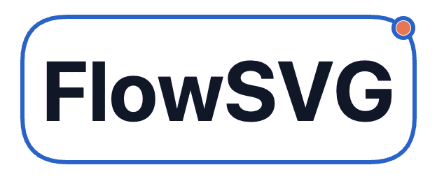
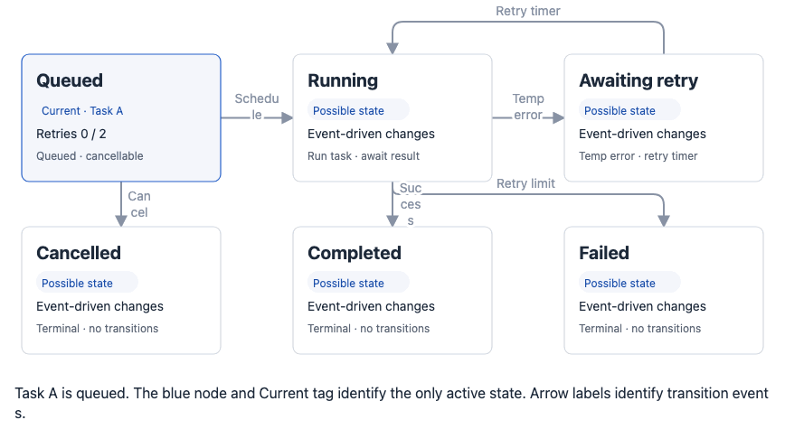

<p align="center">
  
</p>

<p align="center">声明式 SVG 图解，支持时间线播放与 SVG／GIF 导出。</p>

<p align="center"><a href="https://cdn.jsdelivr.net/npm/flowsvg@0.2.0/README.md">English</a> | 简体中文</p>

<p align="center">
  <a href="#定义图解">快速开始</a> ·
  <a href="#典型示例后台任务生命周期">典型示例</a> ·
  <a href="#控制播放">播放&nbsp;API</a> ·
  <a href="#核心-api--flowsvg">核心&nbsp;API</a> ·
  <a href="#文档与动作">文档模型</a> ·
  <a href="#导出-api">导出&nbsp;API</a>
</p>

同一份图解数据可用于原生浏览器、Vue、React 和 Web Component。

```sh
npm install flowsvg
```

## 典型示例：后台任务生命周期

任务 A 重试后完成，任务 B 达到重试上限，任务 C 在执行前取消。三个案例相互独立。结构化卡片和胶囊标签展示当前任务与重试次数，圆角折线展示迁移事件。



完整图解位于 `node_modules/flowsvg/examples/job-lifecycle.json`。将其中的内容用作下方各集成方式的 `diagram` 文档。在 Node 20+ 中，可直接生成带播放控件和 GIF 下载的离线播放器：

```sh
npx flowsvg node_modules/flowsvg/examples/job-lifecycle.json --format html --output job-lifecycle.html --gif-export
```

用浏览器打开 `job-lifecycle.html` 即可播放。生成 HTML 无需安装 Chromium。示例设置 `flow.highlightParticipants: false`，并显式高亮唯一的当前状态，避免事件移动时同时高亮迁移两端。重试上限仅为教学设定。

## 定义图解

```ts
// diagram.ts
import type { DiagramDocument } from "flowsvg";

export const diagram: DiagramDocument = {
  version: 1,
  viewport: { width: 640, height: 240 },
  nodes: [
    { id: "client", kind: "roundedRect", x: 40, y: 90, width: 140, height: 64, label: "Client" },
    { id: "service", kind: "roundedRect", x: 400, y: 90, width: 180, height: 64, label: "Service" }
  ],
  edges: [{ id: "request", from: "client", to: "service", route: "orthogonal" }],
  scenes: [{
    id: "request-response",
    label: "请求与响应",
    beats: [
      { durationMs: 1000, caption: "发送请求", actions: [
        { type: "flow", target: "request", direction: "forward", text: "Request" }
      ] },
      { durationMs: 1000, caption: "返回响应", actions: [
        { type: "flow", target: "request", direction: "reverse" }
      ] }
    ]
  }]
};
```

节点显式指定位置和尺寸。连线支持 `straight`、`orthogonal`（圆角折线）和 `curved`。传递设置 `text` 时显示文字胶囊，省略时显示移动实心圆点。

## 播放

```html
<div id="diagram"></div>
```

```ts
import { createPlayer } from "flowsvg/browser";
import "flowsvg/styles.css";
import { diagram } from "./diagram.js";

const player = createPlayer(document.querySelector<HTMLElement>("#diagram")!, diagram, {
  theme: "light",
  loop: true,
  gifExport: true
});

player.play();
// On disposal: player.destroy();
```

播放器默认暂停，内置播放控件。循环和 GIF 下载默认关闭。样式只需导入一次。原生播放器卸载时调用 `destroy()`；框架组件自动清理。

### Vue

```vue
<script setup lang="ts">
import { FlowPlayer } from "flowsvg/vue";
import "flowsvg/styles.css";
import { diagram } from "./diagram.js";
</script>

<template>
  <FlowPlayer :document="diagram" loop gif-export />
</template>
```

### React

```tsx
import { FlowPlayer } from "flowsvg/react";
import "flowsvg/styles.css";
import { diagram } from "./diagram.js";

export function Diagram() {
  return <FlowPlayer document={diagram} loop gifExport />;
}
```

## 控制播放

`createPlayer(host: HTMLElement, document: DiagramDocument, options?: PlayerOptions): FlowPlayer` 挂载播放器并替换宿主子元素。初始文档非法时抛出 `DiagramValidationError`。

| 方法／属性 | 行为 |
| --- | --- |
| `play(): void` / `pause(): void` | 从当前位置继续／暂停。到达终点后，`play()` 仅在开启循环时重新开始；静态图解不能播放。 |
| `seek(timeMs: number): void` | 时间限制在时间线范围内；除终点外保留播放状态，非有限值按零处理。 |
| `step(direction: 1 \| -1): void` | 暂停并跳转节拍边界；从节拍内部后退时先回到当前节拍起点。 |
| `setSpeed(speed: number): void` | 设置有限正数倍率，忽略非法值；默认 `1`。 |
| `setLoop(loop: boolean): void` | 切换整条时间线循环，保留当前位置和播放状态。 |
| `load(document: DiagramDocument): void` | 成功后暂停在零时刻；失败时触发 `error` 并保留原文档与状态。 |
| `getState(): PlayerState` | 返回 `{ timeMs, totalDuration, playing, loop, speed, frame }`，时间单位为毫秒。 |
| `destroy(): void` | 释放 DOM、监听器和动画资源，可重复调用；Vue／React ref 不提供此方法。 |
| `element: HTMLElement` | 只读宿主元素，也是事件目标；Vue／React ref 不提供此属性。 |

Vue／React ref 提供上表八个播放与状态方法。替换 `document` 对象会重新加载组件；修改 `theme`、`controls`、`gifExport`、`reducedMotion` 或 `hoverFill` 会重建播放器并暂停在零时刻。

### 选项与组件属性

| `PlayerOptions` | 默认值／含义 |
| --- | --- |
| `theme?: "light" \| "dark"` | 使用文档主题，未设置时为 `"light"`。 |
| `controls?: boolean` | `true`；显示播放控件。 |
| `loop?: boolean` | `false`；循环整条时间线。 |
| `gifExport?: boolean` | `false`；在 `controls` 开启时显示 GIF 下载控件。 |
| `hoverFill?: boolean` | `false`；悬停仅高亮边框，设为 `true` 时同时高亮背景。 |
| `reducedMotion?: boolean` | 跟随浏览器偏好；`true` 隐藏传递标记并立即完成视觉过渡，保留时间线时长。 |

Vue／React 的 `FlowPlayerProps` 另提供必填 `document: DiagramDocument`、`speed?: number`（默认 `1`）、`initialTimeMs?: number`（仅首次应用）、`className` 和 `style`。两个入口均导出 `FlowPlayerHandle` 与 `FlowPlayerProps` 类型。原生播放器通过 `play()` 启动，通过 `setSpeed()` 修改倍率。

### 事件

原生播放器在 `player.element` 派发 `CustomEvent`，数据位于 `event.detail`。Vue 处理函数与 React 回调直接接收事件数据。

| 原生／Vue 事件 | React 回调 | 数据 |
| --- | --- | --- |
| `stepchange` | `onStepChange` | `PlayerState`；场景／节拍选择变化。 |
| `timeupdate` | `onTimeUpdate` | `PlayerState`；画面更新。 |
| `playstatechange` | `onPlayStateChange` | `PlayerState`；播放状态变化。 |
| `loopchange` | `onLoopChange` | `PlayerState`；循环设置变化。 |
| `error` | `onError` | `PlayerErrorDetail`：播放器状态加 `error: Error`。 |
| `hover`、`click` | — | 原生／Web Component：`{ id, type, point, timeMs, sceneId, beatId }`；未命中时为 `null`。别名为 `objecthover`、`objectclick`。 |

交互数据中的 `point` 使用图解坐标，`type` 为 `"node"` 或 `"edge"`。画面更新时，如需派发 `stepchange`，该事件先于 `timeupdate`。Web Component 挂载前发生的错误可能不包含播放器状态字段。

## 导出

```ts
import { createDiagram } from "flowsvg";
import { exportGif } from "flowsvg/export";
import { diagram } from "./diagram.js";

const compiled = createDiagram(diagram);
const frame = compiled.evaluateAt(1200);
const svg = compiled.renderSvg(1200, { theme: "dark" });
const gif = await exportGif(diagram, { width: 640, fps: 15 });
```

SVG 返回字符串，GIF 返回 `Uint8Array`。浏览器 GIF 支持 `signal` 与 `onProgress`；需要内置下载按钮时启用 `gifExport: true`。Node 20+ 可从 `flowsvg/node` 使用 `renderHtml` 和 `exportGif`，其中 Node GIF 须提前准备 Chromium。

## 核心 API — `flowsvg`

时间单位均为毫秒，位置与尺寸使用图解单位。`options?: EvaluateOptions` 包含 `theme?: "light" | "dark"` 与 `reducedMotion?: boolean`（默认 `false`）。

| 函数 | 返回值／行为 |
| --- | --- |
| `createDiagram(document: DiagramDocument): Diagram` | 校验、复制、冻结并编译文档，供重复查询。 |
| `renderSvg(document: DiagramDocument, timeMs = 0, options?): string` | 编译并渲染一帧静态 SVG。 |
| `validateDocument(input: unknown): ValidationIssue[]` | 检查字段与引用，返回 `{ path, message }` 问题列表。空数组表示这些检查通过；编译阶段仍可能拒绝非有限的派生传递时长。 |
| `measureNodeContent({ kind, width, content }): NodeContentMeasurement` | 返回 `{ height, diagnostics }`。`kind` 为 `rect`、`roundedRect` 或 `cylinder`；`content` 为单个 `NodeContent` 或非空版本数组，多个版本取所需高度最大值。 |
| `wrapText(label: string, maxWidth: number, typography?): string[]` | 无 DOM 的估算换行；可选排版对象须包含 `fontSize`、`lineHeight`、`charWidth` 三个数值字段，省略时使用节点排版参数。 |

| 编译后的 `Diagram` | 返回值／行为 |
| --- | --- |
| `totalDuration: number` | 只读有效总时长；静态文档为 `0`。 |
| `beats: readonly DiagramBeat[]` | 编译后的 `{ sceneId, beatId, beatIndex, startMs, endMs, caption? }` 区间。 |
| `evaluateAt(timeMs: number, options?): DiagramFrameState` | 返回 `{ timeMs, sceneId, beatId, beatProgress, nodes, edges, camera, caption?, warnings }`。 |
| `renderSvg(timeMs = 0, options?): string` | 渲染 SVG，复用编译结果。 |
| `hitTest(timeMs: number, point: DiagramPoint, options?): HitObject \| null` | 用图解坐标 `{ x, y }` 命中检测，返回 `{ id, type }` 或 `null`。 |

查询时间限制在 `[0, totalDuration]` 内，非有限值按零处理。`DiagramValidationError.issues` 提供字段路径与原因。测量诊断包含 `{ versionIndex, path, dimension, message }`；增加节点高度不能修复宽度溢出或固定高度关系图块内部的溢出。

### 文档与动作

| 类型 | 核心字段 |
| --- | --- |
| `Viewport` | 必填有限正数 `width`、`height`；可选 `fitHeight: { padding }`，底部留白 `padding` 为有限非负数。 |
| `DiagramDocument` | `version: 1`、`viewport`、`nodes`、`edges`、`scenes`；可选 `title`、`theme`。`scenes` 为空时是静态图解。 |
| `DiagramNode` | `id`、`kind`、`x`、`y`、`width`、`height`；可选互斥的 `label`／`content`，以及 `parentId`、`visible`、`style`。类型有 `rect`、`roundedRect`、`ellipse`、`cylinder`、`group`。 |
| `DiagramEdge` | `id`、`from`、`to`；可选 `route`（默认 `straight`）、`fromPort`、`toPort`、`label`、`visible`、`style`。连接方向为 `top`、`right`、`bottom`、`left`。 |
| `Scene` / `Beat` | 场景为 `{ id, label, beats }`；节拍为 `{ durationMs, actions, transitionMs?, caption? }`。`durationMs` 须为正数；`transitionMs` 须位于 `[0, durationMs]`，默认 `min(250, durationMs)`，并受有效节拍时长限制。 |
| `Action` | `{ type, target }`；`updateNode`／`updateEdge` 另需 `value`。`flow` 必填 `direction`（`forward`／`reverse`），可选 `text` 和 `highlightParticipants`（默认 `true`）。`focus` 的目标为节点／分组 ID，或用 `null` 恢复完整视图。 |

`updateNode.value` 支持 `x`、`y`、`width`、`height`、`label`、`content`（`null` 清空）、`fill`、`stroke`、`opacity`；`updateEdge.value` 支持 `label`、`stroke`、`strokeWidth`、`opacity`。节点与连线 ID 全局唯一，子节点位置相对父分组。`NodeContent` 及其内容块类型均从 `flowsvg` 导出。

## 导出 API

| 入口／函数 | 返回值／要求 |
| --- | --- |
| `flowsvg/export` → `exportGif(document, options?: GifExportOptions)` | `Promise<Uint8Array>`；需要浏览器 canvas 与 worker 支持。 |
| `flowsvg/node` → `renderHtml(document, options?: HtmlRenderOptions)` | `Promise<string>`；生成包含播放器的独立离线 HTML，要求 Node 20+，无需浏览器。 |
| `flowsvg/node` → `exportGif(document, options?: NodeGifExportOptions)` | `Promise<Uint8Array>`；要求 Node 20+ 和预先准备的 Chromium。设置 `executablePath` 或传入 Playwright `browser`，二者互斥；传入的浏览器仍由调用方管理。 |

| `GifExportOptions` | 默认值／含义 |
| --- | --- |
| `theme`、`reducedMotion` | 文档主题，未设置时为 `light`；减少动态效果默认 `false`。 |
| `startMs`、`endMs`、`speed` | 默认导出完整时间线，倍率 `1`；区间含起点、不含终点，完整时间线终点包含完成状态。 |
| `width`、`fps` | 默认 `min(viewport.width, 1280)` 像素；每秒 `15` 次采样（整数 `1`–`30`）。 |
| `includeCaptions`、`captionHeight` | 默认 `true`，固定字幕区域高度为 `80` 像素。 |
| `loopCount`、`finalHoldMs` | `0` 为无限循环，`1`–`65536` 为总播放次数；默认追加 `1000` 毫秒结尾停留。与播放器循环独立。 |
| `signal`、`onProgress` | `AbortSignal`；回调接收 `{ phase, completed, total }`，阶段为 `preparing`、`sampling`、`encoding`、`complete`。 |

GIF 限制：有效时长 120 秒，1800 个采样帧，1801 个编码帧，含字幕的最终长边不超过 1920 像素。`GifExportError.code` 为 `options`、`limit`、`document`、`caption-overflow`、`environment`、`rasterization`、`encoding` 或 `cancelled`。两个导出入口均提供 `GifExportError` 和各自选项／进度类型。

`HtmlRenderOptions` 包含 `theme`、`autoplay`（默认 `false`）、`loop`（`false`）、`controls`（`true`）、`gifExport`（`false`）。内置 GIF 下载按当前主题，以 `1×` 导出完整时间线。

## 其他浏览器 API

- `flowsvg/web-component`（别名 `flowsvg/element`）：在浏览器调用 `defineFlowPlayer(tagName = "flowsvg-player")`，返回已注册的构造器；无自定义元素注册表时返回 `undefined`。可设置 `.document` 对象、`document` JSON 属性，或通过 `src` 加载 URL。播放选项使用 `loop`、`gif-export`、`reduced-motion` 等属性，`autoplay` 默认 `false`，`speed` 默认 `1`。播放方法不含 `load()`，重新赋值 `.document` 即可加载；挂载前或销毁后 `getState()` 可返回 `undefined`。事件支持冒泡并可穿过 Shadow DOM 边界。
- `flowsvg/browser`：`new SelectControl(owner: Document, label: string, onChange: (value: string) => void)` 创建选择控件。挂载 `.element`，调用 `render(choices: readonly SelectChoice[], value: string, disabled = false)` 同步状态，卸载时调用 `destroy()`。每个选项为 `{ value, label }`，调用方管理已提交的值。

## 编写规则

- `show`、`hide`、`highlight`、`unhighlight`、`updateNode`、`updateEdge`、`focus` 跨节拍继承；`flow` 仅在当前节拍生效。
- 单条传递按参考速度 180 图解单位／秒移动，最短 400ms，再执行含高亮渐变的 500ms 到达区间，替代作者的 `durationMs`。多条传递与无传递节拍保留作者时长。实际边界从 `compiled.beats` 读取；阅读停留使用独立无传递节拍。
- 矩形、圆角矩形和圆柱支持结构化 `content`，可包含标题、段落、列表、标签和实体关系小图。通过 `measureNodeContent({ kind, width, content })` 测量后写入固定尺寸，并检查 `diagnostics`；播放时不会自动调整节点尺寸。
- `viewport.fitHeight: { padding: 24 }` 让完整视图按当前内容调整高度；GIF 保留作者视口尺寸与比例。
- 非法文档抛出带字段路径的 `DiagramValidationError`；文字溢出记录在 `frame.warnings`。外部 JSON 可先调用 `validateDocument(input)`。

ESM，附 TypeScript 声明。无 DOM 核心支持 Node 18+，Node 工具要求 Node 20+；Vue 3.5+／React 18+。

[完整 SDK 手册](https://github.com/yokingma/FlowSVG/blob/main/docs/SDK-GUIDE.zh-CN.md) · [更新记录](https://cdn.jsdelivr.net/npm/flowsvg@0.2.0/CHANGELOG.md) · [MIT](https://cdn.jsdelivr.net/npm/flowsvg@0.2.0/LICENSE)
