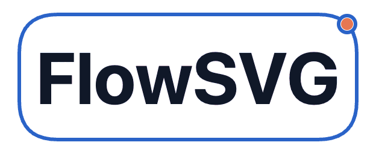

<p align="center">
  
</p>

<p align="center">声明式 SVG 图解，支持时间线播放与 SVG/PNG/GIF 导出。</p>

<p align="center"><a href="https://cdn.jsdelivr.net/npm/flowsvg@0.4.2/README.md">English</a> | 简体中文</p>

<p align="center">
  <a href="https://www.npmjs.com/package/flowsvg"></a>
  <a href="https://www.npmjs.com/package/flowsvg"></a>
</p>

<p align="center">
  <a href="#典型示例">典型示例</a> ·
  <a href="#快速开始">快速开始</a> ·
  <a href="#接入方式">接入方式</a> ·
  <a href="#导出">导出</a> ·
  <a href="#编写图解">编写图解</a> ·
  <a href="#控制播放">播放 API</a> ·
  <a href="https://github.com/yokingma/FlowSVG/blob/main/docs/guides/sdk-guide.zh-CN.md">完整手册</a> ·
  <a href="https://yokingma.github.io/FlowSVG/">在线演示</a>
</p>

在一份 JSON 或 TypeScript 文档中定义节点、连线、场景与节拍。同一文档可用于原生浏览器、Vue、React 或 Web Component 播放器，也可生成独立的离线 HTML。

节点位置和尺寸由作者明确指定。FlowSVG 负责渲染和播放作者编排的布局。

## 典型示例

<p align="center"></p>

<p align="center"><em><a href="https://yokingma.github.io/FlowSVG/?example=basic-shapes">基础形状</a>：展示全部公开节点形状、标签测量、正交连线和高亮。</em></p>

<p align="center"></p>

<p align="center"><em><a href="https://yokingma.github.io/FlowSVG/?example=request-response">请求与响应</a>：请求经过网关、认证与库存检查，随后由订单服务返回响应。</em></p>

<p align="center"></p>

<p align="center"><em><a href="https://yokingma.github.io/FlowSVG/?example=web-service-deployment">Web 服务部署</a>：展示双副本服务、健康检查与故障后的重新路由。</em></p>

<p align="center"></p>

<p align="center"><em><a href="https://yokingma.github.io/FlowSVG/?example=llm-inference">LLM 推理</a>：展示 Transformer 层、因果预填充与 KV Cache 复用。</em></p>

## 安装

```sh
npm install flowsvg
```

包提供 ESM 入口与 TypeScript 类型声明。

| 用途 | 运行要求 |
| --- | --- |
| 无 DOM 核心 | Node 18+ 或兼容 ES2022 的浏览器 |
| 浏览器播放 | DOM、SVG 与 `requestAnimationFrame` |
| Vue / React | Vue 3.5+ / React 18+ |
| Node 导出工具 | Node 20+；图像导出还需准备 Chromium |

## 快速开始

以下示例用于支持包导入的应用，例如使用构建工具的 TypeScript 项目。播放器代码须在客户端运行，且宿主元素已存在。

### 1. 定义图解

保存为 `diagram.ts`：

```ts
import type { DiagramDocument } from "flowsvg";

export const diagram: DiagramDocument = {
  version: 1,
  viewport: { width: 640, height: 240 },
  nodes: [
    { id: "client", kind: "roundedRect", x: 40, y: 90, width: 140, height: 64, label: "Client" },
    { id: "service", kind: "roundedRect", x: 400, y: 90, width: 180, height: 64, label: "Service" }
  ],
  edges: [{ id: "request", from: "client", to: "service", route: "orthogonal" }],
  scenes: [{
    id: "request-response",
    label: "Request and response",
    beats: [
      { durationMs: 1000, caption: "Send request", actions: [
        { type: "flow", target: "request", direction: "forward", text: "Request" }
      ] },
      { durationMs: 1000, caption: "Return response", actions: [
        { type: "flow", target: "request", direction: "reverse" }
      ] }
    ]
  }]
};
```

请求使用文字胶囊，响应使用反向移动的圆点。

- 只有一个 `flow` 的节拍会按路径长度计算时长，替换 `durationMs`。
- 通过 `createDiagram(diagram).beats` 读取实际边界。
- 需要停留阅读时，另加不含 `flow` 的节拍。

### 2. 在浏览器播放

在页面中添加宿主元素：

```html
<div id="diagram"></div>
```

在客户端模块中创建播放器：

```ts
import { createPlayer } from "flowsvg/browser";
import "flowsvg/styles.css";
import { diagram } from "./diagram.js";

const host = document.querySelector<HTMLElement>("#diagram");
if (!host) throw new Error("Diagram host is missing");

const player = createPlayer(host, diagram, { loop: true });
player.play();
// On disposal: player.destroy();
```

运行后，请求从 Client 移向 Service，随后响应反向返回。内置控件支持暂停、跳转、逐节拍导航与变速。

- **启动：**播放器默认暂停，本例通过 `play()` 启动。
- **循环：**`loop: true` 使整条时间线循环播放。
- **样式：**CSS 在应用中导入一次。
- **清理：**销毁原生播放器时调用 `destroy()`。

## 接入方式

以下组件复用同一份 `diagram.ts`。组件默认暂停，并负责清理播放器；点击播放按钮即可启动。CSS 在应用中导入一次。

### Vue

```vue
<script setup lang="ts">
import { FlowPlayer } from "flowsvg/vue";
import "flowsvg/styles.css";
import { diagram } from "./diagram.js";
</script>

<template>
  <FlowPlayer :document="diagram" loop />
</template>
```

组件引用、参数与事件见下文[控制播放](#控制播放)。

### React

```tsx
import { FlowPlayer } from "flowsvg/react";
import "flowsvg/styles.css";
import { diagram } from "./diagram.js";

export function Diagram() {
  return <FlowPlayer document={diagram} loop />;
}
```

ref、回调与文档更新见下文[控制播放](#控制播放)。

### Web Component

先在页面中添加元素，再从客户端模块注册组件并赋值图解：

```html
<flowsvg-player loop></flowsvg-player>
```

```ts
import { defineFlowPlayer, type FlowPlayerElement } from "flowsvg/web-component";
import "flowsvg/styles.css";
import { diagram } from "./diagram.js";

defineFlowPlayer();
const element = document.querySelector<FlowPlayerElement>("flowsvg-player");
if (!element) throw new Error("Diagram element is missing");
element.document = diagram;
```

`defineFlowPlayer(tagName = "flowsvg-player")` 返回已注册的构造器；无自定义元素注册表时返回 `undefined`。该入口也可通过别名 `flowsvg/element` 导入。

通过元素属性传入图解与 `emphasis` 配色；可用 HTML 属性设置循环、自动播放等选项。加载、属性和事件详见 [Web Component](https://github.com/yokingma/FlowSVG/blob/main/docs/guides/sdk-guide.zh-CN.md#web-component)。

## 控制播放

原生播放器与 Vue/React 组件引用共用以下方法：

| 任务 | 方法 |
| --- | --- |
| 播放或暂停 | `play()`、`pause()` |
| 跳转或逐步切换 | `seek(timeMs)`、`step(1)` / `step(-1)` |
| 调整播放 | `setSpeed(speed)`、`setLoop(loop)` |
| 读取或替换图解 | `getState()`、`load(document)` |

原生播放器另提供 `element` 与 `destroy()`。Web Component 使用相同的播放方法，通过重新赋值 `.document` 替代 `load()`。

播放器初始暂停。替换框架组件的图解对象会从零重新加载；替换视觉选项会重建播放器。配置见 [组件参数与更新行为](https://github.com/yokingma/FlowSVG/blob/main/docs/guides/sdk-guide.zh-CN.md#vue--react-的参数与更新行为)，引用方法见 [播放器 API](https://github.com/yokingma/FlowSVG/blob/main/docs/guides/sdk-guide.zh-CN.md#播放器-api)。

### 事件

原生播放器在 `player.element` 上派发 `CustomEvent`；Vue 处理器和 React 回调会直接收到 detail。Web Component 也派发相同的播放与错误事件。

| 事件 | Vue / React | detail |
| --- | --- | --- |
| `stepchange` | `onStepChange` | `PlayerState`；场景或节拍改变。 |
| `timeupdate` | `onTimeUpdate` | `PlayerState`；播放位置改变。 |
| `playstatechange` | `onPlayStateChange` | `PlayerState`；播放状态改变。 |
| `loopchange` | `onLoopChange` | `PlayerState`；循环设置改变。 |
| `error` | `onError` | `PlayerErrorDetail`，包含保留的播放器状态和 `Error`。 |

非法初始图解会抛出 `DiagramValidationError`。后续 `load()` 失败会发送 `error`，并保留当前播放器状态。事件顺序、交互事件和框架差异见[事件](https://github.com/yokingma/FlowSVG/blob/main/docs/guides/sdk-guide.zh-CN.md#事件)；校验行为见[校验与错误](https://github.com/yokingma/FlowSVG/blob/main/docs/guides/sdk-guide.zh-CN.md#校验与错误)。

## 导出

### 在 Node 或浏览器中导出 SVG

```ts
import { createDiagram } from "flowsvg";
import { diagram } from "./diagram.js";

const compiled = createDiagram(diagram);
const svg = compiled.renderSvg(0, { background: "transparent" });
```

`svg` 是完整的 SVG 字符串。复用 `compiled` 可渲染其他时刻或对其他时刻求值，时间单位为毫秒。省略 `background` 时使用主题背景。

### 在浏览器中导出 PNG 和 GIF

```ts
import { exportGif, exportPng } from "flowsvg/export";
import { diagram } from "./diagram.js";

const png = await exportPng(diagram, {
  timeMs: 0,
  width: 1280,
  background: "transparent"
});
const gif = await exportGif(diagram, { width: 640, fps: 15 });
```

两个函数均返回 `Promise<Uint8Array>`；请等待字节结果，再由应用保存或下载。

| 格式 | 浏览器要求 |
| --- | --- |
| PNG | Canvas 2D 与 SVG 图像解码 |
| GIF | PNG 的要求，加上宿主内容安全策略允许的 Blob worker |

文字使用本机已安装的系统字体。

### 在 Node 中生成离线 HTML

Node 20+ 无需 Chromium 即可生成单文件离线播放器。在执行过 `npm install flowsvg` 的目录中，将以下内容保存为 `export-html.mjs`：

```js
import { readFile, writeFile } from "node:fs/promises";
import { renderHtml } from "flowsvg/node";

const diagram = JSON.parse(await readFile(
  "node_modules/flowsvg/examples/job-lifecycle.json", "utf8"
));
await writeFile("job-lifecycle.html", await renderHtml(diagram, { loop: true }));
```

```sh
node export-html.mjs
```

打开 `job-lifecycle.html`，即可播放随包提供的重试、失败与取消示例。文件已内嵌图解、播放器与样式，可离线使用。

也可以用 CLI 处理任意图解 JSON：

```sh
npx --no-install flowsvg node_modules/flowsvg/examples/job-lifecycle.json --format html --output job-lifecycle.html
```

CLI 保留已有文件，传入 `--overwrite` 才会覆盖。`renderHtml` 接受 `theme`、`emphasis`、`autoplay`、`loop`、`controls` 和 `gifExport`。默认采用文档主题，缺省时为浅色；初始暂停、不循环、显示控件，不嵌入 GIF 导出资源。详见 [离线 HTML](https://github.com/yokingma/FlowSVG/blob/main/docs/guides/sdk-guide.zh-CN.md#离线-htmlnode-20)。

### 在 Node 中导出 PNG 和 GIF

`flowsvg/node` 还提供 `exportPng` 与 `exportGif`，均返回 `Promise<Uint8Array>`。

1. 离线前准备 Chromium 与系统字体；SDK 不会下载浏览器。
2. 传入 `executablePath` 或调用方持有的 Playwright `browser`，二选一。
3. 用 `writeFile` 保存返回的字节。

完整示例与浏览器安装步骤见 [Node PNG 导出](https://github.com/yokingma/FlowSVG/blob/main/docs/guides/sdk-guide.zh-CN.md#node-png-导出) 和 [Node GIF 导出](https://github.com/yokingma/FlowSVG/blob/main/docs/guides/sdk-guide.zh-CN.md#node-gif-导出node-20)。CLI 支持 HTML 和 GIF；PNG 使用 SDK API。

### 视觉选项与导出限制

核心查询、SVG、PNG 和 GIF 共用以下视觉选项：

| 选项 | 行为 |
| --- | --- |
| `theme` | `"light"` 或 `"dark"`；默认取文档主题，再取 `"light"` |
| `emphasis` | 可选的 `fill`、`stroke`、`markerText` 配色；每个字段依次回退到文档、主题 |
| `reducedMotion` | 核心查询与导出默认 `false`；隐藏传递标记并立即完成视觉过渡，不改变时序 |

播放器同样接受 `theme` 与 `emphasis`，其减少动画默认值跟随浏览器偏好。HTML 生成接受 `theme` 与 `emphasis`。颜色格式、校验和运行时更新见 [主题与无障碍](https://github.com/yokingma/FlowSVG/blob/main/docs/guides/sdk-guide.zh-CN.md#主题与无障碍)。

- **PNG：**用 `timeMs` 选择画面，单边最多 8192 像素，总像素最多 32,000,000。SVG 和 PNG 支持 `background: "transparent"`。
- **GIF：**使用固定视口尺寸；动画时长最多 120 秒，最终长边最多 1920 像素。浏览器 GIF 导出要求宿主 CSP 允许 Blob worker。
- **播放器下载：**启用控件并设置 `gifExport: true` 可显示 GIF 下载入口；播放器没有内置 PNG 按钮。

默认值、完整选项、限制和错误码见 [浏览器 PNG](https://github.com/yokingma/FlowSVG/blob/main/docs/guides/sdk-guide.zh-CN.md#浏览器-png-与-svg-背景)、[浏览器 GIF](https://github.com/yokingma/FlowSVG/blob/main/docs/guides/sdk-guide.zh-CN.md#浏览器-gif-导出) 和 [内置 GIF 下载](https://github.com/yokingma/FlowSVG/blob/main/docs/guides/sdk-guide.zh-CN.md#内置-gif-下载)。

## 编写图解

- 明确指定节点位置和尺寸；子节点坐标相对于父分组。
- 静态图解使用 `scenes: []`。场景与节拍用于添加播放过程；只含一个 `flow` 的节拍会根据路由长度计算时长。通过 `createDiagram(document).beats` 读取实际时序。
- `diamond`、`parallelogram`、`document` 和 `predefinedProcess` 使用纯文本 `label`。指定高度前，用 `measureNodeLabel` 测量各标签版本。
- 矩形、圆角矩形与圆柱支持结构化 `content`：标题、段落、列表、短标签及实体图。用 `measureNodeContent` 为全部内容版本选择共同高度，再检查其 `diagnostics`。

播放使用作者指定的尺寸。测量不会自动改变节点尺寸，也不能消除宽度溢出。文字使用系统字体和确定性宽度估算；应按最终显示尺寸检查结果，尤其是自定义字体或混合文字。

文档结构、动作、测量示例与字号配置见 [文档与时间线](https://github.com/yokingma/FlowSVG/blob/main/docs/guides/sdk-guide.zh-CN.md#文档与时间线)、[标签测量](https://github.com/yokingma/FlowSVG/blob/main/docs/guides/sdk-guide.zh-CN.md#决策标签与测量) 和 [节点内容](https://github.com/yokingma/FlowSVG/blob/main/docs/guides/sdk-guide.zh-CN.md#节点内容)。

## 核心 API — `flowsvg`

| 入口 | 用途 |
| --- | --- |
| `createDiagram(document)` | 校验并编译一次，复用返回的图解对象 |
| `diagram.evaluateAt(timeMs)` | 读取节点、连线、镜头、说明文字和文字溢出警告 |
| `diagram.renderSvg(timeMs, options?)` | 渲染完整 SVG 字符串 |
| `diagram.hitTest(timeMs, point)` | 按图解坐标查找节点或连线 |
| `diagram.diagnoseAt(timeMs)` | 按需检查估算的几何遮挡风险 |
| `validateDocument(input)` | 在编译前检查字段与引用问题 |

时间单位为毫秒，位置与尺寸使用图解单位。核心查询将时间限制在编译后的时间线范围内；编译非法文档会抛出 `DiagramValidationError`。几何诊断报告估算风险，不会调整布局。

完整签名与契约见 [核心 API](https://github.com/yokingma/FlowSVG/blob/main/docs/guides/sdk-guide.zh-CN.md#核心-api)、[几何诊断](https://github.com/yokingma/FlowSVG/blob/main/docs/guides/sdk-guide.zh-CN.md#按需几何风险诊断) 和 [校验与错误](https://github.com/yokingma/FlowSVG/blob/main/docs/guides/sdk-guide.zh-CN.md#校验与错误)。包内包含公开类型与 JSDoc。

## 文档与示例

[完整 SDK 手册](https://github.com/yokingma/FlowSVG/blob/main/docs/guides/sdk-guide.zh-CN.md) 提供完整 API 与进阶用法：

| 任务 | 手册 |
| --- | --- |
| 配置组件参数和更新行为 | [Vue / React 参数与更新](https://github.com/yokingma/FlowSVG/blob/main/docs/guides/sdk-guide.zh-CN.md#vue--react-的参数与更新行为) |
| 设置配色、字号和减少动画偏好 | [主题与无障碍](https://github.com/yokingma/FlowSVG/blob/main/docs/guides/sdk-guide.zh-CN.md#主题与无障碍) · [字号配置](https://github.com/yokingma/FlowSVG/blob/main/docs/guides/sdk-guide.zh-CN.md#文档级字号) |
| 定制控件或复用 `SelectControl` | [播放器控件](https://github.com/yokingma/FlowSVG/blob/main/docs/guides/sdk-guide.zh-CN.md#播放器控件) |
| 检查警告与几何风险 | [几何诊断](https://github.com/yokingma/FlowSVG/blob/main/docs/guides/sdk-guide.zh-CN.md#按需几何风险诊断) |

手册跟随仓库 `main` 分支更新。特定版本的 API 细节以已安装版本随包提供的类型声明与变更记录为准。

包在 `node_modules/flowsvg/examples/` 下提供 JSON 示例：`job-lifecycle.json`、`decision-branch.json`、`input-output.json`、`report-generation.json`、`subprocess-call.json` 和 `mixed-flow.json`。用前面的离线 HTML 命令即可渲染任意一个。

[变更记录](https://cdn.jsdelivr.net/npm/flowsvg@0.4.2/CHANGELOG.md) · [MIT](https://cdn.jsdelivr.net/npm/flowsvg@0.4.2/LICENSE)
